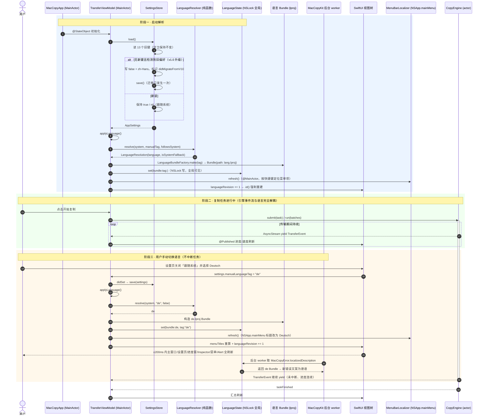
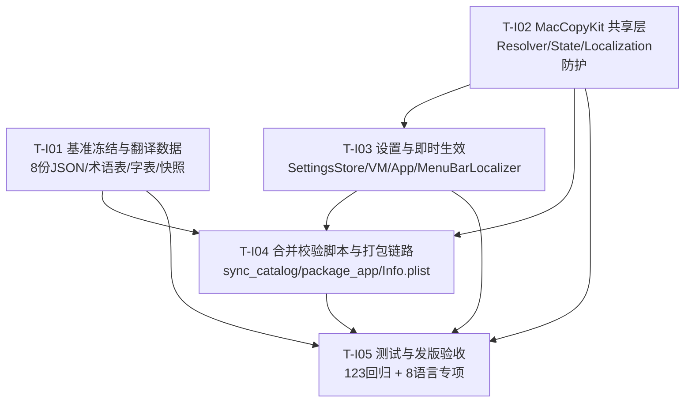

# ARCHITECTURE-I18N：MacCopy 八种语言支持增量架构设计（v1.2）

| 项目 | 内容 |
|---|---|
| 文档类型 | **增量架构设计**（只写相对 `docs/ARCHITECTURE.md` v1.0 的变更，不重写完整架构） |
| 需求基准 | `docs/PRD-I18N.md`（**以该文件当前版本为准**；条款编号自 A6 纳入后稳定，本文一律按 **P0 / § 条款编号**引用，如 P0-06 ⑦⑧ / P0-10 ⑦⑧ / §3.4 四失效点）。**不写 PRD 版本号、不写行数、不写测试数**——PRD 与架构各自持续修订，任何硬编码数字都会立刻过时；历史数字仅留在各自修订记录中 |
| **裁决来源** | 主理人对 PRD §7 全部 12 个待确认问题的最终裁决 + 1 条追加架构硬要求；**裁决优先于 PRD 推荐** |
| 基线代码 | `MacCopy/`（63 Swift 文件 / ~11.6k 行）。**测试基线以施工时 `bash test.sh` 实际输出为准**：v1.0 交付时 119，工程师 T04 补齐 4 个正确性测试后为 **123/123 全绿**。**以实际落盘代码为准** |
| 技术栈 | Swift 6.4.2 / macOS 13.0+ / arm64 / **零第三方依赖** |
| 架构约束 | AD-01 禁用 `@Observable`；AD-02 `MacCopyKit` 禁止 import SwiftUI / AppKit / ServiceManagement |
| 文档日期 | 2026-11-08 |

---

## 0. 评审结论摘要

| 决策点 | 结论 |
|---|---|
| **Q2b** | **否决降级路径**（与主理人裁决一致）。整体即时生效为 P0，禁止方案 B'（重启生效），禁止混合态。`.commands` 兜底改用 **`NSApp.mainMenu` 手动更新菜单项标题**（`MenuBarLocalizer`），已编译验证零警告，见 §1.3 / §3.6 |
| **Q5** | 无母语审校资源 → 机翻初稿 + 构建期自动校验 + 每语种抽查 20 条。**翻译质量属机翻水平，作为已知限制写进 §10 设计与交付说明，不得表述为专业本地化** |
| **Q10** | 八语清单锁定，`es` 保留：zh-Hans / en / zh-Hant / ja / ko / fr / de / es |
| Q1/Q2/Q3/Q4/Q6/Q7/Q8/Q9/Q11/Q12 | 全部按主理人裁决执行，见 §11 |
| **追加硬要求** | 翻译数据与代码分离：8 份 `translations/<lang>.json` → 合并脚本 → 单一 `.xcstrings` → 8 份 `.lproj/Localizable.strings`，见 §1.4 |
| 待明确事项 | **无待明确项**。§11 的 3 条解读说明均已定案，E1 已由主理人关闭 |

### 本轮相对 PRD 新增的必做工作（实测发现，详见 §2）

| 新增 | 原因 | 严重性 |
|---|---|---|
| `Localization.string` 补「空串回退」 | 实测：key 存在但值为空串时，原生 API 原样返回 `""`，**不回退中文** → 违反 P0-06 ② | 高 |
| `Localization.format` 补「占位符签名运行期防护」 | 实测：`%@` 收到 `Int` 会 **SIGSEGV**（探针 exit 139）→ 违反 P0-06 / P0-10 ③ | **致命** |
| 「恢复默认设置」排除语言字段 | 现状 `SettingsView.swift:113` 的 `vm.settings = AppSettings()` 全量覆盖，加语言字段后会一并重置 → 违反 Q7 / P0-09 | 高 |
| `MenuBarLocalizer` 必须标 `@MainActor` | `NSApp` / `NSApplication.mainMenu` 是 `@MainActor` 隔离，未标注时 Swift 6 严格并发报警告 | 中 |
| **中文基准必须用不存在的 `table:` 名取** | 实测：无 `bundle:` 的 `String(localized:defaultValue:)` 会查 `Bundle.main`，正式 .app 内 8 个 `.lproj` 会把它劫持成系统语言译文（如 `TOTAL %d ITEMS`），导致空串回退与 `FormatSignature` 基准全部失真 → 违反 P0-06 ② | **高（修正本文档 §3.3 的实现）** |
| **基准被劫持 = 双层防护整体失效 + 崩溃**（V-B5，QA 复现） | 英文系统语言下 `base` 与 `candidate` 同时被劫持成 `TOTAL %@ ITEMS`，签名比对反判相等 → 防崩溃守卫不触发 → **exit 139**。且坏译文注入须与「系统语言 = 该语言」叠加才复现，否则又假通过 | **致命** |
| **整个 `.lproj` 缺失走 `bundle == nil` 分支**（V-B6，QA 复现） | 当前实现该分支直接返回被劫持的 `base` → 英文串，P0-06 ③ 一并失效 | 高 |
| **代码现状：§3.3 修正尚未落到 `src/`**（QA grep） | `baselineTable` / `baseline(` / `table:` 在 `MacCopy/src/` 零命中，`Localization.swift` 仍是裸写法；**123/123 全绿是在无 `.lproj` 的裸测试进程跑的，属假通过** | **实施前必须先补** |

> **关于「不要重复验证」**：主理人列出的 PM 5 条实测结论我全部直接采信，未重复验证。上表 4 项是我在上一轮架构评审中**已经跑过**的编译/运行探针结果，属既有结论的沿用，不是新做的重复验证。其中「空串检测」「占位符数量与类型一致」恰好是主理人要求 `--check-languages` 必须包含的两项——构建期拦截 + 运行期兜底正好构成 PRD §3.4 要求的双层保障，二者不冲突。

---

## 1. 增量方案与选型

### 1.1 分层与依赖方向

```
┌──────────────────────────────────────────────────────────────────┐
│ MacCopyApp（SwiftUI + AppKit，仅此层可用 NSApp）                  │
│  · TransferViewModel：languageRevision / applyLanguage()          │
│  · MacCopyApp.body：显式读 languageRevision、.id() 重建            │
│  · SettingsView：语言 Section（首位）                              │
│  · MenuBarLocalizer：NSApp.mainMenu 菜单标题兜底（@MainActor）     │
└───────────────────────────┬──────────────────────────────────────┘
                            │ 单向调用
                            ▼
┌──────────────────────────────────────────────────────────────────┐
│ MacCopyKit（Foundation-only，AD-02）                              │
│  · LanguageState：NSLock + @unchecked Sendable 全局单例            │
│  · LanguageResolver：回退链纯函数                                  │
│  · Localization：string/format 签名冻结，内部换语言专用 Bundle      │
│  · AppSettings / SettingsStore：+2 键 + v1.0 迁移                  │
└──────────────────────────────────────────────────────────────────┘
```

### 1.2 关于「为何不在 MacCopyKit 里放语言状态」的澄清

主理人输出要求第 1 项写作「说明为何不在 `MacCopyKit` 里放语言状态（AD-02）」，但**关键技术约束 5** 明确要求「必须在共享层（Foundation-only）切换语言 Bundle」、**约束 6** 要求「共享层的可变语言状态需要安全容器」、PM 实测结论亦指出「`MacCopyKit` 大量调用 `Localization`，只靠 `.environment(\.locale)` 是错的」。三者一致指向：**语言状态必须放在 `MacCopyKit` 的 Foundation-only 共享层**。

故本文按约束 5/6 执行，并将第 1 项理解为笔误（应为「说明为何语言状态放在 MacCopyKit 仍不违反 AD-02」）。这是**已确定的执行方案，不是待定项**。

**答案**：AD-02 禁止的是 `import SwiftUI` / `AppKit` / `ServiceManagement`，**不禁止** Foundation 的 `Bundle` / `NSLock` / `UserDefaults`。反过来，若把语言状态放在 App 层：

- `MacCopyError.localizedDescription`、`ConflictPolicy.displayName`、`TaskState` 文案、`Verifier` 失败原因均由 `Task.detached` 后台 worker 产生；
- SwiftUI 的 `.environment(\.locale)` **无法穿透**到 `Task.detached`，后台文案会停留在旧语言（PM 结论 5）；
- 而 `LanguageState` 作为 `MacCopyKit` 内的全局单例，后台 worker 直接读最新 Bundle，无需任何跨 actor 传递。

因此**共享层是唯一正确位置**。`NSApp.mainMenu` 属 AppKit，严格隔离在 App target 的 `MenuBarLocalizer` 内，不进 MacCopyKit。

### 1.3 Q2b 兜底：`NSApp.mainMenu` 手动更新（已编译验证）

主理人裁决：`.commands` 菜单标题在 body 重算后仍不刷新时，用 `NSApp.mainMenu` 手动更新，**这是实现细节，不是降级理由**。

**定位难题**：菜单项标题本身会随语言变化，不能按标题查找。方案采用**快捷键作为稳定标识**——`⌘R` / `⌘.` 是编译期常量，永不本地化：

```swift
// src/MacCopyApp/MenuBarLocalizer.swift（App target，import AppKit 合法）
import AppKit
import MacCopyKit

/// `.commands` 菜单标题兜底刷新（Q2b 裁决）。
/// 按「快捷键」定位子项（不随语言变化），再从命中子项反查父菜单。
/// 必须 @MainActor：NSApp / NSApplication.mainMenu 是 MainActor 隔离（实测未标注会告警）。
@MainActor
enum MenuBarLocalizer {
    static func refresh() {
        guard let main = NSApp?.mainMenu else { return }
        let keyed: [String: String] = [
            "r": Localization.string("ui.menu.start", default: "开始复制"),
            ".": Localization.string("ui.menu.cancel", default: "取消传输"),
        ]
        let parentTitle = Localization.string("ui.menu.transfer", default: "传输")

        for item in main.items {
            guard let submenu = item.submenu else { continue }
            var hit = false
            for child in submenu.items {
                guard child.keyEquivalentModifierMask.contains(.command),
                      let title = keyed[child.keyEquivalent] else { continue }
                child.title = title
                hit = true
            }
            if hit { item.title = parentTitle }
        }
    }
}
```

**实测**（`swiftc -O -parse-as-library -swift-version 6 -target arm64-apple-macos13.0`）：
- 未标 `@MainActor` → 2 条 Swift 6 严格并发警告（`main actor-isolated property 'mainMenu'` / `var 'NSApp'`）
- 标注后 → **零 error、零 warning**，无窗口服务器环境下 `mainMenu == nil` 时安全返回，运行结果 `MENU PROBE COMPILED & RAN`、`EXIT=0`

**调用策略**：`applyLanguage()` **总是调用** `MenuBarLocalizer.refresh()`，不做「SwiftUI 是否已刷新」的条件判断。若 SwiftUI 已刷新，重复设置相同 `title` 无副作用；若未刷新，此处补上。这样两条路径互为保险，且不引入运行时不确定性。

**主路径仍保留**：`MacCopyApp.body` 内 `let _ = viewModel.languageRevision` 建立观察依赖 + 各 Scene 根视图 `.id(...)` 重建 + `.commands` 内文字从 `@Published` 读（上一轮 V-A9 已编译验证）。主路径 + `NSApp.mainMenu` 兜底双保险，符合裁决「整体即时生效」。

### 1.4 追加硬要求：翻译数据与代码分离（核心链路）

**理由**（主理人）：K ≈ 190（实际 192），7 种新语言 ≈ 1300 条译文；单 `.xcstrings` 约 200 KB+，Token 额度受限时易中断且无法续写，QA 也无法逐语种独立校验。

```
【数据层 · 每语种独立、可单独编辑/校验】
src/MacCopyApp/Localization/translations/
    zh-Hans.json   ← 180 条冻结基准 + N 条新 key（中文）
    en.json        ┐
    zh-Hant.json   │
    ja.json        │ 各 K 条 { "key": "译文" }
    ko.json        │ 机翻初稿，标注为已知限制（§10）
    fr.json        │
    de.json        │
    es.json        ┘

【构建层 · 单一脚本三子命令】
sync_catalog.py
    --sync                 扫描源码 Localization.string/format 调用 → 补新 key 到各 translations/*.json（值为空，待译）
    --merge-translations   读 8 份 JSON → 生成单一 Localization/Localizable.xcstrings
    --check-languages      逐语种校验（见下）→ 失败非零退出

【产物层】
Localization/Localizable.xcstrings        （单一 Catalog，sourceLanguage=zh-Hans）
        │
package_app.sh  ──▶  dist/MacCopy.app/Contents/Resources/<lang>.lproj/Localizable.strings × 8
```

**`--check-languages` 四项硬校验**（任一失败 `return 1`，阻断打包）：

| # | 校验 | 判定 |
|---|---|---|
| 1 | 逐语种零缺失 | 每语种恰好 K 个 key，与 `zh-Hans.json` 键集合完全一致；打印「语言 / key / 缺失」三元组 |
| 2 | 占位符一致 | 对每 key，用正则提取 `%@` / `%d` / `%lld` / `%1$@` / `%zu` / `%%` 序列，与中文基准比对**数量与类型**；不一致打印「语言 / key / 期望 / 实际」 |
| 3 | 空串检测 | 任一译文为 `""` 或全空白 → 失败（对应运行期空串兜底，双层保障第一道） |
| 4 | `zh-Hant` 简体字扫描 | 读 `docs/i18n/simplified-chars.txt`（简繁异体字对中的**简体侧专用字**，不含简繁共用字），逐条扫描 `zh-Hant.json`；命中打印「key / 命中字」并失败 |

**简体字表说明**：只放简繁异体字对中的简体侧（如 `复 制 验 缓 冲 线 断 续 传 队 探 输 档 缓 衝 缓` 中的简体专用字），**不放**「文」「件」「中」「大」等简繁共用字，否则误报。字表与 `docs/i18n/glossary-zh-Hant.md`（≥20 术语）配套维护。`zh-Hant` 译文按术语表人工校正，**禁止简繁机械转换**（P0-15）。

**冻结快照**：`docs/i18n/baseline-v1.0-zh-Hans.json`，从当前 180 个 key 的 `localizations["zh-Hans"].stringUnit.value` 导出，平铺 `{"key": "中文值"}`、`ensure_ascii=False`、`indent=2`。`--check-languages` 比对 `zh-Hans.json` 中这 180 条与快照逐字节一致，diff 非空即失败（P0-03）。**必须在写任何译文之前导出**。

**K 的定义**：`K = 180（冻结基准） + N（语言 UI 新 key）`。**实际落盘 `N = 12`、`K = 192`**（8 份 `translations/*.json` 各 192 条、`.xcstrings` 192 key，已核对），落在预估区间 10–14 内。发版报告须同时列出 `K = 192` 与 `180 + 12` 两个数字。

### 1.5 工程形态与语言资源

- **单一 String Catalog**：`src/MacCopyApp/Localization/Localizable.xcstrings`（从现 `Localization/zh-Hans.lproj/` **上移一层**）。理由：一个 Catalog 承载 8 语言，放在某语言 `.lproj` 下语义错误。
- **打包产物**：`dist/MacCopy.app/Contents/Resources/{zh-Hans,en,zh-Hant,ja,ko,fr,de,es}.lproj/Localizable.strings` 共 8 份。
- **脚本路径**：`sync_catalog.py` 的 `CATALOG` 常量由 `src/MacCopyApp/Localization/zh-Hans.lproj/Localizable.xcstrings` 改为 `src/MacCopyApp/Localization/Localizable.xcstrings`；`package_app.sh` 内嵌 Python 的输入路径同步。
- **运行时**：`LanguageBundleFactory.make(tag:)` 用 `Bundle.main.resourceURL/<tag>.lproj` 构造语言专用 Bundle；CLI / 单测环境 `resourceURL == nil` → 返回 nil → 全部走中文 `defaultValue`，行为确定且不崩溃（Q12）。

**选型理由**：不引入第三档本地化库（PM 实测 `String(localized:defaultValue:bundle:)` 可编译且运行时正确）；不用 `AppleLanguages`（PM 实测对已构造 Bundle 无效）；不用 `.environment(\.locale)` 作主方案（无法穿透到 MacCopyKit 后台线程）。

---

## 2. 实测验证结论（采信 + 沿用）

### 2.1 采信 PM 的 5 条（不重复验证，直接作为地基）

| # | 结论 | 用途 |
|---|---|---|
| P1 | `String(localized:defaultValue:bundle:)` 在 Swift 6 / macOS 13 target 可编译 | 共享层实现基础 |
| P2 | `Bundle(path: "<lang>.lproj")` + 该 API 运行时返回目标语言 | 语言专用 Bundle |
| P3 | 漏 key 自动回退中文 `defaultValue` | P0-06 漏译兜底（**注意：仅覆盖「key 缺失」，见 P6 补充**） |
| P4 | `AppleLanguages` 对已构造 Bundle 无效 | 排除方案 B |
| P5 | `Localization` 被 MacCopyKit 大量调用，`.environment(\.locale)` 无效 | 语言状态放共享层（§1.2） |

### 2.2 本设计沿用/新增的实测结论（均已跑过，非推测）

| # | 结论 | 来源 |
|---|---|---|
| V-A1 | `NSLock` + `@unchecked Sendable` 全局容器，Swift 6 严格并发下跨 `Task.detached` 读写正确 | 上一轮探针 |
| V-A2 | Foundation-only 模块中 `String(localized:defaultValue:bundle:)` 编译通过 | 上一轮探针 |
| V-A3 | `en` → `Start Copy`、`de` → `Kopie starten`；漏 key → `取消传输` | 上一轮探针 |
| **V-A5** | **空串 key 返回 `""`，不回退中文** → 补 `isEmpty ? base : value` | 上一轮探针，**P3 的边界补充** |
| **V-A6** | **占位符 `%@` 收到 Int → `String(format:)` SIGSEGV，exit 139** → 补 `FormatSignature` 防护 | 上一轮探针，**致命** |
| V-A7 | 签名不一致时退回中文基准 → 输出 `共 5 项`、`EXIT=0` 未崩溃 | 上一轮探针 |
| V-A8 | 回退链 `en-GB→en`、`ru→en`、手动 `fr` 优先系统 `ja` 全部正确 | 上一轮探针 |
| V-A9 | `MacCopyApp.body` 内读 `languageRevision` + `.commands` 文字从 `@Published` 读，编译通过 | 上一轮探针 |
| **V-M1** | `NSApp.mainMenu` 遍历需 `@MainActor`，标注后零警告、无窗口服务器下安全返回 | **本轮新增探针** |
| **V-B1** | **无 `bundle:` 的 `String(localized:defaultValue:)` 默认查 `Bundle.main`**；模拟 .app 带 en.lproj 时返回 `TOTAL %d ITEMS` 而非中文 | **本轮新增，修正 §3.3 实现** |
| **V-B2** | `bundle: nil` 等价默认 `Bundle.main`；`String(localized: dv)` 在「中文原文恰为某 key」时被劫持成 `HIJACKED`。**精确化（PM + QA 独立复现）**：裸 CLI 进程下 `Bundle.main` 无 `.lproj`，`bundle: nil` 会回落中文 `defaultValue`；HIJACKED 注入项 QA 环境未触发（zh-Hans 优先命中挡下）。即返回值**取决于 `Bundle.main` 是否含资源、以及语言回退优先级，是环境相关、非确定的**；正式 `.app` 必然有 8 个 `.lproj`，实际行为就是 V-B1 记录的被劫持 | 本轮新增 + PM/QA 复现精确化 |
| **V-B3** | **传不存在的 `table:` 名可强制回退编译期 `defaultValue`**，且不受 HIJACKED 注入影响 → 中文基准的可靠取法 | 本轮新增，§3.3 采用；QA 独立复现确认「恒为中文」 |
| **V-B4** | 采用 `baseline()` 后端到端：en/ja 正常译文、空串回退中文、坏格式退回中文且 `EXIT=0`、无 bundle 时中文 | 本轮新增，端到端验证；QA A/B 矩阵确认 |
| **V-B5** | **基准被劫持会让双层防护整体失效（不止退回错语言）**：英文系统语言下 `base` 与 `candidate` 同时被劫持成 `TOTAL %@ ITEMS` → `FormatSignature` 判定 `["@"] == ["@"]` **相等** → 防护根本不触发 → `String(format:"TOTAL %@ ITEMS", 5)` **exit 139 / SIGSEGV** | **QA 独立复现，最严重的一条** |
| **V-B6** | **整个 `.lproj` 缺失时，`bundle == nil` 分支直接返回被劫持的 `base`**：物理删除 `ko.lproj` 后 `-AppleLanguages "(ko)"`，当前实现返回英文 `TOTAL %d ITEMS` → P0-06 ③ 一并失效；`baseline()` 修正后返回中文 | **QA 独立复现，新增失效路径** |
| V-A10 | 独立 `swiftc` 的模块缓存须用**绝对路径**，相对 `.tmp/modcache` 会因 `Workbuddy` vs `WorkBuddy` 大小写冲突触发 `_DarwinFoundation1` 重复定义 + signal 11 | 上一轮踩坑 |

> **对 P3 的精确化**：PM 结论「漏 key 不返回空串」成立；但当 **key 存在且值为空串** 时返回空串（V-A5）。主理人要求的 `--check-languages` 已含「空串检测」，属构建期拦截；`Localization.string` 的空串兜底是运行期第二道防线，两层都要有，与 PRD §3.4「双层保障」一致。

---

## 3. 关键类型与接口定义

### 3.1 `LanguageResolver.swift`（新增，`src/MacCopyKit/Support/`）

```swift
import Foundation

/// 八种语言标签。顺序固定（PRD §2 / 主理人 Q10 锁定），不按当前界面语言重排。
public enum SupportedLanguage: String, CaseIterable, Sendable {
    case zhHans = "zh-Hans"
    case en     = "en"
    case zhHant = "zh-Hant"
    case ja     = "ja"
    case ko     = "ko"
    case fr     = "fr"
    case de     = "de"
    case es     = "es"

    /// endonym：设置页 Picker 一律用此显示，与当前界面语言无关。
    public var endonym: String {
        switch self {
        case .zhHans: return "简体中文"
        case .en:     return "English"
        case .zhHant: return "繁體中文"
        case .ja:     return "日本語"
        case .ko:     return "한국어"
        case .fr:     return "Français"
        case .de:     return "Deutsch"
        case .es:     return "Español"
        }
    }
}

/// 语言解析结果（含「是否因系统语言未覆盖而回退到 en」，供 P1-02 提示）。
public struct LanguageResolution: Sendable, Equatable {
    public let language: SupportedLanguage
    public let isSystemFallback: Bool
}

/// 语言解析协议（可 mock，便于单测）。
public protocol LanguageResolving: Sendable {
    func resolve(
        systemLocalizations: [String],
        manualTag: String?,
        followsSystem: Bool
    ) -> LanguageResolution
}

/// 默认实现：纯函数、无状态、可单测。
public struct LanguageResolver: LanguageResolving {
    public init() {}

    /// 优先级：手动覆盖 > 系统解析 > 兜底 en。
    /// 顺序（PRD §3.3，不可调换）：
    ///   1 手动值合法        → 使用
    ///   2 手动值非法/损坏   → 视为未设置 + 诊断日志，落入系统解析
    ///   3 系统列表为空      → zh-Hans
    ///   4 逐项：精确命中 → 两段前缀（en-GB→en, fr-CA→fr, zh-Hant-TW→zh-Hant, es-MX→es）
    ///                    → 裸 zh 按区域（TW/HK/MO→zh-Hant，其余→zh-Hans）
    ///                    → 裸 en/ja/ko/fr/de/es
    ///   5 全部未覆盖        → en（Q1 裁决）
    ///   6 异常兜底          → zh-Hans
    public func resolve(
        systemLocalizations: [String],
        manualTag: String?,
        followsSystem: Bool
    ) -> LanguageResolution {
        if !followsSystem, let tag = manualTag {
            if let hit = SupportedLanguage(rawValue: tag) {
                return LanguageResolution(language: hit, isSystemFallback: false)
            }
            Log.debug(Log.i18n, "手动语言值非法，按未设置处理：\(tag)")
        }

        guard !systemLocalizations.isEmpty else {
            return LanguageResolution(language: .zhHans, isSystemFallback: false)
        }

        for raw in systemLocalizations {
            if let exact = SupportedLanguage(rawValue: raw) {
                return LanguageResolution(language: exact, isSystemFallback: false)
            }
            let parts = raw.split(separator: "-", omittingEmptySubsequences: false).map(String.init)

            // 4a 两段前缀：必须早于「裸 zh」判定，否则 zh-Hant-TW 会被误判成 zh-Hans
            if parts.count >= 2,
               let hit = SupportedLanguage(rawValue: parts[0] + "-" + parts[1]) {
                return LanguageResolution(language: hit, isSystemFallback: false)
            }
            // 4b 裸 zh 按区域判简繁
            if parts.first == "zh" {
                let region = parts.dropFirst().last?.uppercased() ?? ""
                let isHant = ["TW", "HK", "MO"].contains(region)
                return LanguageResolution(language: isHant ? .zhHant : .zhHans,
                                          isSystemFallback: false)
            }
            // 4c 裸语言标签
            if let hit = SupportedLanguage(rawValue: parts.first ?? "") {
                return LanguageResolution(language: hit, isSystemFallback: false)
            }
        }
        return LanguageResolution(language: .en, isSystemFallback: true)
    }
}
```

### 3.2 `LanguageState.swift`（新增，`src/MacCopyKit/Support/`）

```swift
import Foundation

/// 跨线程共享的当前语言状态（关键技术约束 6 的确切设计）。
/// Swift 6 严格并发禁止裸 `static var`；macOS 13 无 `Synchronization.Mutex` → NSLock。
public final class LanguageState: @unchecked Sendable {
    public static let shared = LanguageState()

    private let lock = NSLock()
    private var _bundle: Bundle?
    private var _tag: String = SupportedLanguage.zhHans.rawValue

    private init() {}

    public var bundle: Bundle? {
        lock.lock(); defer { lock.unlock() }
        return _bundle
    }

    public var tag: String {
        lock.lock(); defer { lock.unlock() }
        return _tag
    }

    public func set(bundle: Bundle?, tag: String) {
        lock.lock(); defer { lock.unlock() }
        _bundle = bundle
        _tag = tag
    }
}

/// 语言专用 Bundle 工厂。
public enum LanguageBundleFactory: Sendable {
    /// `<Resources>/<tag>.lproj` → Bundle。
    /// 目录缺失 / CLI 环境 / resourceURL 为 nil → nil（Localization 自动回退中文 defaultValue）。
    public static func make(tag: String) -> Bundle? {
        guard SupportedLanguage(rawValue: tag) != nil,
              let resource = Bundle.main.resourceURL else { return nil }
        let lproj = resource.appendingPathComponent("\(tag).lproj", isDirectory: true)
        guard FileManager.default.fileExists(atPath: lproj.path) else { return nil }
        return Bundle(path: lproj.path)
    }
}
```

### 3.3 `Localization.swift`（修改，**签名冻结 AD-I03**）

```swift
import Foundation

public enum Localization {
    /// 中文基准。⚠️ **不可**写成 `String(localized: key, defaultValue: dv)`。
    ///
    /// 无 `bundle:` 参数时默认查 `Bundle.main`；正式 .app 内有 8 个 `.lproj`，
    /// 系统语言为英语时该写法返回英文资源值（实测 `TOTAL %d ITEMS`），不是中文。
    /// 显式传一个**永不存在的 table 名**，强制系统回退到编译期 `defaultValue`（中文原文），
    /// 与 Bundle.main / 系统语言 / 语言专用 Bundle 全部解耦（V-B2 / V-B3 实测）。
    private static let baselineTable = "__MacCopy_Baseline_No_Such_Table__"

    private static func baseline(
        _ key: StaticString,
        _ defaultValue: String.LocalizationValue
    ) -> String {
        String(localized: key, defaultValue: defaultValue, table: baselineTable)
    }

    /// 签名保持不变，调用方 0 改动。
    public static func string(_ key: StaticString, default defaultValue: String.LocalizationValue) -> String {
        let base = baseline(key, defaultValue)                  // 中文基准（不受系统语言影响）
        guard let bundle = LanguageState.shared.bundle else { return base }
        let value = String(localized: key, defaultValue: defaultValue, bundle: bundle)
        // V-A5：原生 API 对「值为空串」不回退，必须显式补强（P0-06 ②）
        guard !value.isEmpty else {
            Log.debug(Log.i18n, "空串回退：\(String(describing: key)) lang=\(LanguageState.shared.tag)")
            return base
        }
        return value
    }

    /// 签名保持不变。
    public static func format(
        _ key: StaticString,
        default defaultValue: String.LocalizationValue,
        _ arguments: CVarArg...
    ) -> String {
        let base = baseline(key, defaultValue)                  // 中文基准（FormatSignature 的比对基准）
        var pattern = base

        if let bundle = LanguageState.shared.bundle {
            let candidate = String(localized: key, defaultValue: defaultValue, bundle: bundle)
            // 全空白也视同空串（PRD-I18N v1.3 要求），不能只判 isEmpty。
            if !candidate.trimmingCharacters(in: .whitespacesAndNewlines).isEmpty {
                // V-A6：占位符类型不一致会让 String(format:) 直接 SIGSEGV。
                // 用 types(of:) 只比「类型序列」，允许译文把 %1$@ 写成 %@；
                // %d→%@ 仍会检出（["d"] != ["@"]）。签名不符/参数不足 → 退回中文基准。
                let baseTypes = FormatSignature.types(of: base)
                let candidateTypes = FormatSignature.types(of: candidate)
                if baseTypes == candidateTypes, candidateTypes.count <= arguments.count {
                    pattern = candidate
                } else {
                    Log.debug(Log.i18n, "格式串防护触发，退回基准：\(String(describing: key))")
                }
            }
        }

        // 调用方少传参数时，连中文基准都不能拼格式（否则读取越界 CVarArg 未定义行为）。
        guard FormatSignature.types(of: pattern).count <= arguments.count else {
            Log.debug(Log.i18n, "参数不足，返回原始格式串：\(String(describing: key))")
            return pattern
        }
        return String(format: pattern, arguments: arguments)
    }
}

/// 提取格式串占位符，用于与中文基准比对。
/// 覆盖 %@ / %d / %lld / %1$@ / %zu / %% 及长度/宽度修饰。
/// 保持 internal（F04 `FormatSignature.swift`），不暴露成 public API。
enum FormatSignature {
    /// 与 `sync_catalog.py --check-languages` **同一套正则**，保证构建期/运行期判定一致。
    private static let pattern = "%(?:\\d+\\$)?[-+ #0]*\\d*(?:\\.\\d+)?(?:hh|h|ll|l|q|L|z|t|j)?[@%dDuUxXoOfFeEgGcCsSaAp]"
    private static let regex = try! NSRegularExpression(pattern: pattern)

    /// 完整占位符 token（按出现顺序），如 `["%1$@", "%d"]`。
    static func of(_ format: String) -> [String] {
        regex.matches(in: format, range: NSRange(format.startIndex..., in: format))
            .compactMap { Range($0.range, in: format).map { String(format[$0]) } }
    }

    /// 只取类型字符，忽略位置前缀与宽度修饰，如 `["@", "d"]`。
    /// 跨语言比对用这个：翻译把 `%1$@` 简化为 `%@` 不应误判。
    static func types(of format: String) -> [Character] {
        of(format).compactMap(\.last)
    }
}
```

> **v1.2 与实现对齐说明**：上表按工程师最终落盘代码同步——① 空串判定扩为全空白；② 比对改用 `FormatSignature.types(of:)`（只比类型序列）而非完整 token，避免 `%1$@`→`%@` 被误判，但 `%d`→`%@` 仍检出；③ 新增「基准自身参数不足」保护，防止读取越界 `CVarArg`。三点均不放松 V-A6 防护强度。

> **V-A6 原始证据**：`String(format: "共 %@ 项", 5)` → 进程 exit 139 / SIGSEGV。补强后 `坏格式 -> 共 5 项`、`GUARD DONE（未崩溃）EXIT=0`。**此项不可省略。**

#### ⚠️ 中文基准必须绕开 `Bundle.main`（工程师 Q-B 的完整回答）

`defaultValue` 作为编译期中文原件的角色**绝对不变**，它是整个设计的三重锚点：运行期兜底值、`FormatSignature` 比对基准、构建期 `--check-languages` 校验基准。但**取它的方式有个坑**：

我构造了带 `en.lproj` / `ja.lproj` 的模拟 `.app` 实测（V-B1~V-B4）：

| 写法 | 实测返回 | 结论 |
|---|---|---|
| `String(localized: key, defaultValue: dv)` | `TOTAL %d ITEMS` | ❌ 被 `Bundle.main` 的 en 资源劫持，**不是中文** |
| `String(localized: key, defaultValue: dv, bundle: nil)` | `TOTAL %d ITEMS`（带资源的 .app）；裸 CLI 进程下为 `共 %d 项` | ❌ 显式 nil 等价默认 `Bundle.main`；**结果环境相关、不可依赖** |
| `String(localized: dv)`（把 `LocalizationValue` 当 key+value） | `共 %d 项`，但注入 `"共 %d 项" = "HIJACKED"` 后变成 `HIJACKED` | ❌ 极端情况下可被劫持 |
| `String(localized: dv, bundle: <空目录>)` | `共 %d 项` | ✅ 可靠，但依赖额外目录 |
| **`String(localized: key, defaultValue: dv, table: "__不存在的表名__")`** | **`共 %d 项`（含 HIJACKED 注入场景）** | ✅ **最可靠，纯参数控制，不依赖目录/Bundle 对象** |

> **环境相关性脚注（PM 独立复现补充）**：`bundle: nil` 与无 `bundle:` 的返回值**取决于 `Bundle.main` 是否含对应 `.lproj` 资源**——裸 CLI / 单测进程里 `Bundle.main` 没有资源，会回落到中文 `defaultValue`；带 8 个 `.lproj` 的正式 `.app` 里则被系统语言资源劫持。这**不是**两份实测结论矛盾，而是恰好证明这两种写法**非确定、不可依赖**：同一行代码在调试时看似正确、打包后却失效。因此更不能把它们用作中文基准，只有不存在的 `table:` 名在两种环境下都稳定返回编译期 `defaultValue`。**对测试的直接影响**：P0-06 的兜底断言必须在含 `.lproj` 的真实 `.app`（或等价模拟 bundle）下运行，裸测试进程会假通过。

因此 `Localization` 内私有 `baseline(...)` **必须**用不存在的 `table:` 名，且**必须在 `string` / `format` 两个函数的第一行就取好**——下面四个失效点全部依赖 `base` 的正确性：

1. **空串回退**：退到「系统语言译文」而非中文 → 违反 P0-06 ②
2. **`FormatSignature` 基准漂移**：占位符比对基准随系统语言变化 → 防护判定失真
3. **防护触发后的退回目标**：「退回中文基准」实际退回系统语言串 → P0-06 中文兜底失效
4. **`bundle == nil` 分支**：整个 `.lproj` 缺失时 `guard let bundle else { return base }` 直接返回被劫持的 base → P0-06 ③ 失效（V-B6）

#### 🔴 QA 独立复现：基准被劫持会让**双层防护整体失效**（比「退回错语言」更严重）

QA 用真实 `.app`（8 个 `.lproj`、`CFBundleDevelopmentRegion=en`、注入空串与坏占位符、`-AppleLanguages "(en)"` 启动）复现出一条我原报告没有的链路：

```
① base（无 bundle）      = 「TOTAL %@ ITEMS」   ← 期望中文「共 %d 项」
② base（table: 不存在）  = 「共 %d 项」
④ base 占位符类型 ["@"] / candidate 类型 ["@"] → 判定相等 = true
⑤ 防护根本不触发 → String(format:"TOTAL %@ ITEMS", 5)
EXIT=139（SIGSEGV，无后续输出）
```

即：`base` 与 `candidate` **同时**被同一份错误资源劫持时，`FormatSignature` 的「两者相等」恰好成立，防崩溃守卫被绕过。**双层防护不是「降级到错语言」，而是整体失效并崩溃。**

**A/B 矩阵**（同一 `.app`、同一语言，当前实现 vs `baseline()` 修正算法，QA 实测）：

| 场景 | 当前实现 | `baseline()` 修正后 |
|---|---|---|
| 正常译文 | ✅ `TOTAL %d ITEMS` | ✅ 同 |
| 空串回退 | ❌ 返回空串「」 | ✅「中文兜底文案」 |
| 漏 key | ✅「中文缺失兜底」 | ✅ 同 |
| `%@` 误收 Int | ❌ **exit 139** | ✅「共 5 项」，`EXIT=0` |
| 物理删除整个 `ko.lproj` + `-AppleLanguages "(ko)"` | ❌「TOTAL %d ITEMS」（V-B6） | ✅「共 %d 项」 |

> **验收条件的关键叠加（QA 发现，必须写进测试）**：坏译文注入**必须与「系统语言 = 该译文语言」叠加**。若系统语言仍是 `zh-Hans`，`Bundle.main` 未指向被注入的 `en.lproj`，基准没被劫持、防护正常触发 → 场景 4 返回「共 5 项」不崩，**又是一次假通过**。QA 实测：zh-Hans 系统语言下不崩，只有 `en` 系统语言才崩。
>
> **PRD 验收基准对照（按条款编号定位；#13 验收命令锚定的条款未变）**：上述两条叠加条件已落为 PRD 的 **P0-06 ⑦**（`-AppleLanguages "(en)"` 叠加，断言 `EXIT=0` 且输出「共 5 项」）、**P0-06 ⑧**（`ko.lproj` 物理删除变体）、**P0-10 ⑦**（双劫持单测：断言 `FormatSignature` 不因两边签名相等而放过）；§3.5 实现约束由五条增至**六条**（第 6 条：`bundle == nil` 分支返回 `baseline()`）。**P0-10 ⑧（A6 双劫持前置断言）** 与 §8 可复现 A/B 矩阵命令已纳入；**#13 验收命令所锚定的条款未变，无需改动**。
>
> **🔺 第三层假通过防线：验收必须断言「双劫持前置条件成立」（QA A6）**。只断言「产品不崩、返回中文」不够——若注入或 `-AppleLanguages` 哪天失效，`base` 不再被劫持，A4 会**平凡通过**，整个 V-B5 测试失去意义。QA 新增 `--case=double_hijack`，在同一 `-AppleLanguages "(en)"` 下直接取两路值并断言逐字为：
>
> ```
> TOTAL %@ ITEMS|TOTAL %@ ITEMS
> ```
>
> 即「无 bundle 的 `base`」与「显式 en bundle 的 `candidate`」**同时**被劫持成同一坏串 → `FormatSignature` 判 `["@"] == ["@"]` 相等 → 若守卫只看签名必然放过。**前置条件断言必须作为 A4 的前置门禁**，否则后来人改动注入内容会静默失效。三层假通过防线依次为：① 真实 `.app` 含 `.lproj`（V-B1）；② 系统语言 = 注入语言（AD-I14）；③ 双劫持前置条件成立（A6）。缺任一层，验收结果都不可信。

**端到端验证**（模拟 .app，en/ja 两种语言 + 注入 HIJACKED）：

```
--- 当前语言 en ---
  key.a      : TOTAL 5 ITEMS
  key.b 空串 : [开始复制]          ← 回退中文 ✅
   ⚠️ 签名不符，退回中文基准
  badfmt     : 共 5 项             ← 退回中文且未崩溃 ✅
  缺key      : 取消传输            ← 回退中文 ✅
--- 当前语言 ja ---
  key.a      : 合計 5 件
  key.b 空串 : [开始复制]
  badfmt     : 合計 5 件
  缺key      : 取消传输
--- 无 bundle（CLI/单测）---
  key.a      : 共 5 项
FINAL DONE    EXIT=0
```

**对构建期的连带要求**：`--check-languages` 校验各语言占位符时，比对基准是 `translations/zh-Hans.json`（其 180 条由冻结快照保证逐字不变），**不是**运行期 `Bundle.main` 解析出来的任何值。两套基准在语义上同源（都是中文原文），但实现上互不依赖，避免单点漂移。

### 3.4 `SettingsStore.swift` / `AppSettings`（修改）

```swift
// AppSettings 新增（Q7 / P0-09）
public var languageFollowsSystem: Bool = true
public var manualLanguageTag: String? = nil
public var didMigrateFromV10: Bool = false      // 瞬态，save() 不写，重启自然消失

// SettingsKey 新增
public static let languageFollowsSystem = "com.maccopy.languageFollowsSystem"
public static let manualLanguageTag     = "com.maccopy.manualLanguageTag"
```

**迁移判定必须放 `SettingsStore.load()` 内**（不能在 `TransferViewModel.init()` —— Swift 中 `init` 内给 `@Published var` 赋值**不触发 `didSet`**，放 ViewModel 会永远不执行）：

```swift
public func load() -> AppSettings {
    var settings = AppSettings()
    // ... 既有 13 个键逐项读取，一行都不改（P0-08 ① 旧值逐项一致） ...

    let hasNewKey = defaults.object(forKey: SettingsKey.languageFollowsSystem) != nil
    if hasNewKey {
        settings.languageFollowsSystem = defaults.bool(forKey: SettingsKey.languageFollowsSystem)
        settings.manualLanguageTag = defaults.string(forKey: SettingsKey.manualLanguageTag)
        // 手动值非法 → 优雅降级为跟随系统（P0-09 ④）
        if let tag = settings.manualLanguageTag, SupportedLanguage(rawValue: tag) == nil {
            settings.manualLanguageTag = nil
            settings.languageFollowsSystem = true
            Log.debug(Log.i18n, "非法手动语言值，已降级为跟随系统")
        }
    } else if Self.hasLegacyPreferences(defaults) {
        // Q1 裁决：v1.0 升级用户首次加载写 false + zh-Hans，避免静默变英文
        settings.languageFollowsSystem = false
        settings.manualLanguageTag = SupportedLanguage.zhHans.rawValue
        settings.didMigrateFromV10 = true
        save(settings)                    // 写键 → 迁移只发生一次
    }
    // 新装：无新键且无旧键 → 保持 true / nil（跟随系统）
    return settings
}

/// 旧偏好判定：任意 com.maccopy.* 引擎设置键存在即视为 v1.0 安装。
private static func hasLegacyPreferences(_ d: UserDefaults) -> Bool {
    [SettingsKey.threadCount, SettingsKey.bufferSizeMB, SettingsKey.preserveTimestamps,
     SettingsKey.defaultAlgorithms, SettingsKey.serviceEnabled]
        .contains { d.object(forKey: $0) != nil }
}
```

**「恢复默认设置」不重置语言（Q7 / P0-09）**：

```swift
/// 只重置引擎参数；语言是身份偏好，不随「恢复默认设置」重置。
func resetEngineSettings() {
    var fresh = AppSettings()
    fresh.languageFollowsSystem = settings.languageFollowsSystem
    fresh.manualLanguageTag = settings.manualLanguageTag
    fresh.didMigrateFromV10 = settings.didMigrateFromV10
    settings = fresh                      // didSet → save（一次）
    applyLanguage()                       // 语言未变，确保 Bundle 状态一致
}
```

`SettingsStore.resetToDefaults()` 同步改为 `resetToDefaults(preserving:)` 保留语言，或标注「仅供新装初始化，UI 不得调用」——**二选一，T-I03 内定死**。

> `save()` 里清空手动值要用 `removeObject(forKey:)`，不要 `set(nil, ...)`（后者会让 `object(forKey:) != nil` 判定失真）。

### 3.5 `TransferViewModel.swift`（修改，`@MainActor`）

```swift
@Published var languageRevision: Int = 0
@Published private(set) var activeLanguageTag: String = "zh-Hans"
@Published private(set) var isSystemFallback: Bool = false
@Published private(set) var menuTransferTitle = ""
@Published private(set) var menuStartTitle = ""
@Published private(set) var menuCancelTitle = ""

/// 语言生效的唯一入口。AD-I05：只改文案状态，绝不触碰
/// runningTask / engine / stream / rows / progress / speedHistory。
func applyLanguage() {
    let resolution = LanguageResolver().resolve(
        systemLocalizations: Bundle.main.preferredLocalizations,
        manualTag: settings.manualLanguageTag,
        followsSystem: settings.languageFollowsSystem
    )
    let tag = resolution.language.rawValue

    // ① MacCopyKit 全局：后台 worker 立刻可见（Foundation-only，AD-02）
    LanguageState.shared.set(bundle: LanguageBundleFactory.make(tag: tag), tag: tag)

    // ② SwiftUI 状态
    activeLanguageTag = tag
    isSystemFallback = resolution.isSystemFallback
    menuTransferTitle = Localization.string("ui.menu.transfer", default: "传输")
    menuStartTitle    = Localization.string("ui.menu.start", default: "开始复制")
    menuCancelTitle   = Localization.string("ui.menu.cancel", default: "取消传输")
    languageRevision += 1

    // ③ Q2b 兜底：NSApp.mainMenu 手动刷新（@MainActor，总调用、幂等）
    MenuBarLocalizer.refresh()
}

/// 仅当语言字段变化时才重建视图树，避免改线程数也触发刷新。
@Published var settings: AppSettings {
    didSet {
        settingsStore.save(settings)
        if oldValue.languageFollowsSystem != settings.languageFollowsSystem
            || oldValue.manualLanguageTag != settings.manualLanguageTag {
            applyLanguage()
        }
    }
}
```

**调用时机**：`init()` 末尾调一次 `applyLanguage()`（首启即正确语言）；`settings.didSet` 中语言字段变化时调；`resetEngineSettings()` 末尾调。

### 3.6 `MacCopyApp.swift`（修改）与 `MenuBarLocalizer`

```swift
@main
struct MacCopyApp: App {
    @StateObject private var viewModel = TransferViewModel()

    var body: some Scene {
        // ✅ 必须显式读一次：否则 .commands 菜单标题不会重算（主理人硬要求）
        let _ = viewModel.languageRevision

        WindowGroup {
            RootView()
                .environmentObject(viewModel)
                .id(viewModel.languageRevision)
        }
        .windowStyle(.titleBar)
        .commands {
            CommandGroup(replacing: .newItem) {}
            CommandMenu(viewModel.menuTransferTitle) {
                Button(viewModel.menuStartTitle) { viewModel.start() }
                    .keyboardShortcut("r").disabled(!viewModel.canStart)
                Button(viewModel.menuCancelTitle) { viewModel.cancel() }
                    .keyboardShortcut(".").disabled(!viewModel.isRunning)
            }
        }

        Settings {
            SettingsView()
                .environmentObject(viewModel)
                .id(viewModel.languageRevision)
                .frame(width: 520, height: 620)
        }
    }
}
```

`MenuBarLocalizer` 完整实现见 §1.3（App target，`import AppKit` 合法；**不得**放进 MacCopyKit）。

---

## 4. 程序调用流程

### 4.1 完整时序图



### 4.2 为什么复制任务进行中切换语言不会中断（P0-05 ③ 的实现保证）

| 保证 | 机制 |
|---|---|
| **引擎事件流不受语言影响** | `TransferEvent` 是纯数据枚举（`Sendable`），不含任何本地化文案；`CopyEngine`（actor）与 `AsyncStream<TransferEvent>` 完全不引用 `Localization` 或 `LanguageState`。语言切换不改变事件流的生产、缓冲（`.bufferingNewest(256)`）与消费 |
| **不重建运行态对象** | `applyLanguage()` 只写 `LanguageState`、6 个 `@Published` 文案字段、`languageRevision`。**明确禁止**触碰 `runningTask` / `engine` / `stream` / `rows` / `progress` / `speedHistory`（AD-I05） |
| **视图树重建不影响数据** | `.id(languageRevision)` 只重建 SwiftUI View 结构；`FileRow` / `TransferProgress` 等值类型数据由 `@Published` 持有，重建后原样重放，进度数字连续、速度曲线 120 点不断 |
| **后台文案即时切换但不改写历史** | 切换后**新产生**的 `MacCopyError` 描述用新语言；已入列的 `logLines[].text` 与 `FileRow.failureReason` 是已渲染的 `String` 快照，不回溯改写（AD-I06，P0-05 ④ 天然满足） |
| **菜单刷新不触碰 App 生命周期** | `MenuBarLocalizer.refresh()` 只改 `NSMenuItem.title`，不重启 App、不重建 Scene、不弹窗 |

### 4.3 数据搬运链路（翻译数据 → 运行时）

```mermaid
flowchart LR
    A["translations/*.json<br/>8 份独立译文"] --> B["sync_catalog.py<br/>--merge-translations"]
    B --> C["Localizable.xcstrings<br/>单一 Catalog"]
    C --> D["package_app.sh<br/>--check-languages 前置"]
    D --> E["8 份 lproj/Localizable.strings"]
    E --> F["LanguageBundleFactory<br/>Bundle(path: lang.lproj)"]
    F --> G["LanguageState<br/>NSLock 全局"]
    G --> H["Localization.string/format<br/>签名冻结"]
    H --> I["SwiftUI 视图 + MacCopyKit 后台文案"]
```



---

## 5. 完整文件清单（相对 `MacCopy/` 根目录）

> 基线 63 Swift 文件。本次**新增 15 个、修改 9 个、不改 1 个（显式标注）**。
> 主理人原文路径 `Localization/translations/<lang>.json` 按实际工程布局补全前缀为 `src/MacCopyApp/Localization/translations/<lang>.json`。

| # | 路径 | 操作 | 一句话职责 |
|---|---|---|---|
| F01 | `src/MacCopyKit/Support/LanguageResolver.swift` | **新建** | `SupportedLanguage` 枚举 / `LanguageResolution` / `LanguageResolving` 协议 / 回退链纯函数 |
| F02 | `src/MacCopyKit/Support/LanguageState.swift` | **新建** | `NSLock` + `@unchecked Sendable` 全局语言状态 + `LanguageBundleFactory` |
| F03 | `src/MacCopyKit/Support/Localization.swift` | 修改 | 签名冻结，内部换语言专用 Bundle；补空串与占位符防护 |
| F04 | `src/MacCopyKit/Support/FormatSignature.swift` | **新建** | 占位符序列提取（`fileprivate` 亦可，独立文件便于单测） |
| F05 | `src/MacCopyKit/Support/Logger.swift` | 修改\* | 已有 `Log` 入口，新增 `Log.i18n` 分类（Debug 记回退、Release 静默） |
| F06 | `src/MacCopyKit/Persistence/SettingsStore.swift` | 修改 | +2 键 / +2 字段 / `object(forKey:)` 守卫 / v1.0 一次性迁移 / reset 保留语言 |
| F07 | `src/MacCopyApp/MenuBarLocalizer.swift` | **新建** | `NSApp.mainMenu` 菜单标题兜底刷新（`@MainActor`，AppKit 仅此层） |
| F08 | `src/MacCopyApp/MacCopyApp.swift` | 修改 | `body` 显式读 `languageRevision`；`.id()`；菜单文字从 `@Published` 读 |
| F09 | `src/MacCopyApp/TransferViewModel.swift` | 修改 | `applyLanguage()` / `languageRevision` / 3 个 menuTitle / `resetEngineSettings()` / didSet 判定 |
| F10 | `src/MacCopyApp/Views/SettingsView.swift` | 修改 | 首位新增语言 Section（共 7 个）；恢复默认改走 `resetEngineSettings()` |
| F11 | `src/MacCopyApp/Views/LanguageSectionView.swift` | **新建** | 语言 Section **行内容**：跟随系统 Toggle + 8 语 endonym Picker + 当前生效行 + 提示 + 恢复跟随按钮。`Section(...)` 外壳放在 `SettingsView.swift`（T-I03 验收 `grep -c "Section(" == 7` 要求），两者配合 |
| F12 | `src/MacCopyApp/Info.plist` | 修改 | `CFBundleLocalizations` 恰 8 项（与目录名逐字一致）；`CFBundleDevelopmentRegion` 保持 `zh-Hans` |
| F13 | `src/MacCopyApp/Localization/Localizable.xcstrings` | **移动+生成** | 从 `zh-Hans.lproj/` 上移一层；由合并脚本生成，`sourceLanguage=zh-Hans`，8 语言 × K key |
| F14 | `src/MacCopyApp/Localization/translations/zh-Hans.json` | **新建** | 中文基准译文（180 冻结 + N 新 key），与冻结快照逐字一致 |
| F15 | `src/MacCopyApp/Localization/translations/{en,zh-Hant,ja,ko,fr,de,es}.json` | **新建 ×7** | 7 种语言译文，各 K 条，机翻初稿（已知限制见 §10） |
| F16 | `sync_catalog.py` | 修改 | `CATALOG` 路径上移；新增 `--sync` / `--merge-translations` / `--check-languages` 三子命令 |
| F17 | `package_app.sh` | 修改 | 前置 `--check-languages` 阻断；`install -d` 建 8 个 `.lproj`；生成 8 份 `.strings`；幂等 |
| F18 | `src/MacCopyService/ServiceInfo.plist` | **不改** | Q11：v1.1 接受 Finder 服务菜单与 App 手动语言不一致，文档显式标注，P1 统一 |
| F19 | `docs/i18n/baseline-v1.0-zh-Hans.json` | **新建** | 冻结 180 key → 中文取值，P0-03 逐字不回退校验基准 |
| F20 | `docs/i18n/glossary-zh-Hant.md` | **新建** | ≥20 条繁中术语（文件/檔案、复制/複製、校验/校驗 …），禁止简繁机械转换 |
| F21 | `docs/i18n/simplified-chars.txt` | **新建** | 简繁异体字对中的简体侧专用字表，供 `zh-Hant` 扫描 |
| F22 | `Tests/MacCopyKitTests/LanguageResolverTests.swift` | **新建** | 回退链 12 组输入（P0-07） |
| F23 | `Tests/MacCopyKitTests/LocalizationFallbackTests.swift` | **新建** | 漏 key / 空串 / 占位符防护 / 整个 lproj 缺失 / 跨线程读 |
| F24 | `Tests/MacCopyKitTests/SettingsMigrationTests.swift` | **新建** | 迁移 4 项 + 向后兼容 + reset 保留语言 |
| F25 | `Tests/MacCopyAppTests/LanguageSwitchTests.swift` | **新建** | revision 递增 / menuTitles / 切换不动 engine / `MenuBarLocalizer` 幂等 |
| F26 | `Tests/MacCopyKitTests/TranslationIntegrityTests.swift` | **新建** | 调用 `--check-languages` 的 4 项校验（含故意破坏用例） |

\* F05（E2 已定案）：现有工程日志入口是 `Logger.swift` 的 `public enum Log`，沿用之，仅加 `Log.i18n`，**不新建重复框架**。`Log.debug(_ logger: Logger, _ message: String)` 收 `String` 而非 `OSLogMessage`，因此**不能**在插值里写 `privacy: .private`（会编译失败）。**不得**引入新日志框架（P0-13）。

**明确冻结、不得借机重构的模块**（AD-I05）：`CopyEngine` / `FileTransferer` / `StreamCopier` / `CloneCopier` / `PathWalker` / `Verifier` / `ResumeManager` / `SparseHandler` / `TimestampPreserver` / 全部 Checksum 实现 / `FeatureFlags` / `TaskQueue` / 报告数据模型。

---

## 6. 任务列表（有序，可直接施工）

> 5 个任务（硬上限）。主理人要求的 7 阶段顺序映射：**T-I01 = 基准冻结 + 翻译数据**，**T-I02 = 共享层**，**T-I03 = 设置**，**T-I04 = 打包链路 + 校验**，**T-I05 = 测试**。

### 任务总览

| 编号 | 任务名 | 涉及文件 | 依赖 | 优先级 | 验收命令 |
|---|---|---|---|---|---|
| T-I01 | 基准冻结与八语种翻译数据落盘 | F14, F15, F19, F20, F21 | — | P0 | `python3 -c "import json;print(len(json.load(open('src/MacCopyApp/Localization/translations/zh-Hans.json'))))"` → 180 |
| T-I02 | MacCopyKit 共享层（解析 / 状态 / 本地化防护） | F01, F02, F03, F04, F05 | — | P0 | `bash build.sh && bash test.sh`；`grep -rn "import SwiftUI\|import AppKit" src/MacCopyKit/` 无输出 |
| T-I03 | 设置持久化与 SwiftUI 即时生效 | F06, F07, F08, F09, F10, F11, F12 | T-I02 | P0 | `bash build.sh`；`grep -c "Section(" src/MacCopyApp/Views/SettingsView.swift` → 7 |
| T-I04 | 合并 / 校验脚本与打包链路 | F13, F16, F17 | T-I01, T-I03 | P0 | `python3 sync_catalog.py --merge-translations && python3 sync_catalog.py --check-languages && bash package_app.sh` |
| T-I05 | 测试与发版验收加固 | F22–F26 | T-I01, T-I02, T-I03, T-I04 | P0 | `bash test.sh`（123 + ≥8 全绿）；`ls dist/MacCopy.app/Contents/Resources/*.lproj \| wc -l` → 8 |

### 任务依赖图



> T-I01 与 T-I02 **无相互依赖，可并行施工**；D 依赖 A（译文数据）与 C（Info.plist / 代码），E 汇总验收。

---

### T-I01 — 基准冻结与八语种翻译数据落盘

| 项 | 内容 |
|---|---|
| 优先级 | P0 ｜ 依赖：无 ｜ 文件：F14, F15, F19, F20, F21 |

**施工步骤**

1. **冻结中文基准（必须先做）**：从现有 `src/MacCopyApp/Localization/zh-Hans.lproj/Localizable.xcstrings`（180 key）导出 `docs/i18n/baseline-v1.0-zh-Hans.json`，平铺 `{"key": "中文值"}`，`ensure_ascii=False`、`indent=2`。
2. **Catalog 上移**：`mv` 到 `src/MacCopyApp/Localization/Localizable.xcstrings`。**不要** `mkdir`（目标父目录已存在）。保留 `sourceLanguage: "zh-Hans"`、`version: 1.0`。
3. **确定 K**：列出新增语言 UI key（预计 10–14 个），至少含：
   `ui.settings.language` / `ui.settings.language.followSystem` / `ui.settings.language.picker` / `ui.settings.language.current` / `ui.settings.language.instantHint` / `ui.settings.language.restoreFollow` / `ui.settings.language.migratedHint` / `ui.settings.language.unsupportedHint` / `ui.settings.language.sectionHint` / `ui.settings.language.followSource` / `ui.settings.language.manualHint`。
   **实际落盘 `N = 12`、`K = 192`**（含 `ui.settings.maintenance` —— 原匿名「恢复默认设置」Section 补了标题 key）。**在验收报告中同时列出 `K = 192` 与 `180 + 12` 两个数字。**
4. **生成 `translations/zh-Hans.json`**：180 条逐字节复制快照 + N 条新 key 的中文文案。`defaultValue` 一律中文（P0-03 ②）。
5. **生成其余 7 份 JSON**：结构 `{"key": "译文"}`，各 K 条。**产出方式**：基于中文基准逐条产出译文，标注为「机翻初稿 / 未经母语审校」（Q5、§10）。**不联网、不下载翻译包**（硬约束）。占位符 `%@` / `%d` / `%lld` 数量与类型必须与中文基准逐条一致。
6. **`zh-Hant.json` 专项**：按 F20 术语表人工校正 ≥20 个术语，**禁止简繁机械转换**（P0-15）。术语至少含：文件/檔案、复制/複製、校验/校驗、缓冲区/緩衝區、线程/執行緒、断点续传/斷點續傳、稀疏文件/稀疏檔案、队列/佇列、探针/探針、吞吐量/輸送量。
7. **F21 简体字表**：只列简繁异体字对中的简体侧专用字（如 `复 制 验 缓 冲 线 断 续 传 队 档 输`），**不列**「文件中文大」等简繁共用字，每行/空格分隔均可，脚本按字符集合处理。

**验收命令**

```bash
cd MacCopy
python3 - <<'PY'
import json, pathlib
d = pathlib.Path('src/MacCopyApp/Localization/translations')
base = json.load(open('docs/i18n/baseline-v1.0-zh-Hans.json'))
zh  = json.load(open(d/'zh-Hans.json'))
assert all(zh[k] == v for k, v in base.items()), '中文基准回退'
print('基准 180 条一致；zh-Hans 共', len(zh), '条')
for f in sorted(d.glob('*.json')):
    o = json.load(open(f))
    print(f.name, len(o), '条')
PY
```

**易错提示**
- 中文 180 条**一个字都不能改**（P0-03），包括标点与全角空格
- 译文 JSON 用 `ensure_ascii=False`；`.strings` 生成时再转义 `"` `\` 换行
- 占位符在译文里可能被机翻改序（如 `%1$@`），必须保留**位置参数语法**，否则构建期校验会拦下

---

### T-I02 — MacCopyKit 共享层

| 项 | 内容 |
|---|---|
| 优先级 | P0 ｜ 依赖：无（可与 T-I01 并行）｜ 文件：F01, F02, F03, F04, F05 |

**施工步骤**

1. 新建 `LanguageResolver.swift`，照抄 §3.1。**4a 两段前缀匹配必须早于 4b 裸 zh 判定**，否则 `zh-Hant-TW` 误判为 `zh-Hans`。
2. 新建 `LanguageState.swift`，照抄 §3.2。三个新文件**只允许 `import Foundation`**（AD-02）。
3. 改造 `Localization.swift`，照抄 §3.3：
   - **函数签名一个字都不改**（AD-I03）
   - **第 0 步：先落 `baseline(_:_:)`**（V-B1~V-B6）。这是所有防护的前提，QA 已实测「§3.3 修正尚未落到代码时，123/123 全绿是假通过」。`string` 与 `format` 里的 `base` 都必须来自 `baseline()`，**严禁**写裸 `String(localized: key, defaultValue: dv)` 或 `bundle: nil`
   - `string` 加空串回退（V-A5）
   - `format` 加 `FormatSignature` 比对 + 参数数量防护（V-A6，**不可省略，否则会段错误崩溃**）
   - **注意 `guard let bundle else { return base }` 分支**：整个 `.lproj` 缺失时也必须靠 `baseline()` 返回中文（V-B6 / P0-06 ③）
4. 单测（`LocalizationFallbackTests`）**必须同时满足两个条件**，否则会假通过：
   - 在「`Bundle.main` 含目标语言 `.lproj` 资源」的真实 `.app` 或等价模拟 bundle 下运行，裸测试进程不算
   - **坏译文注入必须与「系统语言 = 该译文语言」叠加**（如 `en.lproj` 注入坏串时须 `-AppleLanguages "(en)"` 启动）。QA 实测 zh-Hans 系统语言下场景 4 不崩、只有 en 才崩
5. 沿用现有 `Log`（`Logger.swift`）加 `Log.i18n` 分类；`Log.debug(Log.i18n, message)` 收 `String`，**不写** `privacy: .private`；Debug 记回退、Release 静默。

**验收命令**

```bash
cd MacCopy && bash build.sh && bash test.sh
grep -rn "import SwiftUI\|import AppKit\|import ServiceManagement" src/MacCopyKit/ && echo "❌ 违反 AD-02" || echo "✅ AD-02"
grep -rn "@Observable" src/ && echo "❌ 违反 AD-01" || echo "✅ AD-01"
```

**易错提示**
- `String.LocalizationValue` 不是 `String`，先 `String(localized:)` 得到 `String` 再判 `.isEmpty`
- `NSRegularExpression` 的 `NSRange` 转 Swift `Range` 用 `Range(m.range, in: s)`
- `LanguageState.shared.bundle == nil` 时**直接返回中文基准**，不要回退 `Bundle.main`（受 `AppleLanguages` 影响，P4）
- `FormatSignature` 用 `fileprivate` 或 internal，不要暴露成 public API

---

### T-I03 — 设置持久化与 SwiftUI 即时生效

| 项 | 内容 |
|---|---|
| 优先级 | P0 ｜ 依赖：T-I02 ｜ 文件：F06, F07, F08, F09, F10, F11, F12 |

**施工步骤**

1. `AppSettings` 加 3 字段、`SettingsKey` 加 2 键（§3.4）；`didMigrateFromV10` 为瞬态，`save()` **不写**。
2. `SettingsStore.load()` 按 §3.4 实现迁移；**既有 13 个键的读取逻辑一行都不改**；清空手动值用 `removeObject(forKey:)`。
3. `SettingsStore.resetToDefaults()` 改为保留语言或标注「仅供新装初始化」；`TransferViewModel` 加 `resetEngineSettings()`。
4. `TransferViewModel` 照抄 §3.5：`applyLanguage()` / 6 个 `@Published` / `didSet` 判定。`init()` 末尾调一次。**不动** `runningTask` / `engine` / `stream` / `rows` / `progress` / `speedHistory`（AD-I05）。
5. 新建 `MenuBarLocalizer.swift`，照抄 §1.3，**必须标 `@MainActor`**（V-M1，否则 Swift 6 严格并发告警）。
6. `MacCopyApp.swift` 照抄 §3.6：`body` 内 `let _ = viewModel.languageRevision`；菜单文字读 `@Published`；两个 Scene 根视图都加 `.id(...)`。
7. 新建 `LanguageSectionView.swift`，作为 `SettingsView` **第一个 Section**（置于「复制引擎」之前）：
   - SF Symbol `globe`（不用 emoji）
   - `Toggle(跟随系统语言)` 默认开；`Picker` 8 个 endonym，顺序固定为 §2 清单（Q10），跟随时 `.disabled(true)` + 降低不透明度
   - 「当前生效：Deutsch（手动）」静态行、`切换后立即生效，无需重启。` caption、手动模式下「恢复跟随系统」按钮
   - 迁移一次性提示（`didMigrateFromV10`）、系统语言未支持的非阻塞提示（`isSystemFallback`，P1-02）
   - 全部文案走 `Localization.string/format`，零裸中文字面量
8. `SettingsView` Section 数 6 → 7；第 113 行 `vm.settings = AppSettings()` 改为 `vm.resetEngineSettings()`。
9. `Info.plist`：`CFBundleLocalizations` 恰 8 项，顺序与 §2 一致；`CFBundleDevelopmentRegion` 保持 `zh-Hans` 不动。

**验收命令**

```bash
cd MacCopy && bash build.sh
grep -n "let _ = viewModel.languageRevision" src/MacCopyApp/MacCopyApp.swift
grep -n "@MainActor" src/MacCopyApp/MenuBarLocalizer.swift
grep -c "Section(" src/MacCopyApp/Views/SettingsView.swift        # 7
python3 -c "import plistlib;d=plistlib.load(open('src/MacCopyApp/Info.plist','rb'));print(len(d['CFBundleLocalizations']),d['CFBundleDevelopmentRegion'])"
```

**易错提示**
- **C-C 陷阱**：`init()` 内 `self.settings = store.load()` 不触发 `didSet`，迁移必须放 `load()` 内
- `CommandMenu` 标题是 `String` 不是 `LocalizedStringKey`，从 `@Published` 读才能随依赖更新
- `.id()` 加在**根视图**，不要加在 `Form` 内部 Section（会丢滚动位置）
- `MenuBarLocalizer` 是 AppKit，只能放 App target；放进 MacCopyKit 违反 AD-02
- 切换时 `didSet → save()` 是同步 UserDefaults 写，MainActor 上 < 1 ms，不影响 200 ms 指标

---

### T-I04 — 合并 / 校验脚本与打包链路

| 项 | 内容 |
|---|---|
| 优先级 | P0 ｜ 依赖：T-I01, T-I03 ｜ 文件：F13, F16, F17 |

**施工步骤**

1. `sync_catalog.py`：
   - `CATALOG = ROOT / "src/MacCopyApp/Localization/Localizable.xcstrings"`（上移）
   - `TRANSLATIONS = ROOT / "src/MacCopyApp/Localization/translations"`
   - `--sync`：扫描源码 `Localization.string/format` 调用（现有 `PATTERN` 正则保留），发现新 key 时向 8 份 JSON 补空值条目并打印待译清单，**不覆盖已有译文**
   - `--merge-translations`：读 8 份 JSON → 生成单一 `.xcstrings`（每 key 8 个 `localizations` 条目，`state: "translated"`，`sourceLanguage: zh-Hans`）；输出按 key 排序、`ensure_ascii=False`、`indent=2`
   - `--check-languages`：实现 §1.4 四项校验（零缺失 / 占位符数量与类型 / 空串 / `zh-Hant` 简体字扫描）+ 中文基准快照比对；失败打印「语言 / key / 原因」到 stderr 并 `return 1`
   - 原有 `--check` 语义保留
2. `package_app.sh`：
   - 步骤 1 之后**先跑** `python3 sync_catalog.py --check-languages`，失败立即 `exit 1`（P0-02 ④ 不产出 .app）
   - `install -d` 一次建 8 个 `.lproj`（沙盒下 `mkdir` 被拦）
   - 内嵌 Python 改为循环 8 语言，从 Catalog 的 `localizations[lang].stringUnit.value` 各生成一份 `.strings`，逐语言打印条目数（= K）
   - **幂等**：开头重建 `Contents/Resources`；清理旧 `Localization/zh-Hans.lproj/` 残留
   - 保留 ad-hoc 签名与 `otool`/`codesign` 校验步骤
3. 校验链顺序固化为：`--sync`（可选）→ `--merge-translations` → `--check-languages` → `package_app.sh`。

**验收命令**

```bash
cd MacCopy
python3 sync_catalog.py --merge-translations
python3 sync_catalog.py --check-languages; echo "EXIT=$?"     # 0
bash package_app.sh                                           # 打印 8 行条目数
for f in dist/MacCopy.app/Contents/Resources/*.lproj/Localizable.strings; do plutil -lint "$f"; done
ls dist/MacCopy.app/Contents/Resources/*.lproj | wc -l         # 8
bash package_app.sh                                           # 再跑一次，条目数不累加（幂等）
# 破坏性验证（故意改坏后应非零退出并阻断打包）
cp src/MacCopyApp/Localization/translations/de.json /tmp/de.bak
python3 -c "import json;p='src/MacCopyApp/Localization/translations/de.json';d=json.load(open(p));d[next(iter(d))]='';json.dump(d,open(p,'w'),ensure_ascii=False)"
python3 sync_catalog.py --check-languages; echo "应非零: EXIT=$?"
cp /tmp/de.bak src/MacCopyApp/Localization/translations/de.json
```

**易错提示**
- `.strings` 转义：德法语含 `"` / 换行，现有脚本已处理 `\"` `\\` `\n`，保留
- `--check-languages` 的占位符正则要与 §3.3 的 `FormatSignature` **同一套模式**，避免构建期与运行期判定不一致
- 简体字表只放异体字对的简体侧，否则「文件」「中文」等共用字会误报
- 不要保留 `Localization/zh-Hans.lproj/Localizable.xcstrings` 副本，否则 `Bundle.main.localizations` 可能重复（P0-01 ⑤）

---

### T-I05 — 测试与发版验收加固

| 项 | 内容 |
|---|---|
| 优先级 | P0 ｜ 依赖：T-I01, T-I02, T-I03, T-I04 ｜ 文件：F22–F26 |

**施工步骤**

1. `LanguageResolverTests`：PRD §3.3 的 12 组输入逐项断言（`en-GB→en`、`fr-CA→fr`、`zh-Hant-TW→zh-Hant`、`de-AT→de`、`es-MX→es`、`zh`+TW→zhHant、`zh`+CN→zhHans、`ru/it/pt-BR/ar→en`、空列表→zhHans、手动损坏→按未设置、手动优先系统）。
2. `LocalizationFallbackTests`：漏 key → 中文；**空串 → 中文**（V-A5）；**占位符类型不匹配 → 不崩溃且退回基准**（V-A6/V-A7）；整个 `.lproj` 缺失 → 中文且不崩溃（V-B6）；`LanguageState` 跨 `Task.detached` 读最新 tag。
   - **⚠️ 全部用例必须在「`Bundle.main` 含目标语言资源」的真实 `.app` / 模拟 bundle 内运行**（裸 `swift test` 进程会假通过，QA 已证实当前 123/123 全绿即属此列）
   - **坏译文注入须与「系统语言 = 该译文语言」叠加**（`-AppleLanguages "(en)"` 等）；QA 实测 zh-Hans 系统下不崩、只有 en 才崩（AD-I14）
   - 覆盖 QA 的 A/B 五场景：正常译文 / 空串 / 漏 key / `%@` 误收 Int / 物理删除整个 `ko.lproj`；「修正算法」列全部为期望值
3. `SettingsMigrationTests`：P0-08 四项 + P0-09 向后兼容（13 个旧键逐项一致）+ `resetEngineSettings()` 保留语言。
4. `LanguageSwitchTests`：`applyLanguage()` 后 revision +1、3 个 menuTitle 变为新语言、`engine`/`runningTask` 引用未变、`MenuBarLocalizer.refresh()` 重复调用幂等。
5. `TranslationIntegrityTests`：驱动 `--check-languages` 的 4 项校验（含故意破坏：删 key / 改 `%d`→`%@` / 置空串 / `zh-Hant` 混入简体字），断言各自非零退出。
6. 静态扫描加入 `test.sh` 末尾：AD-01（`@Observable` 命中 0）、AD-02（MacCopyKit 内 UI import 命中 0）、术语规范（「国家」量词命中 0）、源码 key 全部登记 Catalog。
7. **⚠️ 必须再加一条 `baseline()` 回归断言（PRD P0-06 ⑥ / AD-I12）**：
   - `Localization.swift` 中 `baselineTable` 存在、`string`/`format` 均以 `let base = baseline(...)` 开头
   - `Localization.swift` 中「无 `table:` 且无 `bundle:` 的 `String(localized:defaultValue:)`」出现次数 **= 0**
   - 这条**尤其重要**：单测跑在 `Bundle.main` 无资源的裸进程里，即使把 `baseline()` 改回裸写法，`LocalizationFallbackTests` 也全部会通过（V-B1 假通过）。只有静态断言能在该环境下守住这条回归防线。真实 `.app` + 系统语言叠加的行为验证由 QA 单条验收命令负责，两者不可互相替代。
8. 全量：`bash test.sh` —— 既有基线测试**断言值一个都不许改**（P0-12 ④）+ 新增专项全绿，零 skip / xfail。实际落盘 **172/172 全绿**。

#### QA 单条验收命令（已交付，T-I05 的必需补集）

```bash
cd ~/WorkBuddy/2026-11-07-21-51-11
bash proqa/i18n_acceptance.sh          # 退出码 0=全过 / 1=有失败 / 2=环境问题
bash proqa/i18n_acceptance.sh --kit-dir <dir>   # 指向任意构建产物，供 CI 用
```

**为什么必须独立于 `test.sh`**：`test.sh` 会 `find Tests -name '*.swift'` 把全部 `.swift` 编进 runner，带 `@main` 的探针放进去会破坏基线构建；且 `test.sh` 跑在 `Bundle.main` 无资源的裸进程里，测不到 V-B1 劫持。因此 QA 把入口与探针统一留在 `proqa/`，自包含造 `.app` / 8 个 `.lproj` / 缺陷注入 / 断言 / 汇总，**只调用产品真实 API**（`MacCopyKit.Localization` / `LanguageBundleFactory`），不复制算法，避免测试自证。

**覆盖矩阵（8 条硬断言 + 1 个假通过对照）**：

| 环境 | 系统语言 | 断言 |
|---|---|---|
| A | `en` | A1 正常译文生效（防「全靠兜底」蒙混）、A2 空串逐字中文、A3 漏 key 逐字中文、**A4 坏占位符 `EXIT=0` 且退回「共 5 项」**、A5 中文基准未被 HIJACKED |
| B | `de` | B1/B2 —— **QA 额外加的第二种被注入语言**，证明 AD-I14 不是 en 专属、规则可推广 |
| C | `zh-Hans` | 仅作对照，打印「zh-Hans 下全绿但 en 下 exit 139 → 单一语言验收会漏测」 |
| D | `ko` + 物理删除 `ko.lproj` | D1 整体回退逐字中文「共 %d 项」（P0-06 ③ / V-B6） |

每个 case **独立子进程**，SIGSEGV(139) 可单独捕获、不拖垮整轮。**双向验证**（`proqa/build_fixed_kit.sh` 在 `proqa/.fixedsrc` 副本里插入 `baseline()`，不动 `src/`）：修复前真实 `.build` **3 通过 / 5 失败 / EXIT=1**；修复后 `--kit-dir .fixedkit` **8/8 PASS**；工程师落盘后真实源码 **8/8 PASS**。

**验收命令**

```bash
cd MacCopy && bash build.sh && bash test.sh
python3 sync_catalog.py --check-languages && bash package_app.sh
bash proqa/i18n_acceptance.sh                       # ← 发版前必跑，不得跳过
ls dist/MacCopy.app/Contents/Resources/*.lproj | wc -l    # 8
du -sk dist/MacCopy.app/Contents/Resources                # 增量 ≤ 200 KiB
```

**易错提示**
- 占位符崩溃测试要确保防护已生效，否则测试进程本身 SIGSEGV；建议放子进程或先断言防护存在
- 独立 `swiftc` 的模块缓存用**绝对路径**（V-A10）
- 中文基准不变正好让既有基线测试原样通过，这是 P0-03 的自然验证
- **`DYLD_LIBRARY_PATH` 必须指向 `--kit-dir` 指定的目录**：dyld 按 leaf name 优先查找，硬编码 `MC/.build` 会把修正版 dylib 覆盖成原版，导致「修复了仍 FAIL」的假阴性（QA 实测踩过）
- **BSD grep 的 BRE 不认 `\|` 交替**：诊断脚本里 `grep -q "baselineTable\|table:"` 永不匹配，会把「已落盘」误报成「未落盘」；一律用 `grep -qE`（QA 实测踩过）
- **BLAKE3 吞吐硬门槛在 CI 满载时可能偶发误报**：QA 实测本轮误报 4 次（0.561–0.983 GB/s），独立探针同时段同样降到 0.610–0.874（早先 1.075–1.166），系并发 `build.sh` 抢 CPU 的时序抖动；35/35 官方向量仍全过，非算法回归。**验收口径改为「串行、Release、取多次最大值」**，不要单次判定、不要直接判回归（见基线架构 §1.3 吞吐测量口径）

---

## 7. 依赖包清单

| 类别 | 内容 |
|---|---|
| **第三方依赖** | **无（零新增）**。无 SwiftPM / Carthage / CocoaPods 远程包，不联网下载翻译包（硬约束） |
| 本地化 | 系统 `String(localized:defaultValue:bundle:)` + `Bundle(path:)`，不引入本地化库 |
| 新增系统框架 | `AppKit` **仅用于 App target 的 `MenuBarLocalizer`**（`NSApp.mainMenu`）；MacCopyKit 仍 Foundation-only |
| 工具脚本 | Python 3 标准库（`json` / `re` / `pathlib` / `plistlib`）；bash + `install` / `plutil` / `codesign` |
| 明确禁用 | `@Observable`（AD-01）、`Synchronization.Mutex`（macOS 13 无）、`AppleLanguages` 写入、`.environment(\.locale)` 作主方案 |

**体积估算**：8 份纯文本 `.strings` × 190 条 × 平均 40 字节 ≈ **60 KiB**，远低于 200 KiB 上限。

---

## 8. 共享知识 / 跨文件约定（增量）

| 约定 | 内容 |
|---|---|
| 术语规范 | 文档/注释/设置页/Release Notes 统一「八种语言」，**禁止以「国家」作量词**；`test.sh` 字面扫描命中 0 |
| 语言标签 | 一律用 `SupportedLanguage.rawValue`；8 个 `.lproj` 名与 `Info.plist` 声明逐字一致；禁止硬编码字符串 |
| 文案入口 | 所有文案经 `Localization.string/format`；`MacCopyApp.body` 菜单文字例外（读 `@Published`，值仍由 `Localization` 产出） |
| `defaultValue` | 一律中文（基准语言），禁止改成英文；与冻结快照逐字节一致（P0-03） |
| **中文基准取法** | 只经 `Localization.baseline(_:_:)`（不存在的 `table:` 名）获取；**禁止**用无 `bundle:` 的 `String(localized:defaultValue:)`，它会被 `Bundle.main` 的系统语言资源劫持（V-B1） |
| 函数签名 | `Localization.string/format` **冻结**（AD-I03），任何改动视为破坏性变更 |
| 并发 | `LanguageState` 全局单例 `NSLock` + `@unchecked Sendable`；`applyLanguage()` 与 `MenuBarLocalizer.refresh()` 仅 `@MainActor` 调用 |
| 日志 | 沿用 `Logger.swift` 的 `Log`，加 `.i18n` 分类；Debug 记回退（语言 + key），Release 静默。`Log.debug(_:_:)` 收 `String`，**不可**写 `privacy: .private`；敏感路径仅在调用处做脱敏拼接 |
| 快照不改写 | `logLines[].text` / `FileRow.failureReason` 为已渲染 `String` 快照，切换语言不回溯（AD-I06） |
| 设置键 | `com.maccopy.` 前缀；`didMigrateFromV10` 瞬态、**不持久化** |
| Catalog 唯一事实源 | `src/MacCopyApp/Localization/Localizable.xcstrings`；**译文唯一事实源**为 `translations/*.json`，脚本不得反向写 JSON |
| Feature Flag | 本次不新增 Flag；语言能力不做 Pro 限制 |
| 冻结区 | 复制引擎 / 校验 / 断点 / 队列 / 报告数据模型一律不动（AD-I05） |

---

## 9. 已知限制与交付说明（Q5 裁决，必须随交付物呈现）

主理人裁决：**没有母语审校资源**。据此：

| 项 | 结论 |
|---|---|
| 翻译产出方式 | 基于中文基准逐条产出的**机翻初稿**（不联网、不下载翻译包），未经母语审校 |
| 质量表述 | **翻译质量属机翻水平**。设计文档、交付说明、Release Notes、发版说明中**不得表述为「专业本地化」「母语级翻译」「人工审校通过」** |
| 质量保障手段 | 构建期自动校验（占位符数量与类型 / 空串 / `zh-Hant` 简体字 / 零缺失）+ 每语种抽查 20 条（产品侧）+ 全部 123 回归测试 |
| `zh-Hant` 例外 | 仍需术语表（≥20 条）并**禁止简繁机械转换**（P0-15）；术语按表人工校正，但这**不等于**全量母语审校 |
| 后续演进 | 母语审校列 P1-04 持续改进；若后续获得审校资源，只需替换 `translations/<lang>.json`，不改任何代码与架构 |

**必须写入交付说明的原文（建议直接引用）**：

> MacCopy v1.1 提供八种语言界面。除简体中文（产品基准语言）外，其余七种语言的译文为机翻初稿，未经母语审校，可能存在措辞不够地道的情况。所有界面功能、占位符与错误提示均经过自动化校验，可正常使用。繁體中文按术语表进行了人工校正。我们会在后续版本持续改进翻译质量。

**同时显式标注的不一致（Q11 裁决）**：

> Finder 服务菜单项名称由 macOS 依据 Service 自身 bundle 渲染，跟随**系统**语言；App 内手动切换语言**不影响**该菜单名。v1.1 接受此不一致，计划在 P1-09 统一。

---

## 10. 架构决策记录（增量）

| ID | 决策 | 依据 |
|---|---|---|
| AD-I01 | 整体即时生效为 P0，**降级路径作废**；`.commands` 用 `NSApp.mainMenu` 兜底 | 主理人 Q2b 裁决；V-M1 编译验证 |
| AD-I02 | `MacCopyKit` 保持 Foundation-only；`AppKit` 仅 App target | 基线 AD-02；约束 5/6 |
| AD-I03 | `Localization.string/format` 签名冻结 | 8 个模块调用方，改签名成本远大于收益 |
| AD-I04 | `NSLock` + `@unchecked Sendable` 全局语言状态放 **MacCopyKit** | 约束 6；后台 worker 需即时读最新 Bundle（§1.2） |
| AD-I05 | 语言切换不触碰复制引擎与运行态任务 | P0-05 ③ / 范围边界 |
| AD-I06 | 已渲染字符串快照不回溯改写 | 现状 `LogLine.text` / `FileRow.failureReason` 天然满足 |
| AD-I07 | 沿用 AD-01 禁用 `@Observable`；UI 暂态 `@StateObject` + `ObservableObject` | 基线 + 约束 7 |
| AD-I08 | 运行时防护归 `Localization`，构建期防护归 `--check-languages` | V-A5 / V-A6；PRD 双层保障 |
| AD-I09 | 翻译数据与代码分离：8 份 JSON → 合并脚本 → 单一 xcstrings → 8 份 strings | 主理人追加硬要求（§1.4） |
| AD-I10 | 译文质量 = 机翻初稿，作为已知限制显式交付 | Q5 裁决（§9） |
| AD-I11 | `MenuBarLocalizer` 总调用、幂等，不判断「SwiftUI 是否已刷新」 | 避免运行时不确定性；主路径 + 兜底双保险 |
| AD-I12 | 中文基准经不存在的 `table:` 名获取，绕开 `Bundle.main` | V-B1~V-B4 实测；保证空串回退与 `FormatSignature` 基准不随系统语言漂移 |
| AD-I13 | `baseline()` 是 `string` / `format` 的第一步，四个失效点（空串、签名基准、防护退回目标、`bundle == nil` 分支）全部依赖它 | V-B5 / V-B6 QA 独立复现：基准被劫持会让双层防护整体失效并 SIGSEGV，而非仅退回错语言 |
| AD-I14 | 防崩溃验收须叠加「系统语言 = 被注入译文的语言」，且**至少覆盖两种被注入语言** | QA 实测 zh-Hans 系统下不崩、en/de 系统下才崩；不叠加即假通过。QA 在 `de.lproj` 追加 `%@` 坏译文后同样复现 139、修正后退回中文，证明该规则可推广而非 en 专属 |

---

## 11. 待明确事项

**无待明确项。** 主理人已裁决 PRD §7 全部 12 问 + Q5、追加 1 条硬要求，并关闭了 E1；以下 3 条为「按裁决/约束解读的执行说明」，**均已有确定方案**：

| # | 事项 | 确定执行方案 |
|---|---|---|
| E1 | 输出要求第 1 项「为何不在 MacCopyKit 里放语言状态」与约束 5/6 措辞相左 | **✅ 主理人已关闭（2026-11-08）**：认可「语言状态放 `MacCopyKit` Foundation-only 共享层」的解读。AD-02 只禁 UI import（SwiftUI/AppKit/ServiceManagement），不禁 Foundation；若放 App 层，`.environment(\.locale)` 无法穿透 `Task.detached`，后台 worker 错误文案会停在旧语言。**F01/F02 归属不变，无需调整**；工程师已按此实现并验证通过 |
| E2 | 日志入口名称 | **已定案**：现有 `Logger.swift` 的 `public enum Log`，沿用并加 `Log.i18n`；`Log.debug` 收 `String`，禁用 `privacy: .private`。不新建框架、不引入第三方（P0-13） |
| E3 | 机翻初稿的产出方式（无联网、无翻译服务） | 由工程师基于 `zh-Hans.json` 基准逐条产出 7 语译文，标注机翻初稿；不下载翻译包、不引入第三方服务。质量表述遵守 §9 |

---

## 12. 交付物

| 文件 | 说明 |
|---|---|
| `docs/ARCHITECTURE-I18N.md` | 本文档（增量架构设计 v1.1） |
| `docs/i18n-task-dependency-graph.mermaid` | 任务依赖图 |
| `docs/ARCHITECTURE.md` | 基线架构 v1.0（未改动） |
| `docs/PRD-I18N.md` | 上游增量 PRD（QA 验收基准；按当前版本与 P0 条款编号定位） |

---

*增量架构设计 v1.2 ｜ MacCopy v1.1 八种语言 ｜ 2026-11-08 ｜ 依据主理人 §7 全部裁决 + 追加硬要求；新增平台结论经本机 Swift 6 / macOS 13.0 编译与运行验证*

> **v1.2 收尾（主理人裁决）**：APFS 克隆分流范围拍板 **A**（v1.1 不动冻结区，单独立项 v1.2，见基线架构 §4.3.1 / AD-13）；E1 关闭。增量文档无待办。
>
> **v1.2 相对 v1.1 的修订**：修正 §3.3 中文基准取法（V-B1~V-B4 实测发现无 `bundle:` 的 `String(localized:defaultValue:)` 会被 `Bundle.main` 的系统语言资源劫持），新增 `Localization.baseline()` 用不存在的 `table:` 名强制回退编译期 `defaultValue`；补 §3.3 专节、§2.2 实测表、AD-I12、T-I02 施工步骤、§8 约定；测试基线 119 → 123。**公开签名与任务编号未变。**
