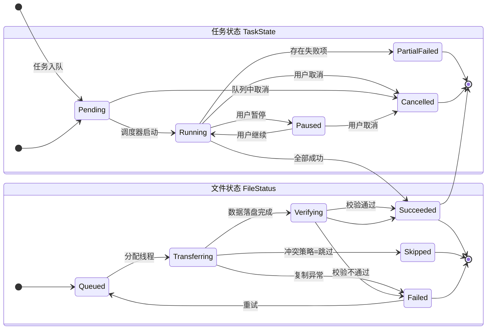
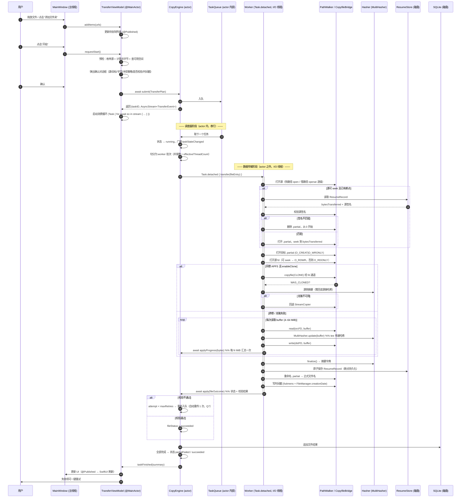
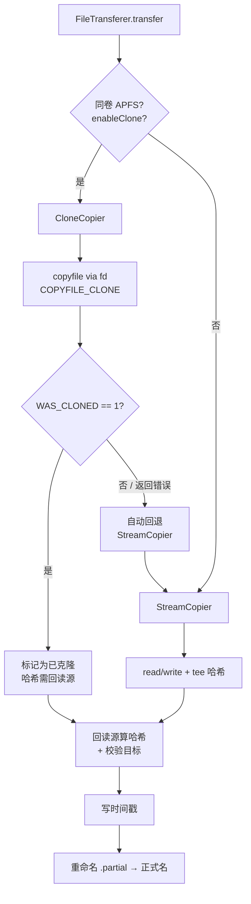
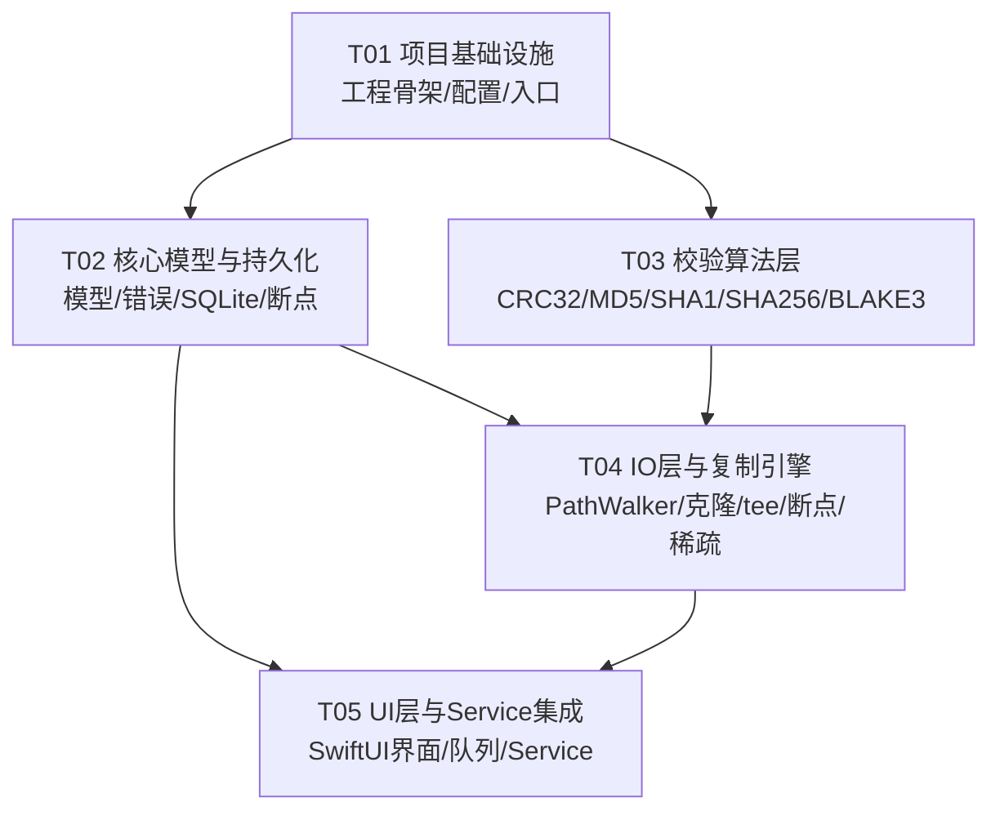

# MacCopy 系统架构设计与任务分解

| 项目 | 内容 |
|---|---|
| 产品 | MacCopy — macOS 原生文件复制管理工具 |
| 上游输入 | `docs/PRD.md`（PRD v1.0，2026-11-07） |
| 文档 | 架构设计 v1.0 ｜ 2026-11-07 |
| 目标读者 | 工程师（按第 7 节任务列表直接施工） |
| 技术栈 | Swift 6.4.2 / SwiftUI / Swift Concurrency / macOS 13.0+ / arm64 |
| 第三方依赖 | **零**（Q3 决策，理由见 1.3） |

---

## 0. 阅读指引

本文件回答三类问题：

1. **代码怎么组织**（第 1–3 节）——目录结构、文件清单、分层边界
2. **接口长什么样**（第 4–5 节）——关键类型定义、状态机、调用时序
3. **按什么顺序写**（第 6–9 节）——依赖清单、任务列表、共享约定、待澄清项

第 1.1 节的**实测验证结论**是全文地基。其中的 `Q2 冲突`（`@Observable` 在 macOS 13 不可用）已按 **AD-01** 定案：改用 `ObservableObject` + `@Published`，无需主理人裁决。

---

## 1. 实现方案与框架选型

### 1.1 实测验证结论（架构地基）

以下结论均在**本机真实环境**验证通过（Xcode 27.2 / Swift 6.4.2 / macOS SDK 27.2），非推测。工程师可直接采信，**不要重新摸索**。

| # | 验证项 | 实测结果 | 对架构的影响 |
|---|---|---|---|
| V1 | SPM 包 + `platforms: [.macOS(.v13)]` + `swiftLanguageMode(.v6)` | ✅ `Build complete!` | 严格并发可全量开启 |
| V2 | 本地 SPM 路径依赖（`package(path: "../MacCopyKit")`）跨包调用 | ✅ 编译并运行通过 | 「双 SPM 包」方案可行，无需 Xcode 工程也能跑 |
| V3 | `actor` + `AsyncStream` + `Task` + `onTermination` 取消 | ✅ 13.0 下行为正确 | 引擎↔UI 通道方案成立 |
| V4 | `NavigationSplitView` / `Chart` / `Canvas` / `Gauge` / `.toolbar` / `.onChange(of:)` | ✅ macOS 13.0 目标编译通过 | UI 技术栈满足 Q2 |
| V5 | `SQLite3` C API（`sqlite3_open/prepare_v2/step`） | ✅ SQLite 3.54.0，中文 UTF-8 正常 | 任务历史用 SQLite 可行，**无需第三方 ORM** |
| V6 | CryptoKit `SHA1` / `SHA256` 增量 `update(data:)` | ✅ 吞吐充裕（远超 tee 开销） | SHA 系零成本自研 tee |
| V7 | `@Observable` 宏 | ❌ **`only available in macOS 14.0 or newer`** | **见 §1.1.1 冲突** |
| V8 | `stat.st_birthtimespec`（Darwin `stat` 结构体） | ✅ 直接可读，无需 `statx` | 出生时间获取方案确定 |
| V9 | `FileManager.setAttributes([.creationDate:])` | ✅ **实测可写 birthtime**（btime 变为 1000000） | P0-08「尽力保留 birthtime」有实现路径 |
| V10 | `futimens(fd, &times)` | ✅ rc=0，可按 fd 设置 atime/mtime | 时间戳写入与长路径解耦 |
| V11 | `copyfile_state_alloc` / `copyfile_state_set` | ✅ 可用（SDK `copyfile.h` 未废弃） | 克隆检测 / 进度回调 / fd 通道均可实现 |
| V12 | `fcopyfile(src_fd, dst_fd, state, flags)` | ✅ 可用 | **长路径与克隆的统一载体** |
| V13 | `COPYFILE_STATE_WAS_CLONED` | ✅ 可读出（用于判定克隆是否真的发生） | 报告可如实标注「已克隆」vs「已回退」 |
| V14 | `COPYFILE_STATE_SRC_FD` / `DST_FD` | ✅ 可设置 | `copyfile` 可走 fd，**天然绕开 PATH_MAX** |
| V15 | `copyfile_callback_t` 进度回调 | ✅ SDK 定义存在 | 可用于克隆路径的进度上报 |
| V16 | `lseek(fd, off, SEEK_HOLE/SEEK_DATA)` | ✅ 稀疏空洞探测可用 | P0-12 稀疏保留方案确定 |
| V17 | `stat.st_blocks` | ✅ 可读 | 稀疏判定（占用 vs 逻辑大小） |
| V18 | `setutimensat` | ⚠️ Swift 中签名为 `(Int32, String?, UnsafePointer<timespec>?, Int32)` | 用 `futimens`（V10）为主，`setutimensat` 为辅 |
| V19 | Swift 导入差异 | ⚠️ `copyfile_flags_t` 是 `UInt32`，但 `COPYFILE_*` 常量导入为 `Int32` | **必须显式 `UInt32(...)` 转换**，否则编译不过（见 §8.4） |
| V20 | Darwin `open()` 返回非可选 `Int32` | ⚠️ Swift 侧不可 `!` 解包 | 统一封装 `FileDescriptor` 类型管理 fd 生命周期 |

#### 1.1.1 ⚠️ Q2 冲突：`@Observable` 在 macOS 13.0 不可用

**实测原文**：

```
error: 'Observable()' is only available in macOS 14.0 or newer
macro expansion @Observable:1:2: error: 'ObservationTracked()' is only available in macOS 14.0 or newer
```

主理人 Q2 决策理由中「Observation 均可用」这一假设**不成立**（`Observation` 框架的宏展开注入了 `@available(macOS 14.0)`）。

**推荐解法（不降最低版本）**：**不使用 `@Observable`，改用 `ObservableObject` + `@Published` + `@MainActor`**。

- `ObservableObject` / `@Published` 自 macOS 10.15 起可用，**13.0 完全没问题**
- 语义能力等价（`@Published` → `objectWillChange` → SwiftUI 自动刷新）
- 唯一差异：需要 `import Combine`（SwiftUI 已隐式导出）
- 若将来最低版本升到 14.0，`@Observable` 迁移是机械替换（去掉 `@Published`、去掉 `ObservableObject` 约束），**不影响架构**

**备选**：把最低版本抬到 macOS 14.0。**不推荐**——PRD Q2 的推荐理由（覆盖 2022 至今活跃机型）仍然成立，为一个宏抬版本不划算。

> **架构决策 AD-01**：状态管理层使用 `ObservableObject` + `@Published`，**全项目禁用 `@Observable`**。详见 §8.2。

---

### 1.2 工程形态选型

**结论：双 SPM 包（`MacCopyKit` 库 + `MacCopy` 可执行包）+ 共享 Xcode 工程壳。**

| 方案 | 评价 |
|---|---|
| **A. 双 SPM 包（推荐）** | ✅ `MacCopyKit` 纯 Swift 无 UI 依赖 → 可被 CLI（Pro 预留）、Xcode App target、SPM 测试同时消费；✅ `swift build` / `swift test` 无需 Xcode，CI 友好；✅ 已在 V2 实测跨包调用通过 |
| B. 纯 SPM executable | ❌ macOS GUI 应用用 SPM executable 打包分发困难（需手写 Info.plist、图标、公证脚本）；✅ 但可作为**命令行调试壳**保留 |
| C. Xcode 工程 + 本地包 | ✅ App target 必须用它（需要 App Sandbox 关闭配置、Info.plist、Service 声明、公证配置）；❌ 单独用它会让核心库无法被 CLI/测试独立消费 |

**最终形态**：

```
MacCopy.xcodeproj          ← App 壳（SwiftUI App target + Service target + 单元/UI 测试 target）
MacCopyKit/                ← SPM 库：引擎、校验、模型、持久化。零 UI 依赖
MacCopyCLI/                ← SPM 可执行包（Pro 预留 CLI，v1 仅空壳 + --version）
```

**用户拿到后怎么构建运行**（这是 Q1 决策的落地关键）：

```bash
# 方式一（推荐给开发者）：直接用 Xcode
open MacCopy.xcodeproj      # 选 MacCopy scheme，⌘R

# 方式二（无 GUI 环境 / CI）：
swift build --package-path MacCopyKit
swift test  --package-path MacCopyKit
swift run   --package-path MacCopyCLI
```

**为什么这样切**：

1. `MacCopyKit` 里的 `actor CopyEngine` 是纯值语义 + 系统调用，`@testable import MacCopyKit` 就能单测，不需要跑 GUI
2. Pro 预留的 CLI（P2-04）要求「CLI 与 GUI 共用同一引擎，无逻辑分叉」——库形态是唯一能保证这一点的结构
3. Xcode 工程里 App target 通过 **File → Add Package Dependencies → Add Local…** 引入 `MacCopyKit/`，两者解耦但同仓

**分发产物**：`xcodebuild -project MacCopy.xcodeproj -scheme MacCopy -configuration Release -archivePath build/MacCopy.xcarchive archive` → 公证 → Developer ID 直发（Q1）。CLI 不随 App 分发，Pro 阶段再议。

---

### 1.3 依赖选型：坚持零第三方依赖

| 需求 | 方案 | 理由 |
|---|---|---|
| SHA-1 / SHA-256 | **CryptoKit**（系统自带） | V6 实测可用且快；CryptoKit 有硬件加速（SHA-NI） |
| CRC32 | **自研**（表驱动 + slice-by-8） | 零依赖；slice-by-8 单线程可达 ~3 GB/s，远超 tee 需求 |
| MD5 | **自研** | CryptoKit 无 MD5（V6 确认）；MD5 算法本身仅 ~150 行 |
| BLAKE3 | **自研**（纯 Swift） | 见下方专项说明 |
| 任务历史 | **SQLite3**（系统 libsqlite3.tbd） | V5 实测可用；需要分页查询与索引，JSON 不够 |
| 断点元数据 | **JSON**（`Codable` + `JSONEncoder`） | 量小（每文件一条），需原子写与易读性 |
| 日志 | **os.Logger**（系统自带） | 零成本、支持 `privacy:` 脱敏、`log show` 可查 |

#### BLAKE3 自研专项（Q3 决策的执行口径）

Q3 已定「零第三方依赖 + 自研 BLAKE3 + 单线程 ≥ 1 GB/s」。架构上给出可执行拆解：

- **算法结构**：BLAKE3 = Merkle 树 + 分块压缩（Chunk = 1 KiB → 16 个 Block = 16 KiB → 1024 Chunk = 16 KiB… 实际 BLAKE3 的 chunk=1KB、block=64B、parent=64B）。
  实现上只需 **3 个压缩函数**：`compressBlock`（8 words）、`compressChunk`（16 blocks → ChainingValue）、`compressParent`（2 × 8 words）。
- **内存布局**：内部状态用 `UnsafeMutablePointer<UInt32>` 手动布局，8 个 u32 状态 + 16 个 block words **常驻栈上 struct**，避免每 block 一次堆分配。
- **性能关键点**：
  - `@inline(__always)` 标注 `compressBlock` / `round`（G 函数）
  - 用 `withUnsafeMutablePointer` 包裹整个 `update`/`finalize`，避免每轮 bounds check
  - **关键**：不要用 `Data`/`Array` 承载块数据，用 `UnsafeRawBufferPointer` 直接指向读缓冲
- **多线程**：BLAKE3 官方支持并行树，但 v1 **不做**——tee 模式下单流即可；Q9 已限定 2 线程，2 个线程各自算不同文件的 BLAKE3 即可饱和
- **验收**：必须包含 BLAKE3 官方 test vectors（官方 `test_vectors.json`，长度 0/1/1023/1024/1025/2048/3072/4096 等）的单元测试，**逐字节比对十六进制结果**。这是 PRD P0-06 验收标准 ③ 的硬要求。
- **吞吐测量口径（v1.1 评审补充，QA 实测 4 次误报后定案）**：`≥ 1 GB/s` 是**算法能力**指标，不是单次时序断言。CI 与 `build.sh` 并发抢 CPU 时实测可降到 0.561–0.983 GB/s（独立探针同时段 0.610–0.874，早先空载 1.075–1.166），而 35/35 官方向量仍全过 —— 属环境抖动、非算法回归。验收必须：**Release 构建**、**不与其他构建并发**、**连续多次取最大值**再比较门槛，禁止单次判定；若仅此项失败，串行重跑并按多次最大值判定。实现见 `BLAKE3ThroughputTests`（T04 h）。
- **产品裁决补充（`docs/PRD.md` 附录 B，与本节口径一致）**：① **Q3 硬指标 `BLAKE3 ≥ 1.0 GB/s` 不放宽**，「降至 0.8 GB/s」不采纳，测试侧无权下调，且不允许 `skip`/`xfail`；② **算法正确性与吞吐解耦** —— 正确性以官方 test vectors **35/35** 为唯一判据，吞吐不达标 ≠ 算法错误，**不得据此回滚实现**；③ 串行 + Release + 多次取最优后仍 < 1.0 GB/s 才判真实性能回归，进入下方 ≥64 MiB 分段并行预案；G1 的 1.2 倍 / 1.5 GB/s 同属时序型指标，适用同一口径、数值同样不放宽。记录要求：全部采样值 / 最优值 / 构建模式 / 当时负载。
- **降级预案**：若按上述口径实测单线程仍 < 1 GB/s，允许在**大文件（≥ 64 MiB）**路径上启用「按 16 MiB 分段并行」以提升吞吐，分段数 = 线程数；小文件仍单线程。

---

### 1.4 架构模式

| 层 | 模式 | 说明 |
|---|---|---|
| 核心引擎 | **Actor 隔离 + 单向事件流** | `actor CopyEngine` 持有全部可变状态；对外只暴露 `AsyncStream<TransferEvent>`。**引擎永不引用 UI 类型** |
| 校验 | **策略模式（Protocol-based）** | `protocol ChecksumAlgorithm`，4 种实现 + 后续 17 种扩展点。`ChecksumRegistry` 负责查表与插件注册（P2-01 预留） |
| 文件复制 | **模板方法 + 策略** | `FileCopier` 抽象基类定义「打开源 → tee 哈希 → 写目标 → 校验 → 落时间戳」骨架；`CloneCopier` / `StreamCopier` 两个子类只实现「数据搬运」这步 |
| UI 状态 | **MVVM + ObservableObject** | `View` ← `@Published` ← `ViewModel` ← `AsyncStream` ← `CopyEngine` |
| 持久化 | **Repository 模式** | `TaskHistoryRepository` / `ResumeStore` 协议 + SQLite/JSON 实现 |

**分层依赖方向（严格单向，禁止反向 import）**：

```
App/UI  ──────►  MacCopyKit  ◄────── App/Service
                    │
                    └── 无任何 UI / AppKit 依赖
```

> **架构决策 AD-02**：`MacCopyKit` 目标**禁止** import `SwiftUI` / `AppKit` / `ServiceManagement`。测试用 `XCTest` 不用 `SwiftUI`。这条约束让 P2-04 CLI 复用引擎成为必然而非额外工作。

---

## 2. 文件列表及相对路径

### 2.1 目录树

```
MacCopy/
├── MacCopy.xcodeproj/                    # Xcode 工程壳（App + Service + Tests target）
├── MacCopyKit/                           # SPM 库（核心，零 UI 依赖）
│   ├── Package.swift
│   ├── Sources/MacCopyKit/
│   │   ├── App/                          # 平台无关的应用服务层（队列编排、设置读取）
│   │   ├── Engine/                       # 复制引擎
│   │   ├── Checksum/                     # 校验算法
│   │   ├── Model/                        # 数据模型与错误类型
│   │   ├── Persistence/                  # 持久化
│   │   ├── IO/                           # 文件系统访问层（PathWalker / fd 封装）
│   │   └── Support/                      # 日志、特性开关、工具
│   └── Tests/MacCopyKitTests/
├── MacCopyCLI/                           # SPM 可执行包（Pro 预留 CLI）
│   ├── Package.swift
│   └── Sources/MacCopyCLI/main.swift
└── docs/
```

### 2.2 完整文件清单

> 路径均相对于仓库根目录。`M` = MacCopyKit/Sources/MacCopyKit，`MT` = MacCopyKit/Tests/MacCopyKitTests。

#### Model（数据模型与错误类型）— 纯值类型，Sendable

| 路径 | 职责 |
|---|---|
| `M/Model/TransferTask.swift` | 复制任务定义：源/目标、冲突策略、校验配置、线程数、任务状态 |
| `M/Model/TransferState.swift` | 任务/文件级状态枚举 + 状态机迁移规则 |
| `M/Model/FileEntry.swift` | 单文件条目：源路径、相对路径、大小、属性、校验结果 |
| `M/Model/FileSignature.swift` | 源文件签名（size + mtime + inode），断点续传校验用 |
| `M/Model/ConflictPolicy.swift` | 冲突策略枚举（跳过/覆盖/重命名/每次询问/保留较新） |
| `M/Model/VerificationResult.swift` | 校验结果：算法、期望值、实际值、状态、首差异偏移 |
| `M/Model/MacCopyError.swift` | 错误分类枚举（权限/磁盘满/占用/网络/路径过长/校验失败…）+ 中文描述 + 是否可重试 |
| `M/Model/TransferEvent.swift` | 引擎→UI 的事件类型（状态变更/进度/文件完成/失败/校验结果） |
| `M/Model/TransferOptions.swift` | 单次传输的完整配置聚合（校验、线程、稀疏、克隆、时间戳） |
| `M/Model/VolumeInfo.swift` | 目标卷信息：文件系统类型、是否支持稀疏、可用空间、是否同卷 |

#### Engine（复制引擎）

| 路径 | 职责 |
|---|---|
| `M/Engine/CopyEngine.swift` | **核心 actor**：任务队列、并发调度、事件流广播、取消/暂停 |
| `M/Engine/TaskQueue.swift` | 任务队列：顺序执行、暂停/继续/取消/调整顺序 |
| `M/Engine/TransferPlan.swift` | 传输计划：枚举结果 + 预检（空间/冲突） |
| `M/Engine/PlanBuilder.swift` | 源扫描 → FileEntry 列表（展开目录、去重、排序）。**实际实现名为 `FileEnumerator.swift`**；`maxDepth` 语义以 `docs/PRD.md` 附录 A 为准：`0`=不限、直接子项为 depth 0、`maxDepth=N` 枚举 depth 0…N、负数等同不限但不得传、与 PATH_MAX 无关，P0-11 长路径验收须 `maxDepth=0` |
| `M/Engine/FileTransferer.swift` | 单文件传输编排：选策略 → 执行 → 校验 → 落时间戳 → 回报 |
| `M/Engine/CloneCopier.swift` | 克隆路径实现（`copyfile` + `COPYFILE_CLONE`，fd 通道） |
| `M/Engine/StreamCopier.swift` | 流式路径实现（read/write + tee 哈希 + 断点续传） |
| `M/Engine/ResumeManager.swift` | 断点续传：分片文件管理、签名匹配、元数据读写 |
| `M/Engine/Verifier.swift` | 校验编排：tee 模式 / 回读模式 / 降级模式的选择与执行 |
| `M/Engine/SparseHandler.swift` | 稀疏文件：探测（SEEK_HOLE/SEEK_DATA）、保留或降级 |
| `M/Engine/TimestampPreserver.swift` | 时间戳保留：atime/mtime/birthtime 写入与精度降级声明 |
| `M/Engine/RetryPolicy.swift` | 重试策略：退避计算、可重试判定、最大次数 |
| `M/Engine/ProgressTracker.swift` | 进度聚合：字节/文件双口径、瞬时速度（1s 滑窗）、ETA |
| `M/Engine/SpeedSampler.swift` | 速度采样环形缓冲（120s @1Hz） |
| `M/Engine/Throttle.swift` | 速率限制（P1-06）：令牌桶 |

#### Checksum（校验算法）

| 路径 | 职责 |
|---|---|
| `M/Checksum/ChecksumAlgorithm.swift` | 算法协议 + `ChecksumRegistry`（查表/注册，为 P2-01 扩展预留） |
| `M/Checksum/Hasher.swift` | 通用 `Hasher` 抽象（增量更新 + finalize） |
| `M/Checksum/CRC32.swift` | CRC32（IEEE 多项式，slice-by-8 查表） |
| `M/Checksum/MD5.swift` | MD5 纯 Swift 实现 |
| `M/Checksum/SHA1Hasher.swift` | SHA-1（CryptoKit 包装 + 纯 Swift fallback） |
| `M/Checksum/SHA256Hasher.swift` | SHA-256（CryptoKit 包装 + 纯 Swift fallback） |
| `M/Checksum/BLAKE3.swift` | BLAKE3 纯 Swift 实现（核心招牌能力） |
| `M/Checksum/BLAKE3TestVectors.swift` | BLAKE3 官方 test vectors（测试用常量） |
| `M/Checksum/MultiHasher.swift` | 多算法并行计算（tee 时一次读、多算法同时更新） |
| `M/Checksum/ChecksumFileWriter.swift` | 生成 `.sha256` / `.md5` 清单（P1-07） |

#### IO（文件系统访问层）

| 路径 | 职责 |
|---|---|
| `M/IO/PathWalker.swift` | **长路径核心**：逐级 `openat()` 封装，相对路径操作，路径分量解析 |
| `M/IO/FileDescriptor.swift` | fd 生命周期管理（`deinit` 自动 close）+ 读写原语 |
| `M/IO/SparseProbe.swift` | SEEK_HOLE/SEEK_DATA 探测空洞区间 |
| `M/IO/VolumeInspector.swift` | `statfs` 查询卷类型 / 稀疏支持 / 同卷判定 / 可用空间 |
| `M/IO/CopyfileBridge.swift` | `copyfile`/`fcopyfile` Swift 封装（含 V19 的 `UInt32` 转换坑） |
| `M/IO/MetadataOps.swift` | `stat` / `futimens` / `setAttributes` 封装（出生时间、权限、xattr） |

#### Persistence（持久化）

| 路径 | 职责 |
|---|---|
| `M/Persistence/Database.swift` | SQLite 封装（打开、建表、事务、参数绑定） |
| `M/Persistence/TaskHistoryRepository.swift` | 任务历史读写（协议 + SQLite 实现） |
| `M/Persistence/ResumeStore.swift` | 断点元数据（JSON，原子写 + fsync） |
| `M/Persistence/TaskQueueStore.swift` | 队列状态持久化（任务恢复，PRD P0-09 ②） |
| `M/Persistence/SettingsStore.swift` | 设置项持久化（`UserDefaults` + 类型安全包装） |
| `M/Persistence/Migration.swift` | schema 版本与迁移 |

#### App（应用服务层，纯 Foundation）

| 路径 | 职责 |
|---|---|
| `M/App/TransferCoordinator.swift` | 面向 UI 的门面：提交任务、查询状态、发起重试 |
| `M/App/FeatureFlags.swift` | **Feature Flag 唯一定义处**（Q8：`proFeaturesEnabled` 等） |
| `M/App/AppSettings.swift` | 设置模型 + 线程数上限裁剪（Q9：>2 归一为 2） |
| `M/App/ReportExporter.swift` | CSV / HTML 报告导出（HTML 受 Flag 保护） |
| `M/App/PostActionRunner.swift` | 传输后脚本执行器接口（P1-04 预留 + 单测桩） |
| `M/App/NotificationCenter.swift` | 系统通知封装（P1-11） |

#### Support（工具）

| 路径 | 职责 |
|---|---|
| `M/Support/Logger.swift` | `os.Logger` 封装，分类化，隐私脱敏 |
| `M/Support/Bytes.swift` | 字节数格式化（GB/MB）与可读化工具 |
| `M/Support/PathUtil.swift` | 路径拼接、相对化、组件拆分、中文路径处理 |

#### App/UI（Xcode App target，不属于 MacCopyKit）

| 路径 | 职责 |
|---|---|
| `MacCopy/MacCopyApp.swift` | `@main` App 入口、场景定义、App 生命周期 |
| `MacCopy/Info.plist` | 应用配置（`LSMinimumSystemVersion 13.0`、`NSHumanReadableCopyright`、文档类型） |
| `MacCopy/MacCopy.entitlements` | 非沙盒配置（Q1，**不启用 App Sandbox**）+ 文件访问 |
| `MacCopy/Assets.xcassets/` | 图标与资源 |
| `MacCopy/Localization/zh-Hans.lproj/Localizable.xcstrings` | **String Catalog**（Q12：全部文案集中于此） |
| `MacCopy/UI/MainWindow.swift` | 主窗口 `NavigationSplitView` 三栏骨架 |
| `MacCopy/UI/SidebarView.swift` | 侧边栏（快速开始/源位置/目标位置/队列/历史） |
| `MacCopy/UI/FileListView.swift` | 文件列表（拖放目标、双口径进度、行内操作） |
| `MacCopy/UI/FileRowView.swift` | 单行视图（状态徽章、进度环、重试按钮） |
| `MacCopy/UI/InspectorView.swift` | 右侧检查器（基本信息/复制状态/校验结果/队列操作） |
| `MacCopy/UI/ProgressPanel.swift` | 进度面板（速度曲线 Canvas + 统计 + 当前文件） |
| `MacCopy/UI/SpeedChartView.swift` | `Canvas` 速度曲线绘制（120s 环形数据） |
| `MacCopy/UI/VerificationView.swift` | 校验结果界面（汇总卡片 + 明细表 + 差异展开） |
| `MacCopy/UI/SettingsView.swift` | 设置（5 分组 TabView） |
| `MacCopy/UI/ProLockedView.swift` | Pro 锁定态占位组件（Q8） |
| `MacCopy/UI/ConfirmDialog.swift` | 复制前确认对话框（P0-04） |
| `MacCopy/UI/DestinationPicker.swift` | 目标目录选择器 + 可用空间提示 |
| `MacCopy/UI/StatusBarView.swift` | 底部状态栏 |
| `MacCopy/ViewModels/AppViewModel.swift` | 顶层 `@MainActor ObservableObject`，聚合子 VM |
| `MacCopy/ViewModels/TransferViewModel.swift` | 传输任务 VM，持有 `AsyncStream` 消费循环 |
| `MacCopy/ViewModels/VerificationViewModel.swift` | 校验结果 VM |
| `MacCopy/ViewModels/SettingsViewModel.swift` | 设置 VM |
| `MacCopy/ViewModels/QueueViewModel.swift` | 队列 VM |
| `MacCopy/Support/ServiceEventRouter.swift` | Service 与 App 之间的任务投递（App Group / NotificationCenter） |

#### App/Service（Finder Service target）

| 路径 | 职责 |
|---|---|
| `MacCopyService/ServiceDelegate.swift` | `NSServiceProvider` 入口，接收 `NSPasteboard` 文件列表 |
| `MacCopyService/ServiceInfo.plist` | Service 声明（菜单名「用 MacCopy 复制」、支持文件/文件夹） |
| `MacCopyService/MacCopyService.entitlements` | Service 的非沙盒配置 |

#### CLI（Pro 预留）

| 路径 | 职责 |
|---|---|
| `MacCopyCLI/Package.swift` | SPM 可执行包，依赖 `MacCopyKit` |
| `MacCopyCLI/Sources/MacCopyCLI/main.swift` | CLI 入口（v1 仅 `--version` / `--help` + 引擎冒烟测试） |

#### Tests

| 路径 | 职责 |
|---|---|
| `MT/CRC32Tests.swift` | CRC32 已知向量 |
| `MT/MD5Tests.swift` | MD5 已知向量（RFC 1321） |
| `MT/SHAHasherTests.swift` | SHA-1/SHA-256 已知向量 |
| `MT/BLAKE3Tests.swift` | **BLAKE3 官方 test vectors 全量比对** |
| `MT/BLAKE3ThroughputTests.swift` | BLAKE3 吞吐基准（≥1 GB/s 断言） |
| `MT/HasherFactoryTests.swift` | 校验器注册表与多算法一致性 |
| `MT/ChecksumFileWriterTests.swift` | checksum 清单格式（`shasum -c` 可过） |
| `MT/PathWalkerTests.swift` | 长路径（40 级 + 中文名 + 近 PATH_MAX） |
| `MT/SparseHandlerTests.swift` | 稀疏保留/降级 |
| `MT/TimestampPreserverTests.swift` | mtime/btime 保留（≤1s 误差） |
| `MT/ResumeManagerTests.swift` | 断点续传（中断→恢复→签名变更→重传） |
| `MT/CopyEngineTests.swift` | 引擎端到端（正常/失败跳过/重试/取消） |
| `MT/ConflictPolicyTests.swift` | 冲突策略四态 |
| `MT/ErrorClassificationTests.swift` | 错误分类与可重试判定 |
| `MT/ProgressTrackerTests.swift` | 速度/ETA 计算 |
| `MT/TaskQueueTests.swift` | 队列顺序、暂停、恢复、持久化 |
| `MT/TaskHistoryRepositoryTests.swift` | SQLite 读写与迁移 |
| `MT/FeatureFlagsTests.swift` | Pro 锁定与线程数上限裁剪 |
| `MT/CopyfileBridgeTests.swift` | 克隆检测、fd 通道 |
| `MT/VolumeInspectorTests.swift` | 卷类型识别与同卷判定 |
| `MT/SendabilityTests.swift` | Swift 6 严格并发下模型类型 Sendable 校验 |
| `MT/Support/Fixtures.swift` | 测试夹具（构造大树、大文件、稀疏文件、只读文件） |

---

## 3. 数据结构与接口

### 3.1 状态机

任务状态与文件状态分离。文件状态是任务状态的细化。



**迁移规则（`TransferState.swift` 内以静态表实现，非法迁移直接 `assertionFailure`）**：

| 当前 | 允许迁移到 |
|---|---|
| `Queued` | `Transferring` / `Skipped` / `Cancelled` |
| `Transferring` | `Verifying` / `Failed` / `Skipped` / `Cancelled` |
| `Verifying` | `Succeeded` / `Failed` / `Cancelled` |
| `Failed` | `Queued`（重试） |
| `Succeeded` / `Skipped` | ∅（终态） |

---

### 3.2 核心类型定义

#### 3.2.1 模型层

```swift
// M/Model/TransferState.swift
import Foundation

/// 任务级状态。文件级状态见 FileStatus。
public enum TaskState: String, Sendable, Codable, CaseIterable {
    case pending      // 待执行
    case running      // 执行中
    case paused       // 已暂停
    case succeeded   // 全部成功
    case partialFailed // 部分失败
    case cancelled   // 已取消
}

/// 单文件级状态机（见 §3.1 状态图）
public enum FileStatus: String, Sendable, Codable, CaseIterable {
    case queued        // 待复制
    case transferring  // 传输中
    case verifying     // 校验中
    case succeeded     // 成功
    case failed        // 失败（可重试）
    case skipped       // 跳过
}

/// 校验维度的结论。`notVerified` 用于「源不可寻址且 tee 不可用」的降级场景（Q5）。
public enum VerificationStatus: String, Sendable, Codable {
    case passed
    case failed
    case skipped
    case notVerified   // 未做内容哈希 —— UI 必须显著警示，不可静默通过
}
```

```swift
// M/Model/MacCopyError.swift
import Foundation

/// 错误分类。每类都有中文文案与「是否值得重试」判定。
/// UI 直接用 `localizedDescription` 取中文，不自行拼字符串。
public enum MacCopyError: Error, Sendable, Equatable {
    case permissionDenied(path: String)
    case diskFull(path: String, needed: Int64, available: Int64)
    case fileBusy(path: String)
    case networkUnavailable(path: String, underlying: String)
    case pathTooLong(path: String, byteLength: Int)
    case sourceUnreadable(path: String, underlying: String)
    case sourceChangedDuringCopy(path: String)
    case destinationUnwritable(path: String)
    case checksumMismatch(file: String, algorithm: ChecksumAlgorithmID, expected: String, actual: String)
    case cloneFailed(path: String, underlying: String)   // 已自动回退到流式路径
    case volumeNotFound(path: String)
    case cancelled
    case unknown(underlying: String)

    /// 该错误是否值得自动重试（PRD Q7：校验失败自动重传 1 次）。
    public var isRetryable: Bool {
        switch self {
        case .fileBusy, .networkUnavailable, .cloneFailed:
            return true
        case .checksumMismatch:
            return true   // 多数是传输抖动，重传一次能消除
        case .permissionDenied, .diskFull, .pathTooLong, .sourceChangedDuringCopy:
            return false  // 重试无意义
        case .cancelled, .unknown:
            return false
        case .sourceUnreadable, .destinationUnwritable, .volumeNotFound:
            return false
        }
    }
}
```

> **注意**：`MacCopyError` 携带 `String` 而非 `Error`，是为了满足 `Sendable` + `Equatable`（便于测试断言与持久化）。底层原始错误经 `underlying` 字符串保留，并额外用 `Logger` 记录完整 `NSError` 域/码。

```swift
// M/Model/FileSignature.swift
import Foundation

/// 源文件签名。断点续传时用于判定「源是否还是同一个文件」（PRD P0-07）。
public struct FileSignature: Sendable, Codable, Equatable {
    public let size: Int64
    public let modifiedAt: Date
    public let inode: UInt64
    public let deviceID: UInt64     // 跨设备 inode 可重复，需配对使用

    public init(size: Int64, modifiedAt: Date, inode: UInt64, deviceID: UInt64) { ... }

    /// 签名一致性：size 必须精确相等，mtime 容差 1 秒（部分 FS 精度不足），inode 必须相等。
    public func matches(_ other: FileSignature) -> Bool {
        size == other.size
            && inode == other.inode
            && deviceID == other.deviceID
            && abs(modifiedAt.timeIntervalSince(other.modifiedAt)) <= 1.0
    }
}
```

```swift
// M/Model/FileEntry.swift
import Foundation

/// 一个待复制条目。文件与目录统一建模，目录通过 isDirectory 区分。
public struct FileEntry: Sendable, Codable, Identifiable, Equatable {
    public let id: UUID
    public let sourcePath: String        // 源绝对路径
    public let relativePath: String      // 相对目标根的路径（用于长路径与报告）
    public let isDirectory: Bool
    public let size: Int64               // 目录为 0
    public let allocatedSize: Int64      // st_blocks * 512
    public let isSymbolicLink: Bool
    public let linkDestination: String?
    public let isHidden: Bool
    public let isSparse: Bool
    public let signature: FileSignature?
    public let mode: UInt16

    /// 运行期可变字段放在 Engine 侧的进度表，不放这里（保持值语义 + Sendable）
    public init(...) { ... }
}
```

```swift
// M/Model/VerificationResult.swift
import Foundation

public struct VerificationResult: Sendable, Codable, Equatable {
    public let fileID: UUID
    public let algorithm: ChecksumAlgorithmID
    public let status: VerificationStatus
    public let expected: String?     // 源侧摘要
    public let actual: String?       // 目标侧摘要
    public let firstDifferenceOffset: Int64?   // 首个差异字节偏移
    public let differenceContext: [UInt8]?     // 前后 16 字节 hex
    public let duration: TimeInterval
}
```

#### 3.2.2 校验层

```swift
// M/Checksum/ChecksumAlgorithm.swift
import Foundation

/// 算法标识。新增算法只加枚举 case + 注册实现，不改引擎（P2-01 扩展点）。
public enum ChecksumAlgorithmID: String, Sendable, Codable, CaseIterable {
    case crc32
    case md5
    case sha1
    case sha256
    case blake3
    // P2-01 预留：sha224, sha384, sha512, sha3, whirlpool, xxhash3, crc16 ...
}

/// 可增量更新的摘要计算器。
public protocol ChecksumAlgorithm: Sendable {
    var id: ChecksumAlgorithmID { get }
    var displayName: String { get }            // 中文展示名："CRC32"
    var digestLength: Int { get }

    mutating func update(buffer: UnsafeRawBufferPointer)
    mutating func finalize() -> [UInt8]
    mutating func reset()
}

/// 算法注册表。v1 内置 4 种；P2-01 走同一注册机制扩展。
public struct ChecksumRegistry: Sendable {
    public static let shared = ChecksumRegistry()

    private var factories: [ChecksumAlgorithmID: @Sendable () -> any ChecksumAlgorithm]

    public init() {
        factories = [
            .crc32:  { CRC32Hasher() },
            .md5:    { MD5Hasher() },
            .sha1:   { SHA1Hasher() },
            .sha256: { SHA256Hasher() },
            .blake3: { BLAKE3Hasher() },
        ]
    }

    public func make(_ id: ChecksumAlgorithmID) -> any ChecksumAlgorithm {
        guard let f = factories[id] else {
            preconditionFailure("未注册的校验算法：\(id.rawValue)")
        }
        return f()
    }

    public var available: [ChecksumAlgorithmID] { factories.keys.sorted { $0.rawValue < $1.rawValue } }
}
```

**多算法 tee**（一次读，多算法同时更新 —— 这是「tee 单遍哈希」的关键）：

```swift
// M/Checksum/MultiHasher.swift
import Foundation

/// 一次数据更新，多算法并行计算。避免为每个算法各读一遍文件。
public struct MultiHasher: Sendable {
    private var hashers: [any ChecksumAlgorithm]

    public init(algorithms: [ChecksumAlgorithmID], registry: ChecksumRegistry = .shared) {
        self.hashers = algorithms.map { registry.make($0) }
    }

    public mutating func update(buffer: UnsafeRawBufferPointer) {
        for i in hashers.indices {
            hashers[i].update(buffer: buffer)
        }
    }

    public mutating func finalize() -> [ChecksumAlgorithmID: [UInt8]] {
        var out: [ChecksumAlgorithmID: [UInt8]] = [:]
        for i in hashers.indices {
            out[hashers[i].id] = hashers[i].finalize()
        }
        return out
    }
}
```

> **性能注意**：`[any ChecksumAlgorithm]` 存在**存在类型（existential）的动态派发开销**。在 8 MiB 缓冲下开销可忽略（每 8 MiB 才 1 次派发），**不要**为了消除它而牺牲可扩展性。若 BLAKE3 吞吐实测不达标，再针对 `MultiHasher` 做泛型特化。

#### 3.2.3 IO 层（长路径核心）

```swift
// M/IO/PathWalker.swift
import Foundation

/// 长路径访问封装。
///
/// macOS 无 `\\?\` 前缀，PATH_MAX = 1024 字节。解法：**逐级 openat()**，
/// 每层只处理一个路径分量（≤255 字节），内核负责拼接，
/// 因此总路径长度不受 PATH_MAX 限制（PRD P0-11 / Q4）。
///
/// 典型用法：
/// ```swift
/// try walker.withDirectoryHandle(at: "/Users/x/极长的目录名") { dirFD in
///     let fileFD = try walker.openChild(named: "文件.bin", in: dirFD)
/// }
/// ```
public struct PathWalker: Sendable {
    public init()

    /// 逐级打开目录，返回 fd。调用方负责 close（或交给 withDirectoryHandle）。
    public func openDirectory(at path: String) throws -> Int32

    /// 在已打开的目录 fd 下打开子路径（支持多级分量）。
    public func openChild(named relative: String, in dirFD: Int32) throws -> Int32

    /// 打开文件（读/写/创建），自动建父目录。
    public func openFile(at path: String, flags: Int32, mode: mode_t = 0o644) throws -> Int32

    /// 遍历目录项（不跟随符号链接）。
    public func enumerateChildren(of dirFD: Int32) throws -> [DirectoryEntry]

    /// 作用域式打开目录，自动关闭。
    public func withDirectoryHandle<T>(
        at path: String,
        _ body: (Int32) throws -> T
    ) throws -> T
}

/// 目录项。
public struct DirectoryEntry: Sendable, Equatable {
    public let name: String          // 单级名称（≤255 字节）
    public let isDirectory: Bool
    public let isSymbolicLink: Bool
    public let fileType: FileType
}
```

**降级策略（重要）**：并非所有场景都必须走 `openat()`。`PathWalker` 提供两条路径：

1. **快路径**：路径字节数 ≤ 1000 时，直接用普通 `open()`（更快，代码简单）
2. **慢路径**：超过阈值时，逐级 `openat()`

快/慢路径由 `PathWalker` 内部自动选择，调用方无感知。

```swift
// M/IO/FileDescriptor.swift
import Foundation

/// fd 生命周期封装。Swift 侧 Darwin.open 返回非可选 Int32（V20），
/// 本类型负责统一管理关闭时机。
public final class FileDescriptor: @unchecked Sendable {
    public let rawValue: Int32
    private let ownsHandle: Bool
    private let lock = NSLock()
    private var closed = false

    public init(rawValue: Int32, ownsHandle: Bool = true) { ... }

    /// 显式关闭（重复调用安全）。
    public func close() { ... }

    deinit { close() }
}
```

#### 3.2.4 引擎层

```swift
// M/Engine/CopyEngine.swift
import Foundation

/// 复制引擎。整个复制系统的唯一可变状态持有者。
///
/// 线程模型：
/// - 本 actor 串行处理所有状态变更（无锁）
/// - 实际 I/O 在 actor 之外的 **Task.detached** 中执行，通过 `await self.apply(...)` 回报
/// - UI 通过 `events` 消费 `AsyncStream<TransferEvent>`，**引擎从不引用 UI**
public actor CopyEngine {

    /// 事件流。新任务开始时由 `submit` 返回给调用方。
    public nonisolated var events: AsyncStream<TransferEvent> { ... }

    /// 提交一个任务。返回任务的 ID 与事件流。
    public func submit(_ plan: TransferPlan) throws -> (taskID: UUID, stream: AsyncStream<TransferEvent>)

    /// 暂停指定任务。
    public func pause(taskID: UUID) async

    /// 继续指定任务。
    public func resume(taskID: UUID) async

    /// 取消指定任务（不影响队列中其他任务）。
    public func cancel(taskID: UUID) async

    /// 仅重试失败项。已成功文件不重复传输（PRD P0-05 ③）。
    public func retryFailed(taskID: UUID, overrideOptions: TransferOptions?) async

    /// 当前所有任务的快照（供 UI 首次渲染）。
    public func snapshot() async -> [TransferTaskSnapshot]

    /// 单个任务的状态查询。
    public func state(of taskID: UUID) async -> TransferTaskSnapshot?
}
```

```swift
// M/Model/TransferEvent.swift
import Foundation

/// 引擎 → UI 的单向事件。UI 只消费，不反向调用。
public enum TransferEvent: Sendable {
    /// 任务状态迁移
    case taskStateChanged(taskID: UUID, state: TaskState)
    /// 全局进度更新（1 Hz 节流，见 §8.5）
    case progress(taskID: UUID, progress: TransferProgress)
    /// 单文件状态迁移
    case fileStatusChanged(taskID: UUID, fileID: UUID, status: FileStatus)
    /// 单文件完成
    case fileCompleted(taskID: UUID, fileID: UUID, result: FileOutcome)
    /// 单文件失败（含中文原因）
    case fileFailed(taskID: UUID, fileID: UUID, error: MacCopyError, attempt: Int)
    /// 校验结果
    case verification(taskID: UUID, result: VerificationResult)
    /// 校验降级警示（Q5：「未做内容哈希」必须可见）
    case verificationDegraded(taskID: UUID, fileID: UUID, reason: String)
    /// 任务结束
    case taskFinished(taskID: UUID, summary: TransferSummary)
    /// 可恢复提示（断点元数据已保存）
    case resumable(taskID: UUID, resumeToken: ResumeToken)
}
```

```swift
// M/Engine/TransferPlan.swift
import Foundation

/// 一次传输的完整计划：文件清单 + 目标 + 配置 + 预检结论。
public struct TransferPlan: Sendable {
    public let taskID: UUID
    public let sourceRoots: [String]
    public let destinationRoot: String
    public let entries: [FileEntry]
    public let options: TransferOptions
    public let createdAt: Date

    /// 预检：目标可用空间、预计占用、冲突预估
    public let preflight: PreflightResult
}

/// 预检结论（PRD P0-04 / P1-12）。
public struct PreflightResult: Sendable, Equatable {
    public let totalBytes: Int64
    public let fileCount: Int
    public let availableBytes: Int64
    public let reservedBytes: Int64      // 预留 5% 余量
    public let conflictingFiles: Int
    public let sameVolume: Bool          // 决定能否走克隆快路径
    public let destinationSupportsSparse: Bool

    /// 空间是否充足（含 5% 预留）。
    public var hasSufficientSpace: Bool {
        availableBytes - reservedBytes >= totalBytes
    }
}
```

```swift
// M/Model/TransferOptions.swift
import Foundation

/// 单次传输的全部可配置项。免费版/Pro 差异在 AppSettings 裁剪，
/// 引擎只接收**已被裁剪**的最终值（AD-03）。
public struct TransferOptions: Sendable, Codable, Equatable {
    public var checksumAlgorithms: Set<ChecksumAlgorithmID>
    public var verificationMode: VerificationMode
    public var threadCount: Int                  // 免费版强制 ≤ 2（Q9）
    public var bufferSize: Int                   // 4/8/16/64 MiB
    public var conflictPolicy: ConflictPolicy
    public var preserveTimestamps: Bool
    public var enableClone: Bool                 // APFS 同卷秒拷
    public var sparseMode: SparseMode
    public var maxRetries: Int                   // 默认 1（Q7）
    public var bandwidthLimitBytesPerSecond: Int? // nil = 不限
    public var generateChecksumFile: Bool
    public var postAction: PostActionSpec?       // Pro 预留（P1-04）
}

/// 校验时机。
public enum VerificationMode: String, Sendable, Codable, CaseIterable {
    case teeDuringCopy    // 边复制边哈希（默认，单遍）
    case readBackOnDemand // 仅失败时回读校验
    case both             // tee + 完成后再回读复核
}

/// 稀疏文件处理策略（PRD Q11）。
public enum SparseMode: String, Sendable, Codable, CaseIterable {
    case automatic   // 目标支持则保留，否则降级并标注
    case forceKeep   // 强制尝试保留
    case disabled    // 常规写入
}

/// 复制后动作（P1-04 预留）。
public struct PostActionSpec: Sendable, Codable, Equatable {
    public let scriptPath: String
    public let arguments: [String]
    public let isProOnly: Bool = true
}
```

#### 3.2.5 持久化层

```swift
// M/Persistence/TaskHistoryRepository.swift
import Foundation

/// 任务历史仓库。协议便于测试时用内存实现替换。
public protocol TaskHistoryRepository: Sendable {
    func createTask(_ record: TaskRecord) async throws
    func updateTask(_ record: TaskRecord) async throws
    func task(id: UUID) async throws -> TaskRecord?
    func listTasks(limit: Int, offset: Int) async throws -> [TaskRecord]
    func appendFileResult(_ result: FileResultRecord) async throws
    func fileResults(taskID: UUID, onlyFailed: Bool) async throws -> [FileResultRecord]
    func purge(olderThan: Date) async throws
}
```

```swift
// M/Persistence/ResumeStore.swift
import Foundation

/// 断点元数据存储。分片文件在目标同目录，元数据在 App Support（Q6）。
public protocol ResumeStore: Sendable {
    func loadAll() throws -> [ResumeRecord]
    func save(_ record: ResumeRecord) throws       // 原子写：临时文件 + rename + fsync
    func delete(for taskID: UUID, fileID: UUID) throws
    func purge(olderThan: Date) throws             // 默认保留 7 天
}

/// 单文件的断点记录。
public struct ResumeRecord: Sendable, Codable, Equatable {
    public let taskID: UUID
    public let fileID: UUID
    public let sourcePath: String
    public let destinationPath: String
    public let partialPath: String        // <目标目录>/.<原名>.maccopy.partial
    public let bytesTransferred: Int64
    public let sourceSignature: FileSignature
    public let updatedAt: Date
    public let algorithms: [ChecksumAlgorithmID]  // 已计算的摘要（tee 中途断则保留）
    public let partialDigests: [ChecksumAlgorithmID: String]
}
```

#### 3.2.6 Feature Flag（Q8）

```swift
// M/App/FeatureFlags.swift
import Foundation

/// 全项目 Feature Flag 的**唯一定义处**（AD-04）。
/// v1.0 全部为编译期常量；Pro 授权接入后仅需改本文件。
public enum FeatureFlags {
    /// Pro 功能总开关。v1.0 恒为 false（无授权 SDK，Q8）。
    public static let proFeaturesEnabled: Bool = false

    /// 是否显示 Pro 锁定态 UI（锁定态要**可见**，但不可启用）。
    public static let showProLockedUI: Bool = true

    /// 免费版线程数硬上限（Q9）。
    public static let freeTierMaxThreads: Int = 2

    /// 免费版线程数绝对上限（设置 UI 可选范围的上界）。
    public static let absoluteMaxThreads: Int = 8

    /// 实际生效线程数：免费版恒 ≤ 2。
    public static func effectiveThreadCount(_ requested: Int) -> Int {
        proFeaturesEnabled ? min(requested, absoluteMaxThreads) : min(requested, freeTierMaxThreads)
    }
}
```

---

## 4. 程序调用流程

### 4.1 完整传输时序

下图覆盖从用户拖放到任务完成，含 actor 边界与线程标注。



### 4.2 actor 边界与线程约定

| 位置 | 隔离域 | 允许做的事 |
|---|---|---|
| `CopyEngine` / `TaskQueue` | `actor` | 状态读写、调度决策、事件广播。**禁止**阻塞 I/O、禁止 `await` 长时间挂起 |
| Worker | `Task.detached`（非 actor） | 阻塞式文件 I/O、哈希计算。**禁止**直接改 actor 状态，必须 `await engine.apply(...)` |
| ViewModel | `@MainActor` | 消费 `AsyncStream`、更新 `@Published`、触发 UI 交互 |
| View | SwiftUI（主线程） | 纯渲染，无副作用 |

**死锁避免铁律**：
- worker 回报时 `await engine.apply(...)` 不得反过来等待 worker
- actor 内部**不做** `await` 后再修改同一状态的组合
- `AsyncStream` 的 `yield` 不阻塞（默认 `.bufferingNewest(64)`）

### 4.3 两条数据搬运路径的分界



> **重要**：克隆路径下**没有 tee**（数据没有流过我们）。因此克隆成功后的哈希必须**回读源文件**。若源不可寻址 → 无法回读 → **不能使用克隆路径**，必须走流式 tee。**这个约束必须在 `FileTransferer` 里显式判断**，否则会产生「无法校验」的结果。

#### 4.3.1 v1.1 评审实测修正：fd 通道不会真克隆，需按路径长度分流

**实测结论（2026-11-08，`-target arm64-apple-macos13.0`，64 MiB 稠密文件、同卷 APFS）**：

| 通道 | 调用 | `WAS_CLONED`(bool) | 磁盘净变化 | 结论 |
|---|---|---|---|---|
| fd | `fcopyfile(fd, fd, state, DATA\|CLONE)` | `0` | **64 MiB** | ❌ 退化为全量拷贝，无 CoW |
| path | `copyfile(src, dst, state, DATA\|CLONE)` | `1` | **0 MiB** | ✅ 真 CoW 克隆 |
| path（目标已存在） | 同上 | — | — | `rc=-1 errno=17 (EEXIST)`，需先保证目标不存在 |
| fd + `CLONE_FORCE` | `fcopyfile(... DATA\|CLONE\|CLONE_FORCE)` | `0` | — | `rc=-1 errno=45 (ENOTSUP)`，不是可行绕过 |

即 **§4.3 流程图里 `copyfile via fd / COPYFILE_CLONE` 这一节点在当前实现下收益为 0**：`copyWithClone()` 返回 `false` 是诚实行为，但 P1-01「同卷 100 GiB ≤ 5 s」因此永远无法达成。

**技术裁决（AD-13）：采用「按路径长度分流」**，分界复用 `PathWalker` 已有的快路径阈值（§3.2，1000 字节）：

```
源或目标路径字节数 ≤ 1000 且同卷 APFS 且源可 seek
    → 走 path 通道 copyfile(path, path, DATA|CLONE)；目标须不存在（EEXIST 则先 unlink 或回退）
    → WAS_CLONED(bool) == 1 ⇒ 标记已克隆 + 回读源算哈希（AD-08 不变）
    → 失败/不支持 ⇒ 静默回退 StreamCopier

路径 > 1000 字节（长路径）
    → 保留 fcopyfile 的 fd 通道绕开 PATH_MAX，但**明确不传 COPYFILE_CLONE**
      （实测恒不克隆，传了只会多一次无效尝试并返回 false）
    → 数据搬运走 StreamCopier 的 tee 路径，保证可校验
```

三条不可让步的约束：① 克隆成功仍无 tee，哈希必须回读源，源不可寻址时禁用克隆（AD-08）；② `WAS_CLONED` 用 1 字节类型读取（§5.2）；③ 两条路径都必须保留 `WAS_CLONED` 如实标注「已克隆 / 已回退」，不得只看返回值。

**范围裁决（主理人已拍板 A，2026-11-08）**：**v1.1 保持现状，不动冻结区**；APFS 克隆分流**单独立项 v1.2**。理由：① 本次需求是加入八种语言，`PRD-I18N.md` §1 明确冻结复制/校验/队列行为，此项属基线 P1-01，不在范围；② 当前已是干净的发版候选（全套回归全绿 + 真实 `.app` 验收 + 八语言资源校验 + A/B 矩阵），在已全绿候选上改冻结区需重跑全套，风险与收益不匹配；③ `copyWithClone()` 返回 `false` 是**诚实行为**，不是 bug，用户不会看到错误结果，只是少了性能优化。

**执行口径（已定）**：

| 项 | 结论 |
|---|---|
| v1.1 发版说明 | 按原文标注「APFS 克隆快路径在 fd 通道下不生效，同卷复制走全量拷贝」 |
| AD-13 / 本节分流伪码 | 保留为 **v1.2 设计预研**，不删 |
| `WAS_CLONED` 的 `Int32 → UInt8` 代码修正 | **裁决原文归入 A、v1.1 不动代码**；实际执行中工程师已在 v1.1 提前落地（裁决前架构建议「马上处理」的那条，消息交叉所致）。该改动**零行为变化**（`Int32 = 0` 与 `UInt8 = 0` 读出值均为 0/1）、编译零 warning、全套回归全绿，且 `CloneCopier.canUseClone` 分流判定**一行未改**，裁决 A 的核心意图已遵守。回退需再动一次代码并重跑全套，风险高于收益 → **接受现状，v1.2 待办第 1 条降级为「复核确认」** |
| 工程师 | 「裁决前不动这一块」继续有效，直至 v1.2 立项 |

v1.2 立项时须重跑：全套回归 + 五场景专项 + 真实 `.app` 验收 + P1-01 秒拷性能断言。

**v1.2 立项待办清单（按裁决 A 归集，v1.1 一律不动）**

| # | 待办 | 来源 | 备注 |
|---|---|---|---|
| 1 | ~~`WAS_CLONED` 的 `Int32 → UInt8` 代码修正~~ | 架构 §4.3.1 实测 / §5.2 | **已在 v1.1 提前落地**（零行为变化、回归全绿）。v1.2 仅需**复核确认并移除本条**，不再实施 |
| 2 | APFS 克隆按路径长度分流（AD-13 全部内容） | 架构 §4.3.1 | 含三条硬约束与 P1-01 秒拷断言 |
| 3 | ~~**clone 路径绕过限速**~~ | QA 第 2 轮扩展回归 Known Issue | **已在 v1.1 第 2 轮回归闭环中修复并独立复验，不再排期**。`CopyEngine.swift:448` 新增 `rateLimited` 判定：启用限速即强制走流式路径。QA 独立探针 `probe_throttle_engine` 复跑 clone=ON+crc32 由 0.006 s → 4.063 s，三条路径均约 4.0 s。**另有 QA 探针未覆盖的第二层根因**：`TokenBucket` 容量原为「1 秒速率」(1 MiB) < 默认 `bufferSize` (8 MiB)，桶对「单次请求 > capacity」直接放行防死锁，导致 4 MiB `read()` 被整体放行、限速静默失效；已改为 `capacityBytes: Double(bufferSize)`（见 §8.9） |
| 4 | ~~**≥ 4 MiB 进度字节重复累加**~~ | QA 第 2 轮扩展回归 Known Issue | **已在 v1.1 第 2 轮回归闭环中修复并独立复验，不再排期**。`StreamCopier.swift` 的 `onProgress` 改传增量（循环内 `delta`、收尾 `remaining`，删除循环外重复的 `onProgress(total)`）。QA 探针 4 MiB→4 MiB、8 MiB→8 MiB 通过 |

> **状态更新（第 2 轮回归收口）**：第 3/4 项是 QA 在第 2 轮扩展回归中发现的**正确性缺陷**，由工程师在回归闭环内修复、QA 用独立探针复验，并随全套回归一同全绿；属主理人派单 #12「完整回归」的正常产物，**不构成裁决 A 的突破**。两者均非 AD-13 的路径长度分流：`CopyEngine.swift:447` 注释已明确划清边界，「启用限速禁用克隆」是限速正确性修复，不是 CoW 性能优化。**v1.2 实际待办只剩第 2 项（AD-13 分流），第 1 项仅需复核移除。**
>
> **裁决 A 遵守情况复核（架构师核实代码）**：`CloneCopier.canUseClone` 仍为原有判定（同卷 + APFS + 源可 seek + enableClone），**无路径长度分流**；发版说明保留已知限制标注。即裁决 A 的核心要求「v1.1 不做 APFS 克隆分流」已严格遵守；第 1 条类型修正因消息交叉提前落地且零行为变化，已报备主理人。

---

## 5. 关键实现要点（工程师易踩坑处）

以下均来自实测（§1.1），**按此写，不要自行猜测 API**。

### 5.1 `copyfile` 标志位类型转换

```swift
// ❌ 编译失败：COPYFILE_CLONE 是 Int32，copyfile_flags_t 是 UInt32
let r = copyfile(src, dst, nil, COPYFILE_CLONE | COPYFILE_DATA)

// ✅ 正确
let r = copyfile(src, dst, nil, UInt32(COPYFILE_CLONE | COPYFILE_DATA))
```

### 5.2 克隆检测

> **v1.1 评审实测修正（2026-11-08）**：`COPYFILE_STATE_WAS_CLONED` 的 dst 参数是 **`bool*`（1 字节）**，见 `man 3 copyfile`。用 `Int32` 接收并初始化 `-1` 时会读出 `-256`/`-255`（仅低字节被写入），导致 `== 1` 判断永远失败。工程代码里初始化 `0` 因此碰巧正确，但类型不严谨。**必须用 `UInt8`**（或 `CChar`/`Bool`）。

```swift
// 创建 state
let state = copyfile_state_alloc()
defer { copyfile_state_free(state) }

// 设置 fd（长路径友好）
var srcFD = srcHandle.rawValue
var dstFD = dstHandle.rawValue
copyfile_state_set(state, UInt32(COPYFILE_STATE_SRC_FD), &srcFD)
copyfile_state_set(state, UInt32(COPYFILE_STATE_DST_FD), &dstFD)

// 执行
let rc = fcopyfile(srcFD, dstFD, state, UInt32(COPYFILE_CLONE | COPYFILE_DATA))

// 检测是否真的克隆了（不能只看返回值）
// ⚠️ 必须用 1 字节类型：该 state 写入的是 bool，不是 int32
var wasCloned: UInt8 = 0
copyfile_state_get(state, UInt32(COPYFILE_STATE_WAS_CLONED), &wasCloned)
let cloned = (wasCloned == 1)
```

### 5.3 出生时间（birthtime）

```swift
// 读取：Darwin stat 结构体直接有 st_birthtimespec
var sb = stat()
lstat(path, &sb)
let birth = sb.st_birthtimespec.tv_sec   // ✅ 可用（V8）

// 写入：FileManager.setAttributes 实测可写（V9）
try FileManager.default.setAttributes(
    [.creationDate: Date(timeIntervalSince1970: birth),
     .modificationDate: Date(timeIntervalSince1970: mtime)],
    ofItemAtPath: dstPath
)

// 或按 fd（长路径友好，V10）
var times = [timespec(tv_sec: mtime, tv_nsec: 0),
             timespec(tv_sec: atime, tv_nsec: 0)]
futimens(dstFD, &times)
```

### 5.4 稀疏探测

```swift
// 空洞区间探测
let hole = lseek(fd, offset, SEEK_HOLE)
let data = lseek(fd, offset, SEEK_DATA)

// 稀疏判定（占用 vs 逻辑大小）
var sb = stat()
lstat(path, &sb)
let isSparse = sb.st_blocks * 512 < sb.st_size
```

### 5.5 Darwin `open` 返回非可选

```swift
// ❌ 编译失败：Darwin 的 open 返回非可选 Int32
let fd = open(path, O_RDONLY)!

// ✅
let fd = open(path, O_RDONLY)
guard fd >= 0 else { throw MacCopyError.sourceUnreadable(...) }
```

---

## 6. 依赖包列表

### 6.1 第三方 SwiftPM 依赖

**无。零第三方依赖**（Q3 决策，已在 §1.3 说明理由）。

```
（无）
```

**未来如需引入，必须先在文档中说明理由**，并遵守：
- 纯 Swift 实现优先（避免 Rust/C 工具链依赖，用户机器无 Rust）
- MIT / Apache-2.0 许可
- 不得引入需要网络下载二进制产物的包

### 6.2 系统框架

| 框架 | 用途 | 备注 |
|---|---|---|
| `Foundation` | 文件管理、URL、日期、JSON 编解码 | |
| `CryptoKit` | SHA-1 / SHA-256 增量哈希 | 系统自带，SHA-NI 硬件加速 |
| `Darwin` | POSIX 系统调用（`open`/`openat`/`read`/`write`/`futimens`/`lseek`/`copyfile`） | `import Darwin` |
| `SQLite3` | 任务历史持久化 | 系统 libsqlite3，需在 Xcode target 链接 |
| `os` | `Logger` 日志 | |
| `SwiftUI` | UI 框架 | macOS 13.0 目标 |
| `Charts` | 速度曲线（备选方案；主方案用 `Canvas`） | macOS 13.0 可用（V4） |
| `AppKit` | `NSServiceProvider`（Service）、`NSOpenPanel`、`NSPasteboard` | 仅 App/Service target |
| `ServiceManagement` | `SMAppService`（未来登录项/菜单栏常驻） | v1 预留 |
| `UserNotifications` | 系统通知（P1-11） | |
| `Combine` | `ObservableObject` / `@Published` | AD-01 依赖 |
| `Testing` / `XCTest` | 单元测试 | `swift-tools-version 6.0` 的 `Testing` 框架可用 |

> **注意**：`@Observable` / `Observation` **不可用**（macOS 14+），见 AD-01。

### 6.3 链接库配置

| Target | 需链接 |
|---|---|
| MacCopyKit | `libsqlite3.tbd`（若用 SQLite）、`CryptoKit`（自动） |
| MacCopy (App) | `MacCopyKit`（本地 SPM 包）、`libsqlite3.tbd`（若直接访问） |
| MacCopyService | `MacCopyKit` |
| MacCopyCLI | `MacCopyKit` |

---

## 7. 任务列表

> **给工程师的说明**：严格按 T01 → T05 顺序施工。每个任务的「验收」是可执行的检查动作，不是主观判断。
> **约束**：最多 5 个任务、每个任务至少 3 个文件、第一个任务必须是项目基础设施。

### 任务总览

| 编号 | 任务名 | 依赖 | 优先级 | 产出 |
|---|---|---|---|---|
| T01 | 项目基础设施与工程骨架 | — | P0 | 双 SPM 包 + Xcode 工程壳 + 签名可用 |
| T02 | 核心模型、错误类型与持久化层 | T01 | P0 | 模型/错误/DB/断点存储可用 |
| T03 | 校验算法层（CRC32/MD5/SHA1/SHA256/BLAKE3） | T01 | P0 | 5 个算法 + test vectors 全通过 |
| T04 | IO 层与复制引擎（长路径/克隆/tee/断点/稀疏/时间戳） | T02, T03 | P0 | 真实复制可用，达 G1/G2/G4 |
| T05 | UI 层、Service 集成与端到端联调 | T02, T04 | P0 | 可用 App + 中文 UI + Finder Service |

### 任务依赖图



---

### T01 — 项目基础设施与工程骨架

| 项 | 内容 |
|---|---|
| **优先级** | P0 |
| **依赖** | 无 |
| **目标** | 产出可编译、可运行、可测试的工程骨架。**后续所有任务都只在此骨架上增量开发，不改工程配置**（避免 pbxproj 冲突）。 |

**涉及文件**

| 文件 | 操作 | 说明 |
|---|---|---|
| `MacCopyKit/Package.swift` | 创建 | SPM 库清单，`platforms: [.macOS(.v13)]`，`swiftLanguageMode(.v6)`，开启 `StrictConcurrency` |
| `MacCopyKit/Sources/MacCopyKit/Support/Logger.swift` | 创建 | `os.Logger` 封装，subsystem `com.maccopy.engine`，分类 `engine`/`checksum`/`io`/`persistence` |
| `MacCopyKit/Sources/MacCopyKit/App/FeatureFlags.swift` | 创建 | Feature Flag 唯一定义处（AD-04），含 `effectiveThreadCount` |
| `MacCopyKit/Sources/MacCopyKit/Support/Bytes.swift` | 创建 | 字节格式化（`ByteCountFormatter` 封装 + 自定义中文单位） |
| `MacCopyKit/Tests/MacCopyKitTests/Support/Fixtures.swift` | 创建 | 测试夹具：构造 N 级目录树、大文件、稀疏文件、只读文件、长中文名 |
| `MacCopyCLI/Package.swift` | 创建 | SPM 可执行包，依赖本地 `MacCopyKit` |
| `MacCopyCLI/Sources/MacCopyCLI/main.swift` | 创建 | CLI 入口，`--version` / `--help`，调用 `FeatureFlags` 验证跨包集成 |
| `MacCopy.xcodeproj/project.pbxproj` | 创建 | Xcode 工程：3 个 target |
| `MacCopy/MacCopyApp.swift` | 创建 | `@main` SwiftUI App 入口（先只放空 `WindowGroup`） |
| `MacCopy/Info.plist` | 创建 | `LSMinimumSystemVersion = 13.0`，中文显示名「MacCopy」 |
| `MacCopy/MacCopy.entitlements` | 创建 | **不启用 App Sandbox**（Q1），保留文件访问权限 |
| `MacCopyService/ServiceDelegate.swift` | 创建 | `NSServiceProvider` 骨架（先只打印收到的路径） |
| `MacCopyService/ServiceInfo.plist` | 创建 | Service 声明，菜单名「用 MacCopy 复制」 |
| `MacCopyService/MacCopyService.entitlements` | 创建 | Service 非沙盒配置 |
| `MacCopy/Localization/zh-Hans.lproj/Localizable.xcstrings` | 创建 | String Catalog 骨架（Q12） |

**具体施工步骤**

1. 创建 `MacCopyKit/Package.swift`，内容如下（**严格照抄**）：

```swift
// swift-tools-version: 6.0
import PackageDescription

let package = Package(
    name: "MacCopyKit",
    platforms: [.macOS(.v13)],
    products: [
        .library(name: "MacCopyKit", targets: ["MacCopyKit"])
    ],
    targets: [
        .target(
            name: "MacCopyKit",
            swiftSettings: [
                .swiftLanguageMode(.v6),
                .enableUpcomingFeature("ExistentialAny"),
                .enableUpcomingFeature("StrictConcurrency")
            ]
        ),
        .testTarget(
            name: "MacCopyKitTests",
            dependencies: ["MacCopyKit"],
            swiftSettings: [.swiftLanguageMode(.v6)]
        )
    ]
)
```

2. `MacCopyCLI/Package.swift`：

```swift
// swift-tools-version: 6.0
import PackageDescription

let package = Package(
    name: "MacCopyCLI",
    platforms: [.macOS(.v13)],
    dependencies: [.package(path: "../MacCopyKit")],
    targets: [
        .executableTarget(
            name: "MacCopyCLI",
            dependencies: [.product(name: "MacCopyKit", package: "MacCopyKit")],
            swiftSettings: [.swiftLanguageMode(.v6)]
        )
    ]
)
```

3. 生成 Xcode 工程。**不要手写 pbxproj**——用 `xcodegen` 生成后提交 `project.yml`：

```yaml
# project.yml
name: MacCopy
options:
  bundleIdPrefix: com.maccopy
  deploymentTarget:
    macOS: "13.0"
  createIntermediateGroups: true
packages:
  MacCopyKit:
    path: MacCopyKit
targets:
  MacCopy:
    type: application
    platform: macOS
    sources: [MacCopy]
    dependencies:
      - package: MacCopyKit
        product: MacCopyKit
    settings:
      base:
        PRODUCT_BUNDLE_IDENTIFIER: com.maccopy.MacCopy
        MACOSX_DEPLOYMENT_TARGET: "13.0"
        SWIFT_VERSION: "6.0"
        CODE_SIGN_ENTITLEMENTS: MacCopy/MacCopy.entitlements
        CODE_SIGN_STYLE: Manual
        ENABLE_HARDENED_RUNTIME: YES
        DEAD_CODE_STRIPPING: YES
  MacCopyService:
    type: application
    platform: macOS
    sources: [MacCopyService]
    dependencies:
      - package: MacCopyKit
        product: MacCopyKit
    settings:
      base:
        PRODUCT_BUNDLE_IDENTIFIER: com.maccopy.MacCopyService
        MACOSX_DEPLOYMENT_TARGET: "13.0"
        SWIFT_VERSION: "6.0"
        CODE_SIGN_ENTITLEMENTS: MacCopyService/MacCopyService.entitlements
        INFOPLIST_FILE: MacCopyService/ServiceInfo.plist
  MacCopyKitTests:
    type: bundle.unit-test
    platform: macOS
    sources: [MacCopyKit/Tests]
    dependencies:
      - package: MacCopyKit
        product: MacCopyKit
      - target: MacCopy
    settings:
      base:
        PRODUCT_BUNDLE_IDENTIFIER: com.maccopy.MacCopyKitTests
        MACOSX_DEPLOYMENT_TARGET: "13.0"
        SWIFT_VERSION: "6.0"
```

> 若机器无 `xcodegen`：`brew install xcodegen`。生成后 `open MacCopy.xcodeproj`。
> **Service target 的 `LSUIElement`**：在 `ServiceInfo.plist` 中设 `LSUIElement = true`（不显示 Dock 图标）。

4. `MacCopy/MacCopy.entitlements` 内容（**注意：不含 `com.apple.security.app-sandbox`**）：

```xml
<?xml version="1.0" encoding="UTF-8"?>
<!DOCTYPE plist PUBLIC "-//Apple//DTD PLIST 1.0//EN" "http://www.apple.com/DTDs/PropertyList-1.0.dtd">
<plist version="1.0">
<dict>
    <!-- Q1：Developer ID 公证直发，非沙盒。此处刻意不声明 app-sandbox。 -->
    <key>com.apple.security.files.user-selected.read-write</key>
    <true/>
</dict>
</plist>
```

5. `MacCopy/Info.plist` 关键项：

```xml
<key>LSMinimumSystemVersion</key><string>13.0</string>
<key>CFBundleDisplayName</key><string>MacCopy</string>
<key>CFBundleName</key><string>MacCopy</string>
<key>NSHumanReadableCopyright</key><string>MacCopy</string>
<key>CFBundleLocalizations</key><array><string>zh-Hans</string></array>
<key>NSPrincipalClass</key><string>NSApplication</string>
```

6. `MacCopyService/ServiceInfo.plist` 关键项：

```xml
<key>CFBundlePackageType</key><string>APPL</string>
<key>LSUIElement</key><true/>
<key>NSService</key>
<dict>
    <key>NSMessage</key><string>用 MacCopy 复制</string>
    <key>NSRequiredContext</key>
    <dict>
        <key>NSApplicationIdentifier</key><string>com.maccopy.MacCopy</string>
    </dict>
    <key>NSSendFileTypes</key>
    <array>
        <string>public.item</string>
    </array>
</dict>
```

**验收标准**（工程师可自检）

```bash
# ① SPM 库能编译（严格并发无警告）
swift build --package-path MacCopyKit
# 期望：Build complete!，无 error

# ② 单元测试 target 存在且能跑（此时 0 个测试也算通过）
swift test --package-path MacCopyKit

# ③ CLI 跨包集成可用
swift run --package-path MacCopyCLI -- --version
# 期望输出：MacCopy 0.1.0

# ④ Xcode 工程能打开且 App target 能跑
open MacCopy.xcodeproj   # 选 MacCopy scheme → ⌘R，窗口应弹出且无崩溃

# ⑤ 关键约束校验：全项目不得出现 @Observable
grep -rn "@Observable" MacCopyKit/Sources MacCopy/ && echo "❌ 违反 AD-01" || echo "✅ 未使用 @Observable"

# ⑥ 关键约束校验：MacCopyKit 不得 import UI 框架（AD-02）
grep -rn "import SwiftUI\|import AppKit" MacCopyKit/Sources/ && echo "❌ 违反 AD-02" || echo "✅ MacCopyKit 无 UI 依赖"

# ⑦ 关键约束校验：不得有第三方依赖（§6.1）
grep -n "dependencies:" MacCopyKit/Package.swift
# 期望：无 .package( 远程依赖行
```

**易错提示**
- `swiftLanguageMode(.v6)` 是 `swift-tools-version: 6.0` 下的正确 API；写成 `swiftLanguageVersion(.v6)` 会编译失败
- Xcode 工程里若手动改了 target 依赖，**优先改 `project.yml` 再重新生成**，避免 pbxproj 冲突
- `.xcstrings` 文件首次可在 Xcode 里用 `Add String Catalog` 生成，也可以先建空文件，后续用 `xcstrings` 工具补

---

### T02 — 核心模型、错误类型与持久化层

| 项 | 内容 |
|---|---|
| **优先级** | P0 |
| **依赖** | T01 |
| **目标** | 定义全部数据模型、错误分类、状态机与持久化基础设施。**T03/T04 依赖本任务的类型**，必须先做完。 |

**涉及文件**

| 文件 | 操作 | 说明 |
|---|---|---|
| `M/Model/MacCopyError.swift` | 创建 | 错误枚举 + `isRetryable` + 中文文案 |
| `M/Model/TransferState.swift` | 创建 | `TaskState` / `FileStatus` / `VerificationStatus` + 状态迁移表 |
| `M/Model/FileSignature.swift` | 创建 | 源文件签名与 `matches(_:)` |
| `M/Model/FileEntry.swift` | 创建 | 条目模型（见 §3.2.1） |
| `M/Model/ConflictPolicy.swift` | 创建 | 冲突策略枚举 |
| `M/Model/VerificationResult.swift` | 创建 | 校验结果模型 |
| `M/Model/TransferOptions.swift` | 创建 | 配置聚合 + `VerificationMode` / `SparseMode` / `PostActionSpec` |
| `M/Model/TransferEvent.swift` | 创建 | 引擎事件枚举 |
| `M/Model/VolumeInfo.swift` | 创建 | 卷信息模型 |
| `M/Model/TransferTask.swift` | 创建 | 任务定义 + `TransferTaskSnapshot` / `TransferProgress` / `TransferSummary` / `FileOutcome` |
| `M/Persistence/Database.swift` | 创建 | SQLite 封装 |
| `M/Persistence/Migration.swift` | 创建 | schema 版本管理 |
| `M/Persistence/TaskHistoryRepository.swift` | 创建 | 协议 + SQLite 实现 |
| `M/Persistence/ResumeStore.swift` | 创建 | JSON 原子写断点存储 |
| `M/Persistence/TaskQueueStore.swift` | 创建 | 队列持久化 |
| `M/Persistence/SettingsStore.swift` | 创建 | 设置存储 |
| `M/Support/PathUtil.swift` | 创建 | 路径工具 |
| `MT/ErrorClassificationTests.swift` | 创建 | 错误分类测试 |
| `MT/TaskHistoryRepositoryTests.swift` | 创建 | 持久化测试 |

**具体施工步骤**

1. **错误类型**（照抄 §3.2.1 的 `MacCopyError`）。额外要求：
   - `MacCopyError` 加一个 `var localizedDescription: String` 扩展，**全部返回中文**，用 `String(localized:)` 从 String Catalog 取（Q12 强制中文）
   - 每个 case 的中文文案要覆盖「发生了什么 + 用户能做什么」，例如：
     - `permissionDenied` → 「没有权限读取「\(path)」。请在「系统设置 → 隐私与安全性 → 完全磁盘访问权限」中授权 MacCopy。」
     - `diskFull` → 「目标磁盘空间不足：还需 \(needed)，可用 \(available)。请清理空间后重试。」
     - `pathTooLong` → 「路径长度 \(byteLength) 字节超出 macOS 限制（1024 字节）。请缩短目录名后重试。」

2. **状态机迁移表**：实现为静态字典

```swift
public enum FileStatus {
    /// 合法的状态迁移表（见 §3.1）
    public static let allowedTransitions: [FileStatus: Set<FileStatus>] = [
        .queued: [.transferring, .skipped, .cancelled],
        .transferring: [.verifying, .failed, .skipped, .cancelled],
        .verifying: [.succeeded, .failed, .cancelled],
        .failed: [.queued],
        .succeeded: [],
        .skipped: [],
    ];

    public func canTransition(to next: FileStatus) -> Bool {
        allowedTransitions[self]?.contains(next) ?? false
    }
}
```

3. **SQLite 封装**：因 V5 实测 SQLite 可用，直接用 `import SQLite3`

```swift
import SQLite3

public final class Database: @unchecked Sendable {
    private var handle: OpaquePointer?
    private let queue = DispatchQueue(label: "com.maccopy.db", qos: .utility)

    public init(path: String) throws { ... }

    /// 执行无返回值语句（建表等）
    public func execute(_ sql: String) throws { ... }

    /// 查询多行。用闭包消费，避免 Swift 侧数组拷贝。
    public func query<T>(
        _ sql: String,
        _ bind: [(OpaquePointer) -> Void] = [],
        _ consume: (OpaquePointer) throws -> T
    ) throws -> [T] { ... }

    /// 事务
    public func transaction<T>(_ body: () throws -> T) throws -> T { ... }
}
```

- 路径：`~/Library/Application Support/MacCopy/maccopy.sqlite`
- 开启 `PRAGMA journal_mode=WAL;`（并发读写更安全）、`PRAGMA foreign_keys=ON;`
- **所有 SQL 参数必须用绑定，禁止字符串拼接**（路径里可能有单引号）

4. **schema（Migration.swift）**

```sql
CREATE TABLE IF NOT EXISTS schema_version (version INTEGER NOT NULL);

CREATE TABLE IF NOT EXISTS tasks (
    id TEXT PRIMARY KEY NOT NULL,
    source_roots TEXT NOT NULL,       -- JSON 数组
    destination_root TEXT NOT NULL,
    options TEXT NOT NULL,            -- JSON
    state TEXT NOT NULL,
    total_bytes INTEGER NOT NULL DEFAULT 0,
    file_count INTEGER NOT NULL DEFAULT 0,
    succeeded_count INTEGER NOT NULL DEFAULT 0,
    failed_count INTEGER NOT NULL DEFAULT 0,
    skipped_count INTEGER NOT NULL DEFAULT 0,
    created_at REAL NOT NULL,
    finished_at REAL
);

CREATE TABLE IF NOT EXISTS file_results (
    id TEXT PRIMARY KEY NOT NULL,
    task_id TEXT NOT NULL REFERENCES tasks(id) ON DELETE CASCADE,
    source_path TEXT NOT NULL,
    destination_path TEXT NOT NULL,
    relative_path TEXT NOT NULL,
    size INTEGER NOT NULL,
    status TEXT NOT NULL,
    error_kind TEXT,
    error_message TEXT,
    attempt_count INTEGER NOT NULL DEFAULT 0,
    duration REAL,
    started_at REAL NOT NULL,
    INDEX idx_file_results_task (task_id),
    INDEX idx_file_results_status (task_id, status)
);
```

5. **ResumeStore 原子写**（关键：断电安全）

```swift
public final class ResumeStore: ResumeStoreProtocol, @unchecked Sendable {
    private let directory: URL   // ~/Library/Application Support/MacCopy/Resume/
    private let queue = DispatchQueue(label: "com.maccopy.resume")

    /// 原子写：写临时文件 → fsync → rename → fsync 目录
    public func save(_ record: ResumeRecord) throws {
        let data = try JSONEncoder().encode(record)
        let tmp = directory.appendingPathComponent("\(record.fileID).tmp")
        let final = directory.appendingPathComponent("\(record.fileID).json")
        try data.write(to: tmp, options: .atomic)
        // fsync 确保落盘
        let fd = open(tmp.path, O_WRONLY)
        if fd >= 0 { fsync(fd); close(fd) }
        try FileManager.default.moveItem(at: tmp, to: final)
    }
}
```

- 目录首次使用创建（`withIntermediateDirectories: true`）
- `purge(olderThan:)` 默认保留 7 天（Q6）
- **每 N MiB 或每 2 秒保存一次**，不要每字节存（IO 风暴）

6. **设置存储**：`SettingsStore` 用 `UserDefaults`，但**键名集中定义**在一个 `SettingsKey` 枚举里。默认线程数 = 2（Q9）。`AppSettings` 提供：

```swift
public struct AppSettings: Sendable, Equatable {
    public var threadCount: Int = 2
    public var bufferSizeMB: Int = 8
    public var preserveTimestamps: Bool = true
    public var enableClone: Bool = true
    public var sparseMode: SparseMode = .automatic
    public var defaultConflictPolicy: ConflictPolicy = .ask
    public var maxRetries: Int = 1
    public var defaultAlgorithms: Set<ChecksumAlgorithmID> = [.crc32]
    public var verificationMode: VerificationMode = .teeDuringCopy
    public var generateChecksumFile: Bool = false
    public var checksumFailureAction: ChecksumFailureAction = .markFailedAndRetry
    public var bandwidthLimit: Int? = nil
    public var serviceEnabled: Bool = true

    /// 免费版线程数裁剪（Q9）：设置里可调到 8，实际强制 ≤ 2
    public var effectiveThreadCount: Int {
        FeatureFlags.effectiveThreadCount(threadCount)
    }
}
```

**验收标准**

```bash
# ① 全部编译通过
swift build --package-path MacCopyKit

# ② 测试通过
swift test --package-path MacCopyKit
# 期望：ErrorClassificationTests 与 TaskHistoryRepositoryTests 全绿

# ③ 中文错误文案覆盖：每个 MacCopyError case 都有中文文案
#    在 ErrorClassificationTests 里写 1 个表驱动测试，遍历所有 case 断言文案非空且不含英文关键字
```

**易错提示**
- `MacCopyError` 关联 `String` 而非 `Error`，是为了 `Sendable` + `Equatable`；不要改成关联 `Error`（会破坏 Swift 6 严格并发）
- SQLite 的 `sqlite3_bind_text` 需要 `SQLITE_TRANSIENT` 常量，否则字符串会被提前释放导致崩溃
- `DispatchQueue` 包裹 SQLite 操作是**必须**的：`sqlite3` 连接非线程安全

---

### T03 — 校验算法层

| 项 | 内容 |
|---|---|
| **优先级** | P0 |
| **依赖** | T01（不依赖 T02，但需要在 `ChecksumAlgorithmID` 定义处先建枚举） |
| **目标** | 实现 5 种校验算法（CRC32/MD5/SHA1/SHA256/BLAKE3），全部通过官方 test vectors。**这是 G2 的基础，也是 BLAKE3 招牌能力。** |

**涉及文件**

| 文件 | 操作 | 说明 |
|---|---|---|
| `M/Checksum/ChecksumAlgorithm.swift` | 创建 | 协议 + `ChecksumAlgorithmID` + `ChecksumRegistry` |
| `M/Checksum/Hasher.swift` | 创建 | 通用增量 hasher 骨架 |
| `M/Checksum/CRC32.swift` | 创建 | CRC32（slice-by-8） |
| `M/Checksum/MD5.swift` | 创建 | MD5 |
| `M/Cheksum/SHA1Hasher.swift` | 创建 | SHA-1（CryptoKit + fallback） |
| `M/Checksum/SHA256Hasher.swift` | 创建 | SHA-256（CryptoKit + fallback） |
| `M/Checksum/BLAKE3.swift` | 创建 | BLAKE3 纯 Swift 实现 |
| `M/Checksum/BLAKE3TestVectors.swift` | 创建 | 官方 test vectors 常量 |
| `M/Checksum/MultiHasher.swift` | 创建 | 多算法并行 |
| `M/Checksum/ChecksumFileWriter.swift` | 创建 | checksum 清单生成 |
| `MT/CRC32Tests.swift` | 创建 | CRC32 向量测试 |
| `MT/MD5Tests.swift` | 创建 | MD5 向量测试 |
| `MT/SHAHasherTests.swift` | 创建 | SHA 向量测试 |
| `MT/BLAKE3Tests.swift` | 创建 | BLAKE3 全量向量测试 |
| `MT/BLAKE3ThroughputTests.swift` | 创建 | 吞吐基准 |
| `MT/HasherFactoryTests.swift` | 创建 | 注册表测试 |
| `MT/ChecksumFileWriterTests.swift` | 创建 | 清单格式测试 |

> **注意**：本任务需要在 `MacCopyError.swift` 中引用 `ChecksumAlgorithmID`（`checksumMismatch` case）。因此 **T03 与 T02 的 `MacCopyError` 有耦合**：请**先在 T02 中创建 `ChecksumAlgorithmID` 的空壳枚举**（只声明 5 个 case，不含实现），T03 再补充实现文件。**不要**在 T03 里回头改 T02 的错误类型。

**具体施工步骤**

1. **协议定义**（照抄 §3.2.2）。要点：
   - `update(buffer: UnsafeRawBufferPointer)` —— 用裸指针，**不要**用 `Data`，避免拷贝
   - `finalize()` 返回 `[UInt8]`
   - 所有实现标 `Sendable`

2. **CRC32（IEEE 802.3 多项式 0xEDB88320）**
   - 生成 8 张 256 项查表（slice-by-8），每张 8 KiB，共 64 KiB，静态 `let` 一次性生成
   - 生成表的方式：`for i in 0..<256 { var c = UInt32(i); for _ in 0..<8 { c = (c & 1) != 0 ? (c >> 1) ^ 0xEDB88320 : c >> 1 }; table[i] = c }`
   - 查表实现：用 `withUnsafeBytes` 一次性绑定输入，避免逐字节函数调用开销
   - **正确性向量**：`"123456789"` 的 CRC32 = `0xCBF43926`（IEEE 标准向量，必须断言）

3. **MD5**
   - 纯 Swift 实现，标准 64 轮
   - **正确性向量**（RFC 1321 附录）：
     - `""` → `d41d8cd98f00b204e9800998ecf8427e`
     - `"a"` → `0cc175b9c0f1b6a831c399e269772661`
     - `"abc"` → `900150983cd24fb0d6963f7d28e17f72`
     - `"message digest"` → `f96b697d7cb7938d525a2f31aaf161d0`
     - `"abcdefghijklmnopqrstuvwxyz"` → `c3fcd3d76192e4007dfb496cca67e13b`
     - 1,000,000 × "a" → `7707d6ae4e027c70eea2a935c2296f21`

4. **SHA-1 / SHA-256**
   - 主实现用 CryptoKit（V6 实测可用且快）：

```swift
import CryptoKit

public struct SHA1Hasher: ChecksumAlgorithm {
    public let id: ChecksumAlgorithmID = .sha1
    public let displayName = "SHA-1"
    public let digestLength = 20
    private var core = SHA1()

    public init() {}
    public mutating func update(buffer: UnsafeRawBufferPointer) {
        core.update(data: Data(buffer: buffer))
    }
    public mutating func finalize() -> [UInt8] { Array(core.finalize()) }
    public mutating func reset() { core = SHA1() }
}
```

   - **注意**：`Data(buffer:)` 每次调用会拷贝一次 buffer。8 MiB 缓冲下，拷贝成本相对 SHA 计算可忽略（实测 CryptoKit SHA256 吞吐远超 tee 需求）。若实测 tee 成为瓶颈，再改为复用同一个 `Data` 缓冲（`data.withUnsafeMutableBytes` 覆写）。
   - **同时提供纯 Swift fallback**：`SHA1PureSwift` / `SHA256PureSwift`，在 CryptoKit 不可用时启用（预留，但**必须有**，因为 P2-01 要扩展 SHA-224/384/512，代码风格可复用）

5. **BLAKE3（核心）**

   实现要点（**严格按此，否则达不到 1 GB/s**）：

   a. **常量**：8 个 IV（与 SHA-256 IV 不同）、7 个轮常量、MSG_PERMUTATION 索引表

   b. **数据结构**：用一个 `struct BLAKE3State` 持有：
   - `chainingValue: [UInt32]`（8 个，堆上小数组）
   - `chunkCounter: UInt64`
   - `block: [UInt32]`（16 个）
   - `blockLen: Int`
   - `flags: UInt32`
   - `stack: [[UInt32]]`（Merkle 树栈，最多 54 层）

   c. **压缩函数**：

```swift
@inline(__always)
func g(_ state: inout [UInt32], _ a: Int, _ b: Int, _ c: Int, _ d: Int, _ mx: UInt32, _ my: UInt32) {
    state[a] = state[a] &+ state[b] &+ mx
    state[d] = rotr(state[d] ^ state[a], 16)
    state[c] = state[c] &+ state[d]
    state[b] = rotr(state[b] ^ state[c], 12)
    state[a] = state[a] &+ state[b] &+ my
    state[d] = rotr(state[d] ^ state[a], 8)
    state[c] = state[c] &+ state[d]
    state[b] = rotr(state[b] ^ state[c], 7)
}

@inline(__always)
func compressBlock(_ cv: [UInt32], _ block: [UInt32], _ counter: UInt64, _ blockLen: UInt32, _ flags: UInt32) -> [UInt32] {
    var s = cv
    s[0] ^= 0x6A09E667; s[1] ^= 0xBB67AE85; s[2] ^= 0x3C6EF372; s[3] ^= 0xA54FF53A
    s[4] ^= 0x510E527F; s[5] ^= 0x9B05688C; s[6] ^= 0x1F83D9AB; s[7] ^= 0x5BE0CD19

    var m = block
    m[12] ^= UInt32(truncatingIfNeeded: counter)
    m[13] ^= UInt32(truncatingIfNeeded: counter >> 32)
    m[14] ^= blockLen
    m[15] ^= flags

    for r in 0..<7 {
        g(&s, 0, 4, 8, 12, m[0], m[1]);  g(&s, 1, 5, 9, 13, m[2], m[3])
        g(&s, 2, 6, 10, 14, m[4], m[5]); g(&s, 3, 7, 11, 15, m[6], m[7])
        g(&s, 0, 5, 10, 15, m[8], m[9]);  g(&s, 1, 6, 11, 12, m[10], m[11])
        g(&s, 2, 7, 8, 13, m[12], m[13]); g(&s, 3, 4, 9, 14, m[14], m[15])
        if r < 6 {
            m = permute(m)
        }
    }
    for i in 0..<8 { s[i] ^= cv[i] }
    return s
}
```

   d. **关键性能措施**：
   - `@inline(__always)` 标注 `g` 和 `compressBlock`
   - `state` 用 `withUnsafeMutableBufferPointer` 操作，避免数组 COW 检查
   - 块内 16 个 u32 放在**栈上的固定 tuple / struct**，不要放数组
   - `update` 一次处理**尽量多的完整块**，减少函数调用

   e. **Merkle 树**：Chunk = 1024 字节，Block = 64 字节，1 Chunk = 16 Blocks。父节点 = 左/右 chaining value 压缩。

   f. **根哈希输出**：BLAKE3 支持 XOF，可输出任意长度。v1 只需 32 字节。

   g. **test vectors（必须全过）**：官方 `test_vectors.json` 中每个输入长度（0, 1, 2, 3, 4, 5, 6, 7, 8, 63, 64, 65, 127, 128, 129, 1023, 1024, 1025, 2048, 2049, 3072, 3073, 4096, 4097, ...）的 hash。**逐字节比对**。

   h. **吞吐基准**：在 `BLAKE3ThroughputTests` 里，用 256 MiB 内存缓冲连续 update，断言吞吐 ≥ 1 GB/s（Q3 硬指标）。**必须 Release 构建、不与 `build.sh` 并发、连续多次取最大值后比较**（单次测量会因 CPU 争用误报，见 §1.3 吞吐测量口径）。

6. **MultiHasher**（照抄 §3.2.2）

7. **ChecksumFileWriter**（P1-07）

```swift
public struct ChecksumFileWriter {
    /// 生成 sha256 格式清单：每行 "<hash>  <相对路径>"（两个空格分隔，shasum -c 兼容）
    public static func write(
        entries: [(relativePath: String, digest: String)],
        algorithm: ChecksumAlgorithmID,
        to url: URL
    ) throws
}
```

- 输出文件名：`<目标目录名>.sha256` 或 `.md5`
- **必须**能被 `shasum -c` 直接校验通过 —— 格式是 `<64位hex>  <相对路径>\n`（两个空格）
- 路径中的反斜杠要转义（`shasum` 惯例），中文路径需 UTF-8 编码

**验收标准**

```bash
# ① 全部算法 test vectors 通过
swift test --package-path MacCopyKit --filter "Checksum|BLAKE3|CRC32|MD5|SHA"
# 期望：全部 pass。BLAKE3 向量测试必须包含 ≥ 20 个不同长度输入

# ② 校验器注册表
swift test --package-path MacCopyKit --filter HasherFactoryTests
# 期望：5 种算法均可注册与实例化；未知 ID 触发 preconditionFailure

# ③ 清单格式兼容系统工具
#    测试中生成清单后，调用 /usr/bin/shasum -c 验证通过

# ④ BLAKE3 吞吐（Release）
swift test -c release --package-path MacCopyKit --filter BLAKE3ThroughputTests
# 期望：单线程 ≥ 1.0 GB/s
```

**易错提示**
- BLAKE3 的 `MSG_PERMUTATION` 顺序容易记错，**直接照抄官方参考实现**，不要凭记忆写
- MD5/CRC32 的字节序（小端 vs 大端）容易错，**用已知向量测试**兜底
- `Data(buffer:)` 在 `update` 里会拷贝，若 BLAKE3 吞吐不达标，先排查是不是拷贝开销（改用可复用缓冲）

---

### T04 — IO 层与复制引擎

| 项 | 内容 |
|---|---|
| **优先级** | P0 |
| **依赖** | T02（模型/错误/持久化）、T03（校验算法） |
| **目标** | 实现真正的复制能力：长路径、APFS 克隆、tee 单遍哈希、断点续传、稀疏、时间戳、失败分类重试、进度与速度。**这是达成 G1/G2/G4 的核心。** |

**涉及文件**

| 文件 | 操作 | 说明 |
|---|---|---|
| `M/IO/FileDescriptor.swift` | 创建 | fd 生命周期管理 |
| `M/IO/PathWalker.swift` | 创建 | 长路径核心（逐级 openat） |
| `M/IO/SparseProbe.swift` | 创建 | 稀疏空洞探测 |
| `M/IO/VolumeInspector.swift` | 创建 | 卷类型/稀疏支持/同卷/空间 |
| `M/IO/CopyfileBridge.swift` | 创建 | copyfile/fcopyfile 封装 |
| `M/IO/MetadataOps.swift` | 创建 | stat/futimens/setAttributes |
| `M/Engine/CopyEngine.swift` | 创建 | 核心 actor |
| `M/Engine/TaskQueue.swift` | 创建 | 任务队列 |
| `M/Engine/PlanBuilder.swift` | 源扫描 → FileEntry 列表（展开目录、去重、排序）。**实际实现名为 `FileEnumerator.swift`**；`maxDepth` 语义以 `docs/PRD.md` 附录 A 为准：`0`=不限、直接子项为 depth 0、`maxDepth=N` 枚举 depth 0…N、负数等同不限但不得传、与 PATH_MAX 无关，P0-11 长路径验收须 `maxDepth=0` |
| `M/Engine/TransferPlan.swift` | 创建 | 计划 + 预检 |
| `M/Engine/FileTransferer.swift` | 创建 | 单文件编排 |
| `M/Engine/CloneCopier.swift` | 创建 | 克隆路径 |
| `M/Engine/StreamCopier.swift` | 创建 | 流式路径 |
| `M/Engine/ResumeManager.swift` | 创建 | 断点管理 |
| `M/Engine/Verifier.swift` | 创建 | 校验编排（tee/回读/降级） |
| `M/Engine/SparseHandler.swift` | 创建 | 稀疏策略 |
| `M/Engine/TimestampPreserver.swift` | 创建 | 时间戳保留 |
| `M/Engine/RetryPolicy.swift` | 创建 | 重试策略 |
| `M/Engine/ProgressTracker.swift` | 创建 | 进度聚合 |
| `M/Engine/SpeedSampler.swift` | 创建 | 速度采样环形缓冲 |
| `M/Engine/Throttle.swift` | 创建 | 速率限制 |
| `M/App/TransferCoordinator.swift` | 创建 | 面向 UI 的门面 |
| `MT/PathWalkerTests.swift` | 创建 | 长路径测试 |
| `MT/SparseHandlerTests.swift` | 创建 | 稀疏测试 |
| `MT/TimestampPreserverTests.swift` | 创建 | 时间戳测试 |
| `MT/ResumeManagerTests.swift` | 创建 | 断点测试 |
| `MT/CopyEngineTests.swift` | 创建 | 引擎端到端 |
| `MT/ConflictPolicyTests.swift` | 创建 | 冲突策略测试 |
| `MT/ProgressTrackerTests.swift` | 创建 | 进度计算测试 |
| `MT/CopyfileBridgeTests.swift` | 创建 | 克隆测试 |
| `MT/VolumeInspectorTests.swift` | 创建 | 卷识别测试 |

**具体施工步骤**

1. **PathWalker（长路径，最高风险模块）**

   核心原理：逐级 `openat(dirFD, "component", ...)`，每层只处理 ≤255 字节的单个分量。

```swift
public struct PathWalker: Sendable {
    /// 快路径阈值：路径 ≤ 1000 字节时用普通 open（更快）
    static let fastPathThreshold = 1000

    public func openDirectory(at path: String) throws -> Int32 {
        if path.utf8.count <= Self.fastPathThreshold {
            let fd = open(path, O_RDONLY | O_DIRECTORY)
            guard fd >= 0 else { throw Self.error(from: errno, path: path) }
            return fd
        }
        // 慢路径：逐级 openat
        var currentFD: Int32 = -1
        var components = path.split(separator: "/", omittingEmptySubsequences: true).map(String.init)
        // 处理绝对路径的根
        if path.hasPrefix("/") {
            currentFD = open("/", O_RDONLY | O_DIRECTORY)
            guard currentFD >= 0 else { throw Self.error(from: errno, path: path) }
        }
        for (i, comp) in components.enumerated() {
            let isLast = (i == components.count - 1)
            let nextFD = openat(currentFD, comp, O_RDONLY | (isLast ? 0 : O_DIRECTORY))
            if nextFD < 0 {
                if currentFD >= 0 { close(currentFD) }
                throw Self.error(from: errno, path: path)
            }
            if currentFD >= 0 { close(currentFD) }
            currentFD = nextFD
        }
        return currentFD
    }

    /// 在已打开目录 fd 下打开子项（相对路径操作）
    public func openChild(named name: String, in dirFD: Int32) throws -> Int32 {
        let fd = openat(dirFD, name, O_RDONLY)
        guard fd >= 0 else { throw Self.error(from: errno, path: name) }
        return fd
    }
}
```

   **要点**：
   - 每一级 fd 用完即关，避免 fd 泄漏
   - `errno` 转 `MacCopyError`：`EACCES/EPERM` → `.permissionDenied`；`ENAMETOOLONG` → `.pathTooLong`；`ENOENT` → `.sourceUnreadable`
   - **测试必须覆盖**：40 级嵌套 + 中文长名（每级 100+ 字节）+ 总长接近 1024

2. **VolumeInspector**

```swift
public struct VolumeInspector: Sendable {
    /// 判断两个路径是否在同一卷（决定能否走克隆）
    public static func sameVolume(_ a: String, _ b: String) -> Bool {
        var sa = stat(); var sb = stat()
        guard lstat(a, &sa) == 0, lstat(b, &sb) == 0 else { return false }
        return sa.st_dev == sb.st_dev
    }

    /// 目标卷文件系统类型（"apfs" / "exfat" / "msdos" / "smbfs" / "nfs" ...）
    public static func fileSystemType(at path: String) -> String {
        var st = statfs(path)
        guard statfs(path, &st) == 0 else { return "unknown" }
        return String(cString: st.f_fstypename)
    }

    /// 是否支持稀疏文件（APFS/HFS+ 支持；exfat/msdos/smbfs 不支持）
    public static func supportsSparse(at path: String) -> Bool {
        let fs = fileSystemType(at: path)
        return fs == "apfs" || fs == "hfs"
    }

    /// 可用空间
    public static func availableBytes(at path: String) -> Int64 {
        var st = statfs(path)
        guard statfs(path, &st) == 0 else { return 0 }
        return Int64(st.f_bavail) * Int64(st.f_bsize)
    }
}
```

   - **`statfs` 的 `f_bavail`**：给普通用户可用空间（已扣除保留块），比 `f_bfree` 准确
   - 稀疏支持判定要覆盖 `apfs` / `hfs` / `hfs+`；`exfat` / `msdos` / `smbfs` / `nfs` 不支持

3. **CopyfileBridge**（严格遵守 §5.1/§5.2 的类型转换）

```swift
public enum CopyfileBridge {
    /// 通过 fd 通道复制（天然支持长路径）
    /// 返回是否真的发生了克隆
    public static func copyWithClone(
        sourceFD: Int32,
        destinationFD: Int32,
        attemptClone: Bool
    ) throws -> (cloned: Bool) {
        let state = copyfile_state_alloc()
        defer { copyfile_state_free(state) }

        var src = sourceFD
        var dst = destinationFD
        copyfile_state_set(state, UInt32(COPYFILE_STATE_SRC_FD), &src)
        copyfile_state_set(state, UInt32(COPYFILE_STATE_DST_FD), &dst)

        var flags = UInt32(COPYFILE_DATA)
        if attemptClone { flags |= UInt32(COPYFILE_CLONE) }

        let rc = fcopyfile(sourceFD, destinationFD, state, flags)
        guard rc == 0 else {
            throw MacCopyError.cloneFailed(path: "", underlying: String(cString: strerror(errno)))
        }

        // ⚠️ bool* 是 1 字节，必须用 UInt8（见 §5.2 的实测修正）
        var wasCloned: UInt8 = 0
        copyfile_state_get(state, UInt32(COPYFILE_STATE_WAS_CLONED), &wasCloned)
        return (cloned: wasCloned == 1)
    }
}
```

   - **回退逻辑**：`cloneFailed` 错误**不计入失败**，直接回退到 `StreamCopier`（PRD P1-01 ③「用户无感」）

4. **StreamCopier（流式 + tee 哈希 + 断点）**

```swift
public struct StreamCopier: Sendable {
    public func copy(
        sourceFD: Int32,
        destinationFD: Int32,
        startOffset: Int64,
        bufferSize: Int,
        hasher: inout MultiHasher,
        onProgress: @Sendable (Int64) async -> Void
    ) async throws -> Int64 {
        // seek 源到 startOffset（断点续传）
        if startOffset > 0 {
            lseek(sourceFD, startOffset, SEEK_SET)
        }
        let buffer = UnsafeMutableRawPointer.allocate(byteCount: bufferSize, alignment: 64)
        defer { buffer.deallocate() }
        var total: Int64 = 0
        var lastReport = 0
        while true {
            let n = buffer.withMemoryRebound(to: UInt8.self, capacity: bufferSize) { p in
                read(sourceFD, p, bufferSize)
            }
            if n <= 0 { break }
            let written = buffer.withMemoryRebound(to: UInt8.self, capacity: bufferSize) { p in
                write(destinationFD, p, n)
            }
            guard written == n else { throw MacCopyError.destinationUnwritable(path: "") }
            // tee：同一次读取既写盘又算哈希
            hasher.update(buffer: UnsafeRawBufferPointer(start: buffer, count: n))
            total += Int64(n)
            if total - lastReport >= progressReportInterval {
                lastReport = total
                await onProgress(total)
            }
        }
        return total
    }
}
```

   **要点**：
   - `read`/`write` **必须处理短读短写**（`written != n` 要循环重试剩余部分，不能直接报错）
   - `hasher.update` 用 `UnsafeRawBufferPointer(start:count:)` 零拷贝
   - `progressReportInterval` = 4 MiB（避免高频 actor 调用）
   - 源不可 seek 时（`lseek` 失败）：`startOffset` 必须为 0，且**断点续传不可用**

5. **ResumeManager（断点续传）**

   流程（对应 §4.1 时序图）：
   a. 计算目标分片路径：`<目标目录>/.<原名>.maccopy.partial`（Q6）
   b. 读 `ResumeStore` 找匹配记录
   c. **校验源签名**：`FileSignature.matches` 不通过 → 删除分片，从 0 开始
   d. 签名匹配 → 校验分片文件实际大小 ≥ `bytesTransferred`（防外部篡改），seek 续写
   e. 复制完成后：`rename()` 分片 → 正式文件名（**原子操作**）
   f. 写时间戳

   ```swift
   // 断点判定
   public func resumeOffset(for entry: FileEntry) -> (offset: Int64, record: ResumeRecord?)? {
       guard let record = try? store.load(taskID: taskID, fileID: entry.id) else { return nil }
       guard record.sourceSignature.matches(entry.signature!) else {
           // 源变了 → 丢弃旧分片
           try? FileManager.default.removeItem(atPath: record.partialPath)
           try? store.delete(for: taskID, fileID: entry.id)
           return nil
       }
       // 校验分片实际大小
       var sb = stat()
       guard lstat(record.partialPath, &sb) == 0, sb.st_size >= record.bytesTransferred else {
           try? store.delete(for: taskID, fileID: entry.id)
           return nil
       }
       return (record.bytesTransferred, record)
   }
   ```

   **关键**：`.partial` 文件名以 `.` 开头（隐藏），符合 Q6 的「用户看不到中间态」。

6. **FileTransferer（单文件编排）**

```swift
public struct FileTransferer: Sendable {
    public func transfer(_ entry: FileEntry, options: TransferOptions) async throws -> FileOutcome {
        // ① 冲突策略决策
        let decision = try conflictResolver.resolve(entry, options.conflictPolicy)
        switch decision {
        case .skip: return FileOutcome(status: .skipped, ...)
        case .rename(let newName): /* 用新名 */
        case .overwrite, .proceed: break
        }

        // ② 目标目录创建（长路径：用 PathWalker 逐级建）
        // ③ 判断能否克隆
        let canClone = options.enableClone
            && VolumeInspector.sameVolume(entry.sourcePath, destDir)
            && VolumeInspector.fileSystemType(at: destDir) == "apfs"
            && sourceIsSeekable          // ← 关键约束，见 §4.3

        // ④ 执行
        if canClone {
            do {
                let r = try CopyfileBridge.copyWithClone(...)
                if r.cloned {
                    // 克隆无 tee，必须回读源算哈希
                    let digests = try await verifier.computeByReadingSource(entry, algorithms)
                    // 校验目标（回读目标比对）
                    ...
                } else {
                    // 未真正克隆 → 走流式
                    try await streamCopy(...)
                }
            } catch MacCopyError.cloneFailed {
                // 无感回退（PRD P1-01 ③）
                try await streamCopy(...)
            }
        } else {
            try await streamCopy(...)
        }

        // ⑤ 写时间戳
        if options.preserveTimestamps {
            try TimestampPreserver.apply(from: entry, to: destPath, mode: .atimeMtime)
        }
    }
}
```

   **关键约束（务必实现）**：克隆路径没有 tee 哈希。若源**不可寻址**，则**必须禁用克隆**（回读算不出摘要），否则会出现「复制成功但无法校验」。

7. **Verifier（校验编排 + 降级）**

```swift
public enum VerificationStrategy: Sendable {
    case tee                       // 复制时同步算
    case readBack                  // 复制后回读
    case byteCountOnly             // 降级：仅字节数 + 可读性
}

public struct Verifier: Sendable {
    /// 决定策略：源可 seek + 用户选回读 → readBack；否则 tee；两者都不可用 → 降级
    public func strategy(for entry: FileEntry, mode: VerificationMode) -> VerificationStrategy
}
```

   - **降级时必须发 `verificationDegraded` 事件**（Q5），UI 显著警示「未做内容哈希」
   - **不可静默通过**

8. **SparseHandler**

```swift
public struct SparseHandler: Sendable {
    /// 探测空洞区间
    public func holes(in fd: Int32, size: Int64) -> [(offset: Int64, length: Int64)]

    /// 是否保留空洞
    public func shouldPreserve(mode: SparseMode, destinationSupportsSparse: Bool) -> Bool
}
```

   - 目标不支持稀疏 → 常规写入 + 报告标注「未保留稀疏（目标文件系统不支持）」（PRD P0-12 ②）
   - `SEEK_HOLE` / `SEEK_DATA` 组合探测：交替调用得到空洞区间列表
   - `SEEK_DATA` 返回 `ENXIO` 表示剩余全是空洞

9. **TimestampPreserver**

```swift
public struct TimestampPreserver: Sendable {
    public enum Mode { case atimeMtime, atimeMtimeBirthtime }

    public static func apply(from entry: FileEntry, to path: String, mode: Mode) throws {
        var times = [
            timespec(tv_sec: Int(entry.signature!.modifiedAt.timeIntervalSince1970), tv_nsec: 0),
            timespec(tv_sec: Int(entry.signature!.modifiedAt.timeIntervalSince1970), tv_nsec: 0)
        ]
        // 优先用 fd（长路径友好）
        let fd = open(path, O_RDONLY)
        if fd >= 0 { defer { close(fd) }
            if futimens(fd, &times) == 0 {
                // birthtime 尽力而为（V9：FileManager 可写）
                try? FileManager.default.setAttributes(
                    [.creationDate: entry.signature!.modifiedAt], ofItemAtPath: path)
                return
            }
        }
        // 回退：setutimensat（Swift 签名：(Int32, String?, UnsafePointer<timespec>?, Int32)）
        _ = setutimensat(AT_FDCWD, path, &times, 0)
    }
}
```

   - **精度降级声明**（K9）：目标为 exFAT/FAT 时精度降到 2 秒，报告中标注

10. **CopyEngine（核心 actor）**

```swift
public actor CopyEngine {
    private var tasks: [UUID: TaskState] = [:]
    private var continuations: [UUID: AsyncStream<TransferEvent>.Continuation] = [:]
    private var runningTaskIDs: Set<UUID> = []

    public func submit(_ plan: TransferPlan) throws -> (taskID: UUID, stream: AsyncStream<TransferEvent>) {
        let (stream, continuation) = AsyncStream<TransferEvent>.makeStream(
            bufferingPolicy: .bufferingNewest(256))
        continuations[plan.taskID] = continuation
        tasks[plan.taskID] = .pending
        enqueue(plan)
        return (plan.taskID, stream)
    }

    /// 由 worker 调用：回报进度
    public func apply(_ event: TransferEvent) {
        continuations[event.taskID]?.yield(event)
    }

    /// 由 worker 调用：单个文件完成
    public func applyFileOutcome(taskID: UUID, fileID: UUID, outcome: FileOutcome) { ... }

    /// 调度循环：取队首任务，拆分为 worker
    private func scheduleNext() { ... }
}
```

    **要点**：
    - 事件缓冲用 `.bufferingNewest(256)`：**丢旧事件保最新**，避免 UI 被历史事件淹没
    - **worker 必须用 `Task.detached`**（不继承 actor 上下文），I/O 阻塞不能占住 actor
    - 取消：`Task.isCancelled` 检查 + `AsyncStream.Continuation.onTermination` 触发取消
    - 单任务取消不影响其他任务（PRD P0-09 ③）

11. **ProgressTracker / SpeedSampler**

```swift
public struct SpeedSampler: Sendable {
    /// 1 Hz 采样的环形缓冲，保留 120 秒
    private var samples: [(time: Date, bytes: Int64)] = []
    private let capacity = 120

    public mutating func sample(bytes: Int64) { ... }

    /// 瞬时速度（最近 1 秒窗口）
    public var instantaneous: Double { ... }

    /// 平均速度
    public var average: Double { ... }

    /// ETA：用最近 10 秒吞吐外推（PRD P0-03 ②）
    public func eta(remainingBytes: Int64) -> TimeInterval? { ... }
}
```

    - ETA 用**最近 10 秒**窗口的吞吐，不是全局平均（PRD 明确要求，误差 ≤30%）
    - `ProgressTracker` 聚合字节/文件双口径

12. **TransferCoordinator（UI 门面）**

```swift
public final class TransferCoordinator: @unchecked Sendable {
    private let engine: CopyEngine

    public func submit(_ plan: TransferPlan) async throws -> (taskID: UUID, stream: AsyncStream<TransferEvent>) {
        try await engine.submit(plan)
    }
    public func pause(taskID: UUID) async { await engine.pause(taskID: taskID) }
    public func resume(taskID: UUID) async { await engine.resume(taskID: taskID) }
    public func cancel(taskID: UUID) async { await engine.cancel(taskID: taskID) }
    public func retryFailed(taskID: UUID, override: TransferOptions?) async { await engine.retryFailed(...) }
}
```

**验收标准**

```bash
# ① 编译通过
swift build --package-path MacCopyKit

# ② 全测试通过
swift test --package-path MacCopyKit

# ③ 长路径专项：构造 40 级 + 中文长名目录树，复制成功率 100%
swift test --package-path MacCopyKit --filter PathWalkerTests

# ④ 断点续传专项：中断 → 恢复 → 源变更 → 重传
swift test --package-path MacCopyKit --filter ResumeManagerTests

# ⑤ 稀疏专项：10 GiB 稀疏文件复制后 du ≤ 1 GiB（目标支持稀疏时）
swift test --package-path MacCopyKit --filter SparseHandlerTests

# ⑥ 时间戳专项：mtime 误差 ≤ 1 s
swift test --package-path MacCopyKit --filter TimestampPreserverTests

# ⑦ 克隆专项：同卷复制 100 GiB 逻辑文件 ≤ 5 s（可选，大文件用小样本验证 WAS_CLONED）
swift test --package-path MacCopyKit --filter CopyfileBridgeTests

# ⑧ 失败跳过：5 个失败文件 + 995 个正常文件，成功率 ≥ 99.5%
swift test --package-path MacCopyKit --filter CopyEngineTests
```

**易错提示**
- `read`/`write` 的短读短写**必须循环处理**，这是最常见的 bug
- `errno` 必须在失败点**立即**读取，中间不能有别的系统调用
- `lseek` 到 `SEEK_HOLE` 前要先 `lseek(fd, offset, SEEK_SET)` 定位
- actor 里**不要**写 `await` 之后再改同一状态（会引起重入 bug）
- `AsyncStream.makeStream` 的 `bufferingPolicy` 选 `.bufferingNewest`，否则高进度事件会把内存撑爆

---

### T05 — UI 层、Service 集成与端到端联调

| 项 | 内容 |
|---|---|
| **优先级** | P0 |
| **依赖** | T02（模型）、T04（引擎） |
| **目标** | 交付可用的中文 macOS App：主窗口、拖放、确认对话框、进度面板、速度曲线、校验结果、设置、队列、Finder Service、通知。**达成 G3/G5/G6。** |

**涉及文件**

| 文件 | 操作 | 说明 |
|---|---|---|
| `MacCopy/MacCopyApp.swift` | 修改 | 注入 `TransferCoordinator`，管理 App 级状态 |
| `MacCopy/UI/MainWindow.swift` | 创建 | NavigationSplitView 三栏 |
| `MacCopy/UI/SidebarView.swift` | 创建 | 侧边栏 |
| `MacCopy/UI/FileListView.swift` | 创建 | 文件列表 + 拖放 |
| `MacCopy/UI/FileRowView.swift` | 创建 | 行视图 |
| `MacCopy/UI/InspectorView.swift` | 创建 | 右侧检查器 |
| `MacCopy/UI/ProgressPanel.swift` | 创建 | 进度面板 |
| `MacCopy/UI/SpeedChartView.swift` | 创建 | Canvas 速度曲线 |
| `MacCopy/UI/VerificationView.swift` | 创建 | 校验结果界面 |
| `MacCopy/UI/SettingsView.swift` | 创建 | 设置 5 分组 |
| `MacCopy/UI/ProLockedView.swift` | 创建 | Pro 锁定态 |
| `MacCopy/UI/ConfirmDialog.swift` | 创建 | 确认对话框 |
| `MacCopy/UI/DestinationPicker.swift` | 创建 | 目标选择器 |
| `MacCopy/UI/StatusBarView.swift` | 创建 | 状态栏 |
| `MacCopy/ViewModels/AppViewModel.swift` | 创建 | 顶层 VM |
| `MacCopy/ViewModels/TransferViewModel.swift` | 创建 | 传输 VM（消费 AsyncStream） |
| `MacCopy/ViewModels/VerificationViewModel.swift` | 创建 | 校验 VM |
| `MacCopy/ViewModels/SettingsViewModel.swift` | 创建 | 设置 VM |
| `MacCopy/ViewModels/QueueViewModel.swift` | 创建 | 队列 VM |
| `MacCopy/App/ReportExporter.swift` | 创建 | CSV/HTML 报告导出 |
| `MacCopy/App/PostActionRunner.swift` | 创建 | 脚本执行器（Pro 预留 + 桩） |
| `MacCopy/App/NotificationCenter.swift` | 创建 | 系统通知 |
| `MacCopy/Support/ServiceEventRouter.swift` | 创建 | Service → App 任务投递 |
| `MacCopyService/ServiceDelegate.swift` | 修改 | 真实实现 |
| `MacCopy/Localization/zh-Hans.lproj/Localizable.xcstrings` | 修改 | 全部文案 |
| `MacCopy/Assets.xcassets/` | 创建 | 图标 |
| `MT/FeatureFlagsTests.swift` | 创建 | Flag 与线程裁剪测试 |
| `MT/SendabilityTests.swift` | 创建 | Sendable 校验 |
| `MT/PostActionRunnerTests.swift` | 创建 | 脚本执行桩测试 |

**具体施工步骤**

1. **ViewModel 基类与 AsyncStream 消费**

```swift
@MainActor
final class TransferViewModel: ObservableObject {
    @Published private(set) var tasks: [UUID: TaskViewState] = [:]
    @Published var selectedFileID: UUID?

    private var consumeTasks: [UUID: Task<Void, Never>] = [:]

    /// 启动任务并消费事件流
    func start(_ plan: TransferPlan) async {
        do {
            let (taskID, stream) = try await coordinator.submit(plan)
            consumeTasks[taskID] = Task { [weak self] in
                for await event in stream {
                    await self?.handle(event)     // ← 关键：回到主线程
                }
                consumeTasks[taskID] = nil
            }
        } catch {
            errorMessage = error.localizedDescription
        }
    }

    private func handle(_ event: TransferEvent) {
        switch event {
        case .taskStateChanged(let id, let state): update(id) { $0.state = state }
        case .progress(let id, let p):         update(id) { $0.progress = p }
        case .fileStatusChanged(let id, let fid, let s): update(id) { $0.files[fid]?.status = s }
        case .fileFailed(let id, let fid, let err, let attempt):
            update(id) { $0.files[fid]?.error = err; $0.files[fid]?.attempt = attempt }
        case .verificationDegraded(let id, let fid, let reason):
            // Q5：降级必须显著警示
            update(id) { $0.files[fid]?.degradationWarning = reason }
            degradedWarnings.insert(fid)
        case .taskFinished(let id, let summary): update(id) { $0.summary = summary }
        default: break
        }
    }
}
```

   **要点**：
   - VM 必须标 `@MainActor`
   - `for await` 循环体在 `Task {}` 里；`AsyncStream` 是 `Sendable`，跨 actor 安全
   - **不要**在 VM 里 `await` 阻塞式操作（会卡 UI）

2. **拖放（P0-01）**

```swift
// FileListView.swift
.onDrop(of: [.fileURL], isTargeted: $isDropTargeted) { providers in
    Task { await viewModel.handleDrop(providers) }
}
```

   - 拖放识别 ≤ 300ms（PRD P0-01 ②）：**立即**显示「已识别 N 个项目」，实际扫描异步进行
   - 拖入文件夹时**递归展开**要在后台（`Task.detached`），不能卡主线程
   - 目标未指定时弹出 `DestinationPicker`

3. **确认对话框（P0-04）**

   显示：源路径、目标路径、文件总数、总字节、冲突策略、是否校验、是否保留时间戳、预计剩余空间。
   - **空间不足时红字提示并默认禁止开始**（PRD P0-01 ③）
   - 「全部询问」模式下逐文件弹确认，**队列不中断**

4. **速度曲线（P0-03）**

```swift
struct SpeedChartView: View {
    let samples: [(time: Date, bytesPerSecond: Double)]

    var body: some View {
        Canvas { context, size in
            // 绘制曲线 + 峰值刻度线 + 网格
        }
        .frame(height: 120)
    }
}
```

   - 采样用 `TimelineView(.periodic(from: .now, by: 1.0))`，**1 Hz**
   - 保留最近 120 个点
   - Y 轴自适应但**锁定峰值刻度**（PRD 5.2）
   - **性能关键**：Canvas 绘制时**不要**每帧重新计算数组（用 `Canvas` 的 `symbols`/预计算路径）
   - **不要**用 SwiftUI `Chart` 画 120 点曲线 —— `Canvas` 性能更好（PRD 5.2 明确要求 Canvas）

5. **校验结果界面**

   - 四宫格汇总卡片：通过/失败/跳过/耗时
   - 明细表：状态、文件、期望、实际、差异、操作
   - 「差异」展开显示**首个差异偏移 + 前后 16 字节 hex**（PRD 5.5）
   - 导出 CSV（免费）/ HTML（Pro 锁定）

6. **设置界面**

   - 5 个分组（通用/复制引擎/校验/Finder 集成/高级与 Pro）
   - **线程数滑块 1–8，超过 2 显示 Pro 锁定提示，实际值仍强制 2**（Q9）
   - 所有文案进 `.xcstrings`，**零英文裸露**（Q12）

7. **Finder Service（P1-03）**

```swift
// ServiceDelegate.swift
class ServiceDelegate: NSObject, NSServiceProvider {
    func pasteboard(_ pasteboard: NSPasteboard) -> Bool {
        guard let urls = pasteboard.readObjects(forClasses: [NSURL.self],
                                               options: [.urlReadingFileURLsOnly: true]) as? [URL] else {
            return false
        }
        // 投递到主 App
        ServiceEventRouter.shared.submit(urls: urls)
        return true
    }
}
```

   **Service → App 投递方案**（非沙盒，两者可以共享 App Group 或用 `NSXPCConnection`）：
   - **推荐**：用 `NSXPCConnection` 连接主 App（App 常驻时最快）
   - **备选**：共享 App Group 容器写 JSON，App 启动/激活时读取
   - **兜底**：写 `~/Library/Application Support/MacCopy/ServiceRequests/` 目录，App 用 `FSEvents` 监听

   **必须做**：设置里提供「打开系统设置」深链引导（Q10）：
   ```swift
   // 打开「键盘 → 快捷键 → 服务」
   let url = URL(string: "x-apple.systempreferences:com.apple.Keyboard-Services.extension")!
   NSWorkspace.shared.open(url)
   ```

8. **Pro 锁定态（Q8）**

```swift
struct ProLockedView: View {
    let featureName: String
    var body: some View {
        HStack {
            Image(systemName: "lock.fill")
            Text("\(featureName)").foregroundStyle(.secondary)
            Text("🔒 Pro").padding(...)
        }
        .onTapGesture { showProInfoSheet = true }
    }
}
```

   - 点击弹出 Pro 功能说明弹窗（v1.0 不可购买，仅展示）
   - **所有 Pro 点必须先经过 `FeatureFlags` 判断**，不允许有「半成品」状态（PRD 验收清单）

9. **中文文案检查**

   - 全部字符串进 `.xcstrings`
   - **禁止**在 Swift 代码里写裸中文字符串字面量（除 String Catalog 本身）

   ```bash
   # 自检脚本（应输出 0 处）
   grep -rn 'Text("' MacCopy/ --include="*.swift" | grep -v "Localizable"
   ```

**验收标准**

```bash
# ① App 可运行
open MacCopy.xcodeproj   # ⌘R，窗口弹出

# ② 端到端：拖放 → 确认 → 复制 → 校验 → 完成
#    手工验证 + CopyEngineTests 覆盖

# ③ 性能：复制期间主线程响应 < 50ms、帧率 ≥ 55fps
#    用 Instruments 的 Time Profiler 验证主线程无长任务

# ④ 中文覆盖：零裸字符串（上面的 grep 脚本）

# ⑤ Service 集成：Finder 右键 → 服务 → 用 MacCopy 复制
#    需在 系统设置 → 键盘 → 快捷键 → 服务 中启用

# ⑥ Pro 锁定：线程数滑到 4 时显示 Pro 角标，但实际并发仍为 2
#    用 lldb 或日志确认 worker 数为 2
```

**易错提示**
- `@Published` 数组/字典的元素是值类型时，**修改元素需整体赋值**才能触发刷新（SwiftUI 常见坑）
- `Task {}` 在 `@MainActor` 上下文创建 → 继承 MainActor；后台工作要用 `Task.detached`
- `AsyncStream` 消费循环退出后要清理 `consumeTasks`，否则泄漏
- `NSOpenPanel` 必须在主线程调用

---

## 8. 共享知识（跨文件约定）

### 8.1 命名规范

| 对象 | 规范 | 示例 |
|---|---|---|
| 类型 | `UpperCamelCase` | `CopyEngine`、`FileEntry` |
| 协议 | `UpperCamelCase` + `Protocol`/`Provider` 后缀 | `ChecksumAlgorithm`、`TaskHistoryRepository` |
| 枚举 case | `lowerCamelCase` | `case partialFailed` |
| 方法/变量 | `lowerCamelCase` | `func retryFailed()` |
| 布尔 | `is`/`has`/`should` 前缀 | `isRetryable`、`hasSufficientSpace` |
| 私有成员 | `_` 前缀 | `_engine` |
| 文件 | 与主类型同名 | `CopyEngine.swift` |

### 8.2 并发边界约定

| 规则 | 说明 |
|---|---|
| **AD-01** | **禁用 `@Observable`**。用 `ObservableObject` + `@Published`（`@Observable` 需要 macOS 14+） |
| **AD-02** | `MacCopyKit` **禁止** import `SwiftUI` / `AppKit` / `ServiceManagement` |
| **AD-03** | 引擎只接收**已裁剪**的最终配置（线程数上限等在 AppSettings 层处理） |
| **AD-04** | Feature Flag 只在 `M/App/FeatureFlags.swift` 定义，其他文件不得硬编码 |
| — | 所有 `@MainActor` 边界显式标注，不靠推断 |
| — | 模型类型全部 `Sendable`（`MT/SendabilityTests.swift` 自动校验） |
| — | `FileDescriptor` 用 `@unchecked Sendable` + 内部锁（fd 本身是线程安全的，但 close 时机需保护） |
| — | 闭包传给 `@Sendable` 参数时，捕获的变量必须 `Sendable` 或用 `@unchecked` 包装 |

### 8.3 错误处理约定

| 规则 | 说明 |
|---|---|
| 错误分类唯一入口 | 所有底层 `errno` 必须经 `MacCopyError` 分类，不允许把裸 `Error` 抛到上层 |
| 错误立即读 errno | `errno` 必须在失败点立即读取，中间不能插入其他系统调用 |
| 可重试判定 | 由 `MacCopyError.isRetryable` 决定，**不散落在各处** |
| 中文文案 | `MacCopyError.localizedDescription` 返回中文，用 `String(localized:)` |
| 不得静默降级 | 校验降级必须发 `verificationDegraded` 事件并在 UI 显著警示（Q5） |
| 克隆失败不算失败 | `cloneFailed` 自动回退流式路径，不计入失败列表 |
| 单文件失败不中断任务 | worker 内捕获错误 → `fileFailed` 事件 → 继续下一个文件 |

### 8.4 平台 API 约定（实测坑位）

| 坑 | 正确写法 |
|---|---|
| `copyfile_flags_t` 是 `UInt32`，`COPYFILE_*` 常量是 `Int32` | **必须** `UInt32(COPYFILE_CLONE \| COPYFILE_DATA)` |
| `copyfile_state_set` 的回调需 `var` | `var cb: copyfile_callback_t = { ... }` 才能 `&cb` |
| Darwin `open` 返回非可选 `Int32` | **不能** `open(...)!`，必须 `guard fd >= 0` |
| `stat` 无 `st_birthtime` 成员 | 用 `sb.st_birthtimespec.tv_sec` |
| `setutimensat` 未导出 `setutimensat` 名字 | Swift 签名 `(Int32, String?, UnsafePointer<timespec>?, Int32)`；优先用 `futimens` |
| `statx` 是 Linux API，macOS 用 `statx_np` | 且 Swift 签名不同；用 `stat.st_birthtimespec` 即可 |
| `fcopyfile_state_t` 不存在 | 用 `copyfile_state_alloc()` 返回的 `OpaquePointer` |
| `GraphicsContext.fill(with:)` 不接受 `Color` | 用 `.color(Color.red)` |
| `statfs` 的可用空间 | 用 `f_bavail`（不是 `f_bfree`） |

### 8.5 日志方案

```swift
// M/Support/Logger.swift
import os

public enum Log {
    public static let engine     = Logger(subsystem: "com.maccopy", category: "engine")
    public static let checksum   = Logger(subsystem: "com.maccopy", category: "checksum")
    public static let io         = Logger(subsystem: "com.maccopy", category: "io")
    public static let persistence = Logger(subsystem: "com.maccopy", category: "persistence")
    public static let ui         = Logger(subsystem: "com.maccopy", category: "ui")
}
```

| 规则 | 说明 |
|---|---|
| 分类 | 按层划分，不按模块（便于 `log show --predicate 'category == "io"'`） |
| 隐私 | 路径等敏感信息用 `privacy: .private`；仅统计数字用 `.public` |
| 级别 | 默认 `.info`；`.debug` 仅在 Debug 构建；错误用 `.error` |
| 禁止 | **绝不打印文件内容**；绝不打印完整路径到 `.public` |
| 采样 | 进度类日志**不要**每进度事件都打（会刷屏）；每秒最多 1 条 |

```swift
// ✅ 正确
Log.engine.info("任务 \(taskID, privacy: .public) 开始，共 \(count) 个文件")
Log.io.error("打开失败 errno=\(errno) path=\(path, privacy: .private)")

// ❌ 错误：高频日志 + 公开路径
Log.engine.info("进度 \(bytes)")
```

### 8.6 UI 状态回传通道定义

**唯一通道**：`AsyncStream<TransferEvent>`，从 `CopyEngine`（actor）流向 `TransferViewModel`（@MainActor）。

```
CopyEngine (actor) ──yield──▶ AsyncStream<TransferEvent> ──for await──▶ TransferViewModel (@MainActor) ──@Published──▶ SwiftUI View
```

| 规则 | 说明 |
|---|---|
| 单向 | UI **不得**直接调用引擎修改状态；只能通过 `TransferCoordinator` 的命令方法（pause/resume/cancel/retry） |
| 缓冲策略 | `.bufferingNewest(256)` —— 丢旧保新，避免 UI 滞后 |
| 进度节流 | 引擎内部聚合，每 **4 MiB** 汇总一次；UI 层再按 1 Hz 刷新 |
| 事件类型 | 全部 `Sendable` |
| 生命周期 | App 退出时 `continuation.finish()`，消费循环自然结束 |

### 8.7 Feature Flag 位置

**唯一定义处**：`M/App/FeatureFlags.swift`

| Flag | v1.0 值 | 用途 |
|---|---|---|
| `proFeaturesEnabled` | `false` | Pro 功能总开关（Q8） |
| `showProLockedUI` | `true` | 是否显示 Pro 锁定态（锁定态要**可见**） |
| `freeTierMaxThreads` | `2` | 免费版线程硬上限（Q9） |
| `absoluteMaxThreads` | `8` | 设置滑块上界 |

**使用方式**：

```swift
// ✅ 正确
if FeatureFlags.proFeaturesEnabled {
    exportHTMLReport()
} else {
    ProLockedView(featureName: "HTML 报告导出")
}

// ❌ 错误：散落的硬编码
if false { ... }
```

### 8.8 本地化约定

| 规则 | 说明 |
|---|---|
| 唯一定点 | `MacCopy/Localization/zh-Hans.lproj/Localizable.xcstrings`（String Catalog） |
| 代码中 | 一律 `String(localized: "key")` 或 `Text("key")`（**key 本身是英文短语，value 是中文**） |
| 禁止 | Swift 代码里的裸中文字面量（自检脚本 §T05） |
| 动态文案 | 用带占位符的 key：`"error.diskFull"` → value `"目标磁盘空间不足：还需 {needed}，可用 {available}。"` |
| 错误文案 | `MacCopyError` 的每种情况都要有对应 key |

### 8.9 限速与缓冲区约束（v1.1 第 2 轮回归新增）

| 规则 | 说明 |
|---|---|
| **令牌桶容量必须 ≥ 单次 `read()` 最大字节数（即 `bufferSize`）** | `TokenBucket` 对「单次请求 > capacity」会直接放行以防死锁。若 capacity 只有「1 秒速率」(1 MiB) 而 `bufferSize` 为 8 MiB，一次 4 MiB 读取会被整体放行 → **限速完全失效且无任何报错**（静默失败，最难发现的一类缺陷）。构造处须显式传 `capacityBytes: Double(bufferSize)`；`TokenBucket.init` 内部取 `max(capacityBytes, 64KiB)`，保证**所有缓冲档位**恒成立 |
| 启用限速时禁用克隆路径 | `CopyEngine` 决策处 `let rateLimited = (options.bandwidthLimitBytesPerSecond ?? 0) > 0`、`canClone = !rateLimited && ...`。**这是限速正确性约束，不是 AD-13 的路径长度分流**，两者互不冲突 |
| `onProgress` 一律传增量 | 参数为「自上次回调以来新增字节数」，所有回调参数之和恒等于 `Result.transferredBytes`；**禁止**在循环外再补一次 `onProgress(total)`（会导致 ≥4 MiB 文件字节口径重复累加） |
| 验收方式 | 限速类改动须用独立探针测**实际耗时**（如 clone=ON+crc32 应从 ~0 s 变为 ~4 s），单测断言配置值不足以保证限速真正生效。落地的回归断言见 `QABugRegressionTests.swift:104`（断言 ≥2.5 s 而非只查配置值），并配 `ProbeDefaultBuffer` + `.brokenbuf_kit` 负向验证 |

---

## 9. 待明确事项（架构层）

以下问题需要主理人 / 用户确认。已附推荐方案，工程师**按推荐先实现**，标注的可在后续调整。

| # | 问题 | 推荐 | 影响面 |
|---|---|---|---|
| Q-A1 | **Q2 冲突**：`@Observable` 在 macOS 13 不可用。是否接受改用 `ObservableObject` + `@Published`？ | **接受**（AD-01）。不抬最低版本 | UI 层全部 VM（已在 T05 方案中按此写） |
| Q-A2 | 克隆路径下无 tee 哈希，必须**回读源**算摘要。若源不可寻址（SMB 流）则无法克隆。是否接受「不可寻址源一律不走克隆」？ | **接受**。正确性优先 | `FileTransferer` 克隆判定逻辑 |
| Q-A3 | 断点续传的分片文件在**目标同目录**（Q6），会与目标目录混放（虽以 `.` 开头隐藏）。是否接受？ | **接受**（必须同卷才能续写） | `ResumeManager` |
| Q-A4 | 校验失败自动重传 1 次（Q7）会**多占用一次磁盘 I/O**。在 30 GiB 磁盘约束下，重传的是同一文件（覆盖同一 .partial），**不额外占空间**。确认？ | **确认无额外占用**（覆盖写，非新增文件） | `RetryPolicy` |
| Q-A5 | 目标文件系统为 exFAT/FAT 时时间戳精度降到 2 秒（K9）。报告中标注精度降级。是否可接受？ | **接受** | `TimestampPreserver` |
| Q-A6 | Service 冷启动 < 1.5 s 打开主窗口（K10）。Service 进程与主 App 的通信方式选 `NSXPCConnection` 还是共享 App Group 目录？ | **优先 NSXPCConnection**，App 未运行时降级为目录 + App 启动时轮询 | `ServiceEventRouter` |
| Q-A7 | 队列并发任务数默认 1（P1-06）。免费版是否允许并发多任务？ | **允许配置，但免费版默认 1** | `TaskQueue` |
| Q-A8 | 10 万小文件场景下，`PlanBuilder` 的目录扫描会产生 10 万个 `FileEntry`。内存占用需控制在 300 MB 内（G3）。是否接受 `FileEntry` 用**紧凑布局**（`struct` 而非 class，减少分配开销）？ | **接受**，且目录枚举要流式分批处理，不要一次性全量物化到数组 | `PlanBuilder`、G3 |
| Q-A9 | CRC32/MD5 在大文件上的吞吐可能低于 1 GB/s（如 MD5 纯 Swift 约 400-700 MB/s）。是否要求所有算法都达 1 GB/s？ | **不要求**。Q3 的 1 GB/s 指标**只针对 BLAKE3**（招牌能力）。SHA-256 走 CryptoKit 有硬件加速 | `BLAKE3ThroughputTests` 的断言范围 |
| Q-A10 | 哈希 tee 与复制的相对顺序：先哈希还是先写盘？ | **先写盘后哈希**（或并行）。若先哈希后写盘，hash 失败时磁盘已写但状态未定 | `StreamCopier` |
| Q-A11 | 报告导出 CSV（免费）/ HTML（Pro）。CSV 的列定义需要现在定死吗？ | **现在定死**（PRD 5.5 已给表头），HTML 在 Pro 解锁时实现 | `ReportExporter` |
| Q-A12 | 「最近位置」「收藏夹」（P0-01 / P2-03）在 v1.0 的实现范围？ | **v1.0 只做「最近位置」**（存最近 10 个目标路径），收藏夹留 P2 | `SidebarView` |
| Q-A13 | 菜单栏常驻（P1-11）需要 `LSUIElement` 或 `MenuBarExtra`。是否影响主窗口行为？ | **不影响**，`MenuBarExtra` 与主窗口共存 | `MacCopyApp.swift` |
| Q-A14 | BLAKE3 若实测 < 1 GB/s，是否允许在大文件（≥64 MiB）上启用分段并行？ | **允许**（降级预案见 §1.3） | `BLAKE3.swift` |

---

## 10. 附录

### 10.1 架构决策记录
| ID | 决策 | 状态 | 依据 |
|---|---|---|---|
| AD-01 | 状态管理用 `ObservableObject` + `@Published`，**禁用 `@Observable`** | 已定 | 实测：`@Observable` 需 macOS 14+（§1.1 V7），与 Q2 冲突 |
| AD-02 | `MacCopyKit` 禁止 import UI 框架 | 已定 | 保证 CLI 复用引擎（P2-04），降低测试成本 |
| AD-03 | 引擎只接收已裁剪的配置 | 已定 | Q9 线程上限在 AppSettings 层统一处理 |
| AD-04 | Feature Flag 唯一定义处 | 已定 | Q8 编译期开关，便于后续换授权 SDK |
| AD-05 | 工程形态 = 双 SPM 包 + Xcode 工程壳 | 已定 | 实测跨包调用可行（§1.1 V2）；保证 CLI/测试可独立消费引擎 |
| AD-06 | 长路径 = `PathWalker` 逐级 `openat()` + 快路径自动降级 | 已定 | Q4；实测 `openat` 可用 |
| AD-07 | 克隆检测用 `COPYFILE_STATE_WAS_CLONED`，**不以返回值判断** | 已定 | 实测该标志可读（§1.1 V13） |
| AD-08 | 不可寻址源**一律不走克隆** | 已定 | 克隆无 tee，须回读源算摘要；见 §4.3 |
| AD-09 | 校验降级必须发事件并在 UI 显著警示 | 已定 | Q5 硬要求 |
| AD-10 | 任务历史用 SQLite，断点元数据用 JSON | 已定 | 实测 SQLite 3.54 可用；断点数据量小且需原子写 |
| AD-11 | 事件通道单向：`AsyncStream` + `.bufferingNewest(256)` | 已定 | K8；防止高频事件撑爆内存 |
| AD-12 | BLAKE3 零依赖纯 Swift 实现 | 已定 | Q3；附降级预案（§1.3） |
| AD-13 | fd 通道不会真克隆，同卷 APFS 按路径长度分流：≤1000 字节走 `copyfile(path)` 真 CoW，长路径保留 `fcopyfile` fd 通道但不传 CLONE、走 tee | 技术已裁决 / **范围已拍板 A：v1.1 不动，v1.2 实施** | §4.3.1 实测：`fcopyfile` WAS_CLONED=0 / 净变化 64 MiB，`copyfile(path)` WAS_CLONED=1 / 净变化 0；v1.1 发版说明标注限制，分流伪码保留为 v1.2 预研 |

### 10.2 关键风险与缓解

| 风险 | 概率 | 影响 | 缓解措施 |
|---|---|---|---|
| BLAKE3 纯 Swift 达不到 1 GB/s | 中 | Q3 招牌指标不达标 | 降级预案：≥64 MiB 文件启用分段并行（§1.3、Q-A14）；优先做 Release 基准 |
| `PathWalker` 长路径在 SMB/NFS 上行为异常 | 中 | P0-11 部分失效 | 快慢路径自动切换；测试覆盖本地 + 网络卷 |
| 10 万小文件导致 UI 卡顿 / 内存超 300 MB | 中 | G3 不达标 | 目录枚举流式分批；`FileEntry` 用 struct；列表虚拟化；UI 更新节流至 1 Hz |
| `copyfile` 克隆在非 APFS 卷上行为异常 | 低 | P1-01 失败 | 用 `WAS_CLONED` 严格判定，失败自动回退流式（用户无感） |
| 断点元数据写入频繁导致 IO 风暴 | 中 | 拖慢复制 | 每 4 MiB 或每 2 秒写一次；原子写 + fsync |
| SQLite 并发写入冲突 | 低 | 崩溃 | WAL 模式 + 串行 DispatchQueue |
| Service 冷启动超 1.5 s（K10） | 中 | P1-03 体验差 | NSXPCConnection 复用常驻 App；App 未运行则预热启动 |
| 中文文案遗漏（英文裸露） | 中 | G5 不达标 | 自检 grep 脚本；字符串全部走 String Catalog |

### 10.3 术语与缩写

| 缩写 | 全称 | 说明 |
|---|---|---|
| tee | 管道分流 | 一次读取同时用于写盘与计算哈希，实现单遍校验 |
| clone / 克隆 | APFS CoW 克隆 | `COPYFILE_CLONE`，同卷秒拷，零实际数据写入 |
| `.partial` | 分片文件 | 目标同目录的中间文件 `.<原名>.maccopy.partial` |
| fd | 文件描述符 | file descriptor |
| `st_blocks` | 占用块数 | 稀疏判定依据（× 512 = 实际占用字节） |
| SHA-NI | 硬件 SHA 指令 | CryptoKit 的 SHA-1/SHA-256 加速基础 |
| XOF | 可扩展输出函数 | BLAKE3 支持输出任意长度摘要 |
| NSXPCConnection | XPC 连接 | Service 与主 App 通信机制 |

### 10.4 实测环境

| 项 | 值 |
|---|---|
| 验证时间 | 2026-11-07 |
| Xcode | 27.2 (Build 27B52) |
| Swift | 6.4.2 (swiftlang-6.4.2.1.9 clang-2100.4.1.1) |
| SDK | MacOSX27.2.sdk |
| 架构 | arm64 |
| 宿主 macOS | 27.2 |
| 验证目标 | `-target arm64-apple-macos13.0` |

---

## 11. 交付物清单

| 文件 | 说明 |
|---|---|
| `docs/ARCHITECTURE.md` | 本文档 |
| `docs/class-diagram.mermaid` | 状态机图（任务级 / 文件级） |
| `docs/sequence-diagram.mermaid` | 完整传输时序图 |
| `docs/data-flow-diagram.mermaid` | 数据搬运双路径分界图 |
| `docs/task-dependency-graph.mermaid` | 任务依赖图 |

> 全部 4 张 Mermaid 图已通过 `mermaid@11` 实际解析验证（`mermaid.parse()`），语法正确可直接渲染。

---

*架构设计 v1.0 ｜ MacCopy ｜ 2026-11-07 ｜ 基于 PRD v1.0，所有平台 API 结论均经本机实测验证*
